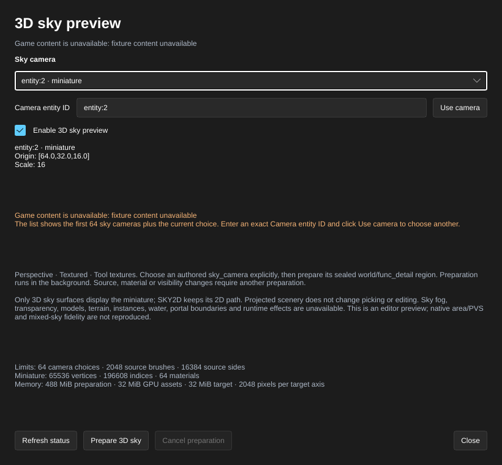
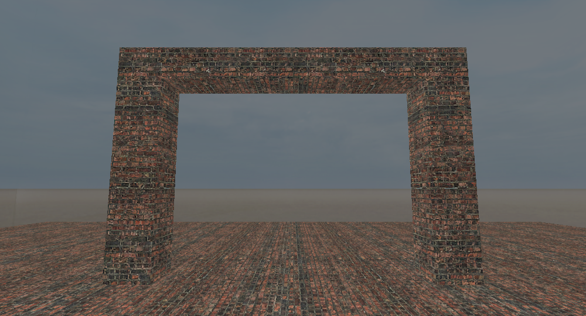

[← Manual](README.md)

# Sky previews and assets

Preview the world's selected sky on sky surfaces while editing, using materials and textures from the mounted game content.

1. Open **World settings…**, set `skyname` to a mounted sky such as `sky_dust`, and click **Apply properties**.
2. Create or select the sky boundary brushes and assign `tools/toolsskybox` or `tools/toolsskybox2d`.
3. Choose **Perspective** and **Textured**, and enable **Tool textures**.
4. Enable **2D sky preview** under **VIEWPORT**. The status names the sky and reports whether all six faces in the selected **Sky channel** are ready. **LDR** is the default.
5. Navigate inside the sky boundary. The sky follows the viewing direction and stays at infinity when the camera moves. Sky surfaces remain pickable, and foreground geometry and selection outlines remain visible.
6. Disable **2D sky preview** to return to the ordinary tool surface.

The setting is shared with MCP through `set_view` using `sky_preview`. `render_view` accepts the same optional setting for a single render. `get_map_info` and rendered-image metadata report the selected sky, six material names, texture dimensions and individual load errors. These controls do not change the map or create undo steps; changing `skyname` uses ordinary undoable world settings.

## Preview a 3D sky region

Display a miniature scene through 3D sky surfaces while editing. The preview
uses one explicitly chosen root `sky_camera` and a sealed connected region of
committed flat world and `func_detail` brushes.

1. Author a point **sky_camera** with **Entity…**, placing its origin inside the
   sealed miniature room. Author an integer `scale` from 1 through 128 in its properties;
   `16` is the usual authored value. The camera origin corresponds to map origin,
   and miniature positions project as `(point - sky_camera origin) × scale`.
   Camera angles do not rotate the miniature geometry.
2. In **VIEWPORT**, click **3D sky preview…**. Choose the camera explicitly in
   **Sky camera**. The list shows entity IDs, names and unavailable camera
   settings; no nearest or first camera is selected automatically. To choose a
   camera beyond the first 64 listed entries, enter its exact `entity:<id>` in
   **Camera entity ID** and click **Use camera**. The selected camera remains
   visible in the chooser even when it lies beyond that list.
3. Click **Prepare 3D sky**. Preparation runs in the background and leaves the
   preview disabled until you enable it. Read the status and diagnostics;
   **Cancel preparation** requests cancellation, and **Refresh status** reads
   the current result. Failed, cancelled and stale preparations are unavailable.
4. When preparation is ready, check **Enable 3D sky preview**. Choose
   **Perspective** and **Textured**, and enable **Tool textures**. Only
   `tools/toolsskybox` surfaces display the projected miniature; ordinary
   foreground geometry keeps its depth and `tools/toolsskybox2d` keeps the
   independent 2D sky path.
5. Use **2D sky preview**, **Sky channel** and **HDR sky exposure (EV)** separately
   for the six-face backdrop. Unfilled miniature pixels can show that backdrop
   when its independent preview is enabled and ready.
6. After changing source geometry, the chosen camera, mounted material assets or
   editor visibility, prepare again. A removed or invalid camera is never
   replaced automatically. **New** and **Open** clear the document's choice and
   disable the preview. Uncheck **Enable 3D sky preview** to hide it, and click
   **Close** to dismiss the controls.

The preview controls preserve source bytes, Undo, selection and the viewport
camera. Miniature scenery adds visual context; picking and editing still use
ordinary source geometry. MCP provides the same camera choices, controls,
preparation and diagnostics through `get_3d_sky_preview` and
`set_3d_sky_preview`. `render_view.sky3d_preview` temporarily displays or hides a
current prepared result without changing shared settings or choosing a camera.

Only structural world brushes establish the enclosure; flat `func_detail`
scenery can contribute displayed surfaces. A solid, outside, ambiguous or leaking
camera seed rejects. Unsupported content that intersects the chosen component,
including unknown bounds, rejects instead of disappearing. Unrelated unsupported
content that is proven outside the region does not reject it. Temporary editor
hiding filters displayed fragments after membership is resolved and cannot open
or repair the structural enclosure. Committed VMF hidden geometry follows the
ordinary compiler omission policy.

The preview supports static opaque single-base `LightmappedGeneric` and
`UnlitGeneric` brush materials, including axis-aligned static
`$basetexturetransform` scale and translation around an authored center. The
transform follows the face's texture mapping and actual texture dimensions.
Absent or empty declarations use identity mapping; repeated operations use the
last value, matching the 2D sky preview. Transform values must be finite and
within ±1024. Nonzero rotation, malformed declarations and overflowing texture
coordinates reject preparation. After editing mounted materials, use
**Browse materials… → Reload material assets**, then **Prepare 3D sky**.

The 1–128
scale range is an editor preview limit. Sky fog,
translucency, terrain, models, instances, water, portal boundaries, generated
detail scenery, animation and runtime effects are unavailable. Nonempty material
`%detailtype` declarations reject because generated models or sprites can extend
beyond their source brush. It does not reproduce native area/PVS or
mixed-sky fidelity. An eligible prepared result permits rendering; it does not
prove a sky surface contributed pixels to the current view. This is an editor
preview, separate from compiling or checking the map in the game.

The camera list displays the first 64 entries plus the current choice; **Camera
entity ID** can select any valid root camera explicitly. Preparation, geometry and target
budgets are reported in the dialog and MCP `limits`; budget failures remain
explicit diagnostics. One preparation worker and one cached result are retained
per document. Preparation never writes a BSP or changes Compile Region.

GPU admission budgets cover 32 MiB of retained miniature assets, 64 MiB of
aggregate upload staging and a 32 MiB color/depth target. These are explicit
payload budgets; driver overhead is additional. Replacement drains retired
uploads before admitting new assets. GPU admission or rendering failures appear
beside the viewport controls and fail an MCP render. The editor near plane is
four main-map units, scaled into miniature coordinates; native game near-plane
and area behavior can differ.

## Preview linear HDR sky images

An explicit HDR editor view can display the authored family's HDR sky textures
with a fixed, readable exposure policy. It changes sky pixels while leaving
ordinary materials, entity helpers, baked lighting and game settings unchanged.

1. Set the applied world `skyname` to a mounted family with six direct `Sky`
   materials and static `$hdrbasetexture` images, such as `sky_dust_hdr`.
2. Enable **2D sky preview** in a perspective **Textured** view with **Tool
   textures** visible, then choose **Sky channel → HDR · editor preview**.
3. Enter a value from −8 through 8 in **HDR sky exposure (EV)** and press Enter.
   Zero is the default; +1 doubles the linear sky radiance before tone mapping,
   and −1 halves it. Invalid input shows an error and restores the last accepted
   view controls without changing Session settings.
4. Read the status. **six HDR faces ready** means the preview admitted all six
   images, including every mip's finite, nonnegative RGB radiance. A failed face
   leaves the ordinary tool surface and a diagnostic; it never substitutes LDR,
   another family or an `_hdr` suffix.
5. Choose **LDR** to return to the original preview. HDR exposure is retained as
   a view preference and does not affect LDR pixels. Disable **2D sky preview**
   to return to the ordinary tool surface.

| −2 EV | 0 EV |
| --- | --- |
|  |  |

The HDR image policy is explicit: RGBA16F samples are linear; RGBA16 integer RGB
uses `value / 65535 × 16`. The renderer applies `2^EV`, then per-channel Reinhard
`x / (1 + x)`, followed by one sRGB target encoding. Texture alpha is ignored and
sky output stays opaque. NaN, infinity and negative RGB reject the image; all
float components must be finite. This is HammeRR's sky editor policy. It does
not emulate game hardware HDR modes, native tone-map adaptation, bloom,
`env_tonemap_controller`, material tint or native exposure settings.

MCP `set_view` and temporary `render_view` accept `sky_channel: "ldr" | "hdr"`
and `sky_exposure_ev`. `get_map_info.skybox` describes the shared view;
`render_view.skybox` describes the actual temporary request. Reports include the
requested channel, exposure, tone-map policy, per-face texture/source/format,
readiness and resource limits. `eligible` means assets and view conditions permit
previewing; it does not claim a sky polygon contributed pixels. Temporary
channel, exposure and camera overrides leave the shared view, document, Undo,
selection, camera and property drafts unchanged.

HDR preview accepts strict complete UTF-8 direct `Sky` materials, one scalar
value per supported parameter, and RGBA16F/RGBA16 VTFs with one frame, one face
and depth one. Patch materials, compressed HDR, proxies, nested effects, unknown
or duplicate parameters, animation and rotated texture transforms reject
explicitly. Axis-aligned scale/translation uses the existing sky mapping. The
selected HDR channel does not require or load an LDR fallback. Original sky
boundary geometry, depth, picking and tool filters remain active.

HDR bounds: 128 source lookups, 64 MiB aggregate original bytes, 1 MiB per VMT,
16 MiB per VTF and 4096 pixels per axis. Shared texture paths deduplicate. One
HDR family, including failures, is cached per material library; changing family
replaces it, and **Reload material assets** clears CPU and GPU admission. Each
HDR GPU set is bounded by 64 MiB; replacement can briefly retain the old and new
sets. Source/parse copies peak at 128 MiB plus one conversion buffer of at most
16 MiB. No exposure value or temporary camera creates another texture cache.

## Inspect mounted sky assets

Inspect the applied family's material and texture structure before choosing a sky or diagnosing a missing channel.

1. Open **World settings…** and click **Inspect applied sky…**. The inspector uses the applied `skyname`; pending property edits remain staged. To inspect a changed name, click **Apply properties**, reopen **World settings…**, and inspect again.
2. Read **LDR assets** and **HDR assets**. Both describe supported material declarations and VTF structure, independently of the editor preview and the game's active channel.
3. Compare the six face buttons: **Right**, **Back**, **Left**, **Front**, **Up** and **Down** show LDR/HDR readiness together. Choose a face to read its exact `skybox/<skyname><suffix>` material, shader, winning directory or VPK source, additional Patch sources, texture references, dimensions, format and issues.
4. Repair the named material or texture in the reported mount, then click **Refresh sky assets**. Read failures remain visible; a broken winning asset does not silently select a healthy lower mount.
5. Click **Close** to return to the existing property edit. Inspection does not change the map, Undo, camera, selection, clipboard or drafts, and starts no game or compiler process.

During document shutdown, opening inspection and **Refresh sky assets** reject
new reads while preserving the last report. **Close** remains available.

MCP provides the same report through `inspect_sky_assets {}`. It reads current mounted files each time and preserves valid authored names and references. Overlong invalid values and bounded diagnostics carry explicit truncation indicators. It does not repair an invalid name, append `_hdr`, choose a substitute family or copy assets into the map.

Inspection supports static `Sky` and `UnlitGeneric` material declarations with bounded Patch resolution. LDR requires `$basetexture`; HDR requires `Sky` with `$hdrbasetexture` in RGBA16F or RGBA16 format. VTF layout must be complete, with one frame, one face, depth one and at most 4096 pixels per axis. Compressed HDR declarations, unknown parameters and nested material effects produce explicit issues. The report permits 128 distinct asset lookups, 64 MiB total reads and 1 MiB per material; limits and read counts accompany the result. Family names are limited to 256 bytes and must be relative, without surrounding whitespace or control characters.

Structural readiness does not decode HDR pixel radiance or establish shader rendering. A declared texture transform can pass inspection while remaining unsupported by the LDR preview. Explicit [Pack sky assets](compile-and-play.md#pack-portable-sky-assets) applies stricter complete raw-material and dependency checks before embedding original files. The explicit HDR editor preview applies its own stricter material and finite-radiance checks; structural inspection remains separate.

## Compiled HDR skies

CS:S resolves the exact authored sky family from mounted game content. Stock families such as `sky_dust_hdr`, `train_hdr`, `militia_hdr` and `de_cobble_hdr` declare both HDR textures and LDR fallbacks. The game's `Sky` shader selects the supported channel; it does not add `_hdr` to a family such as `sky_dust` automatically.

1. Open **World settings…** and enter the mounted HDR family in **SkyBox Texture Name** (`skyname`), then click **Apply properties**. Custom entity definitions may label this field differently.
2. For a dual-channel map, open **Build settings…** and choose **Build lighting → Direct LDR + HDR**. Compile the map and check **HDR native map data** in **Build details…**.
3. Select HDR in the game before loading the map. Native HDR still requires complete map data and game/hardware support; see [HDR channels](compile-and-play.md#hdr-channels).

The compiler preserves `skyname`. With default settings, original sky materials and textures must remain available through the game's mounts. Enable **Build settings… → Pack sky assets** to embed the supported complete family with original bytes and names; packing-only playback can then resolve the sky without the original custom mount. Packing works with **Fullbright** or either lit mode and includes every supported declared channel independently of the bake. See [Pack portable sky assets](compile-and-play.md#pack-portable-sky-assets) for its subset, publication guards and Run behavior.

**Inspect applied sky…** remains a separate read-only material/VTF report. **Generate reflections** retains its own source guards and native/content-freshness requirements. Neither inspection nor packing establishes HDR pixel radiance, shader rendering or the game's selected channel.

The default editor channel previews the family's LDR `$basetexture`. Choosing the explicit HDR editor channel changes only the preview. Neither **six LDR faces ready** nor **six HDR faces ready** establishes the game's selected channel. Baked sunlight and sky ambient use authored `light_environment` values rather than deriving lighting from the sky image.

## Limits

The LDR preview supports six mounted `UnlitGeneric` or `Sky` materials with static LDR `$basetexture` textures. Axis-aligned texture scale and translation are supported, including the vertical scale used by stock skies. Face dimensions may differ. All six faces must resolve; otherwise the ordinary tool surface remains and the status explains why. Textures are limited to 4096 pixels per axis and 64 MiB per file.

Flat shading, wireframe, diagnostic and planar views retain their existing behavior. **Tool textures** hides sky surfaces along with other tools. Only authored sky surfaces display the sky; the editor background remains unchanged. The 2D preview does not reproduce compiled BSP visibility, general HDR scene lighting, native exposure adaptation, fog, material tint, animation, rotated texture transforms or nested material effects. The separate 3D preview uses the explicit preparation workflow above. After changing mounted sky materials or textures, open **Browse materials…**
and click **Reload material assets**. See [Reload changed materials](textures.md#reload-changed-materials)
for diagnostics and limits.
