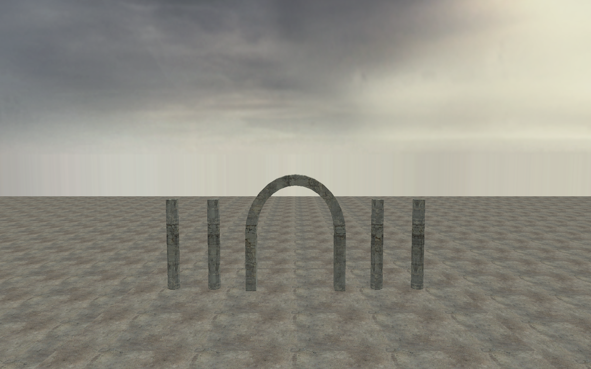
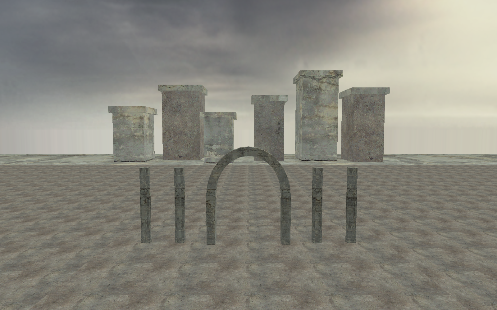
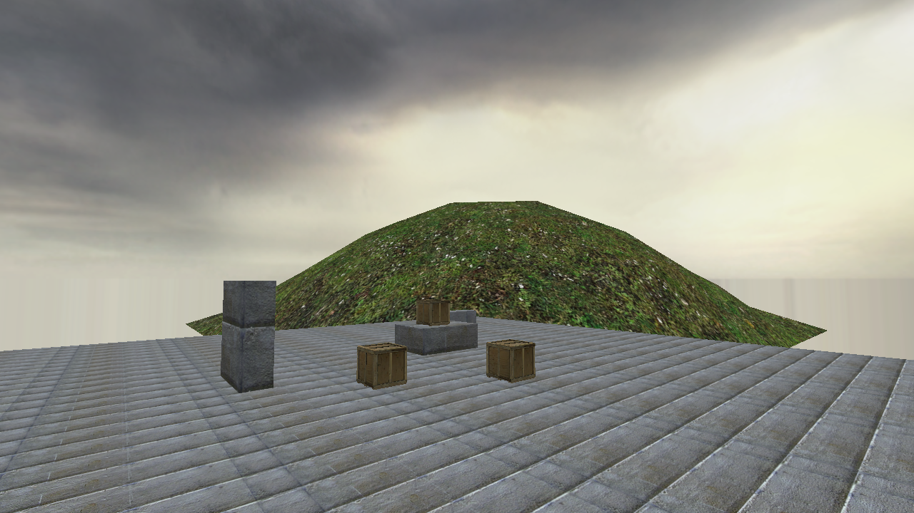
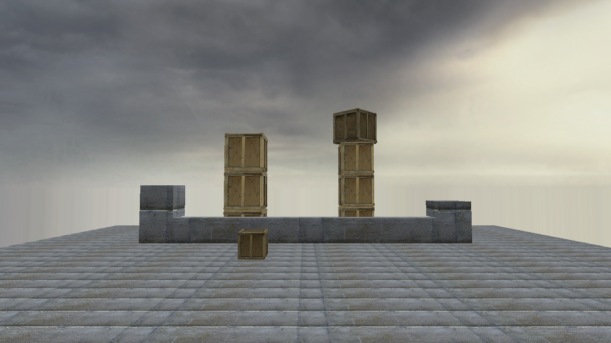
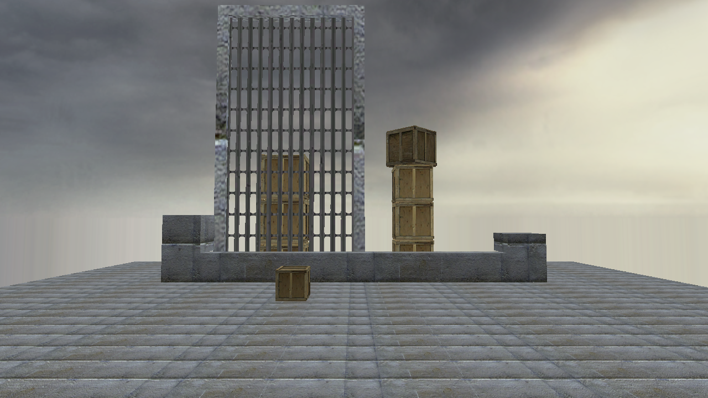
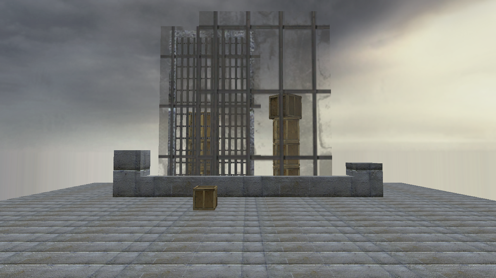
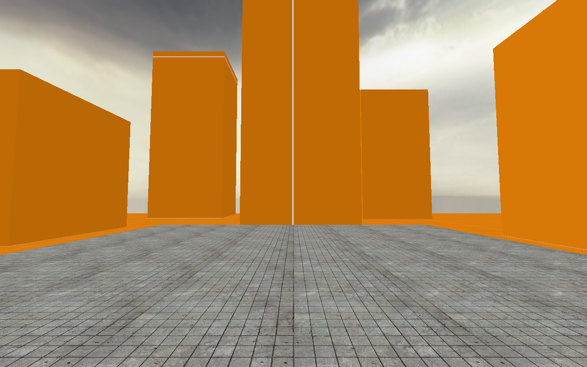
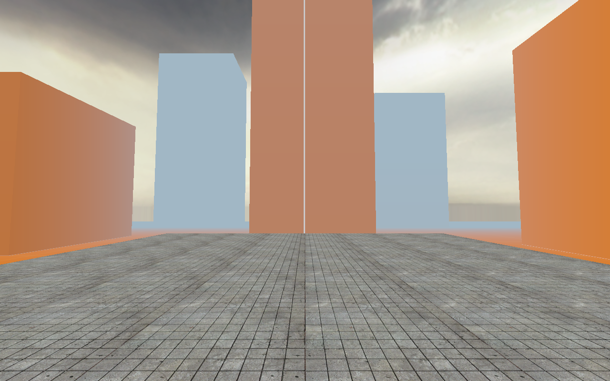
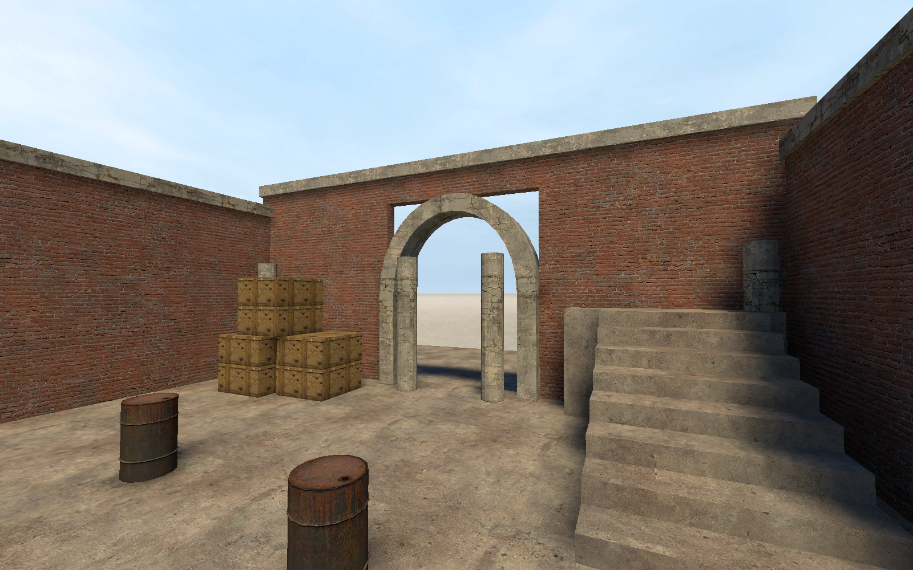

[← Manual](README.md)

# Sky previews and assets

Preview the map sky, static miniature fog and mounted LDR and HDR assets.

## Set and preview the sky

1. Open **World settings…**.
2. Set **SkyBox Texture Name**, then click **Apply properties**.
3. Apply `tools/toolsskybox` to the intended sky surfaces.
4. Choose **Perspective** and **Textured**.
5. Enable **2D sky preview**.
6. Select **Sky channel → LDR**.

Sky previews fill eligible sky surfaces, even when **Tool textures** is off. They do not add compiled sunlight.
Use a `light_environment` for [sun and sky lighting](compile-and-play.md#lighting).

## Preview linear HDR sky images

1. Select **Sky channel → HDR · editor preview**.
2. Check that all six HDR faces are ready.
3. In Legacy display, adjust **Sky EV**. For HDR scene display, use
   **Fog preview… → Scene display → Scene exposure EV**, then click
   **Apply scene display**.

**Sky channel** selects content independently of scene display. A requested HDR
family needs all six HDR faces; LDR faces do not replace missing HDR faces.
In an active HDR pane, scene exposure controls the sky with the other enabled
scene contributors. **Sky EV** retains its value for Legacy panes.
These controls do not change game tone mapping.

## Preview a 3D sky region

1. Build a separate, sealed miniature region from flat world brushes.
2. Use `func_detail` for decorative curves and structures.
3. Place `sky_camera` inside its open space.
4. Set **3D Skybox scale**; the default is 16.
5. Choose **Perspective** and **Textured**.
6. Open **3D sky preview…**.
7. Choose **Sky camera**, or enter **Camera entity ID** and click **Use camera**.
8. Click **Prepare 3D sky**.
9. Check readiness, then enable **Enable 3D sky preview**.

Use **Cancel preparation** to stop the owned preparation.
Use **Refresh status** after source changes. Changed consumed material, texture
or model sources retire readiness; prepare again. For changed VPK indexes or
mounts, use **Reload content** first. Preparation errors remain explicit.
Use **2D sky preview** to fill space behind the miniature.

| 2D sky only | 3D sky preview enabled |
| --- | --- |
|  |  |

## Add terrain to the miniature

1. Create a displacement inside the sealed miniature region.
2. Keep its complete surface clear of walls and component boundaries.
3. Use an opaque material with one base texture.
4. Open **3D sky preview…** and click **Prepare 3D sky** again.
5. Enable **Enable 3D sky preview**.

Whole patches use authored fine triangles, BASE texture coordinates and smooth
vertex normals. Terrain does not seal the region.

## Add fixed models to the miniature

1. Use **Entity…** to place `prop_static` inside the miniature.
2. Use **Browse…** beside **World Model** to choose a supported model.
3. Choose **Skin** and set its position and angles.
4. Leave clearance from walls and the floor. Preparation checks a conservative
   bound for every draw LOD; the visible mesh alone is not the bound.
5. Click **Prepare 3D sky** again, then enable **Enable 3D sky preview**.

Whole models retain LOD 0 geometry, selected skins, model UVs and source normals.
Their materials must be opaque, single-base `VertexLitGeneric`.

## Add a cutout fence or grate

1. Keep opaque brushes around the miniature to seal it.
2. Create a world brush or `func_detail` brush for the fence.
3. Apply a supported plain `LightmappedGeneric` or `UnlitGeneric` material with
   `$alphatest 1`, such as `metal/metalgrate001a`.
4. Click **Prepare 3D sky** again.

Openings show other miniature geometry and the 2D sky behind it. A cutout brush
does not seal the region. The checked alpha reference uses the native 8-bit
cutoff; an omitted or zero reference uses 0.7.

## Add glass to the miniature

1. Create a world or `func_detail` brush inside the sealed miniature.
2. Click **Faces** and [apply](textures.md#apply-a-material)
   `glass/glasswindow001b` to the front face. Use `tools/toolsnodraw` on the other
   faces for a single glass layer.
3. Click **Prepare 3D sky** again.
4. Enable **Enable 3D sky preview**.

The glass can show other miniature geometry and the 2D sky. It uses the texture's
alpha, with miniature fog before blending and HDR exposure after composition.
Glass does not seal the region.

## Preview miniature fog

1. Select the preview's `sky_camera`. In **Inspector**, enable **Advanced properties**.
2. Set **Fog Enable → Yes**, **Primary Fog Color**, **Fog Start** and **Fog End**.
3. For directional colors, set **Fog Blend → Yes**, then set **Secondary Fog Color**
   and **Primary Fog Dir**. **Use Angles for Fog Dir → Yes** uses world orientation.
4. Click **Prepare 3D sky** again after source changes, then enable
   **Enable 3D sky preview**. Use **Perspective** and **Textured**.
5. To change radial initialization, open **View → Fog preview…**, expand
   **Environment**, choose **Initial rule**, then click **Apply preview**.
   **Authored values** keeps the radial setting; **CS:S official-map rule** initializes
   it as radial. **Enable fog preview** can remain off.

For density and radial overrides, add raw `fogmaxdensity` or `fogradial` with
**Property key** and **Value**. They appear as **Fogmaxdensity** and **Fogradial**.
Set `fogradial` to `1` for radial distance or `0` for view depth.
To disable miniature fog, choose **Fog Enable → No** and prepare again.

The miniature uses its own camera fog in both Legacy and HDR scene display.
World fog enable, controller selection,
inputs, transitions and `farz` do not supply its profile. Start and end distances
are divided by the positive miniature scale once. Author the original distances;
do not divide them yourself. Standard `Sky` backgrounds do not receive fog.
In an active HDR pane, the miniature and its fog use **Scene exposure EV**,
even when world fog is off.

| Miniature fog off | Miniature fog on |
| --- | --- |
|  |  |

## Inspect mounted sky assets

1. Open **Inspect applied sky…**.
2. Inspect **LDR assets** and **HDR assets**.
3. Check Right, Back, Left, Front, Up and Down.
4. Use **Refresh sky assets** after asset changes.

Use **Reload material assets** to refresh cached sky display images.

## Compiled HDR skies

Choose **Direct LDR + HDR** for native HDR map data.
Enable **Pack sky assets** to embed the supported original sky files.
The game must enable full HDR to display its HDR channel.

## Limits

- Supported static six-face families only. Missing or malformed required faces report errors.
- Required sky textures must meet the [native texture limits](textures.md#native-texture-files).
- 3D sky preparation is explicit; enabling the switch does not silently load or repair sources.
- Source checks cover consumed topology, material, texture and model inputs.
  Catalogue refresh remains explicit. Preparation allows 128 material/texture
  source paths and 16 MiB of original asset data.
- World and detail terrain can remain outside the miniature when checked
  source and native-LOD bounds prove separation. Whole patches inside the
  selected component can render. Partial, uncertain or boundary contact stops
  preparation. Terrain-generated detail geometry also needs known bounds.
- Fixed, unit-scale `prop_static` models with one bone and supported static
  materials can render wholly inside or remain outside the miniature. Preparation
  checks all draw LODs. Uncertain or partial contact stops preparation. The
  conservative bound can require more clearance than the visible mesh. Changed
  model or material sources clear readiness; prepare again.
- 3D sky uses one base texture. Flat world/detail surfaces can use plain cutout
  or translucent materials. Terrain and models remain opaque. Alpha Patch
  materials, additive or modulated coverage, normal maps and detail layers
  are unsupported.
- Translucent batches sort by depth. Intersecting glass surfaces can blend in
  the wrong order; native BSP transparency ordering is unavailable.
- Miniature scale is an integer from 1 to 128. Camera angles do not rotate the miniature preview.
- Terrain uses authored fine geometry. Native LOD appearance, blend materials
  and partial-patch clipping are unavailable.
- Models use fixed unit scale, default bodygroups and one bone. Partial-model clipping, animation,
  baked model lighting and native model LOD appearance are unavailable.
- Miniature fog is static. Authored lighting and water are not previewed. Runtime sky-camera changes, native exposure adaptation and
  native clipping or pixel parity are unavailable.
- A selected sky camera must be unparented, with no attachment binding.
- Camera origin and fog direction use native 1/32 coordinate conversion,
  including integer wrapping; for example, 16,385 becomes 1. Reports retain
  source and received values separately. A received zero direction mixes colors equally.
- With miniature fog active, an `UnlitGeneric` 2D background requires explicit
  `$nofog 1`. Other unqualified combinations report unavailable; use a standard
  `Sky` family or disable **2D sky preview**.
- Native capture and packing can impose stricter limits than viewport display.
- Compilation rejects a `sky_camera` in visibility area 255. CS:S reserves that value for no 3D sky. Move the camera into another area.

<!-- page-nav -->

---

[← Reference images](reference-images.md) · [Manual](README.md) · [Rope preview →](ropes.md)
