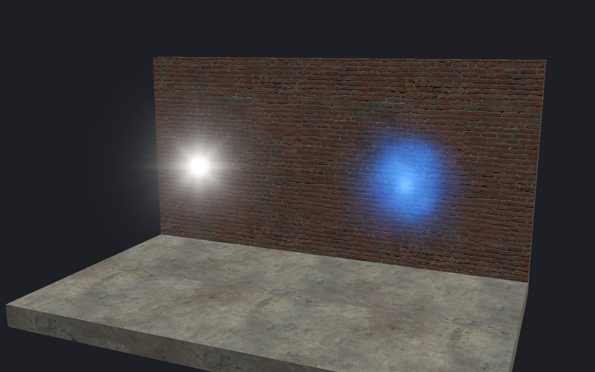

[← Manual](README.md)

# Sprite guides

Show a sprite image at its authored size while editing.

1. Use **Entity…** to place `env_sprite`.
2. Click **Browse…** beside **Sprite Name**.
3. Choose a supported Sprite material, then click **Use material**.
4. Under **Advanced properties**, enter a positive **Scale**.
5. Enable **Entity images** in **Viewport**.
6. Check the helper status for resource or sizing errors.

For an additive guide:

1. Set **Render Mode** to **Additive**.
2. Keep **FX Color (R G B)** white and **FX Amount (0 - 255)** at 255.
3. Set **Render FX** to **Normal**.
4. Enable **Additive Sprite guides**.
5. Check that the status reports **authored Additive LDR**.

## Limits

- Static centered `Sprite` materials with `vp_parallel` orientation and one LDR texture only.
- Missing or unsupported resources show a diagnostic and retain the editable helper box.
- The default guide is an unlit RGBA image. Unsupported additive settings report a reason beside that image.
- No animation, glow visibility, fog, runtime I/O or game pixel match.
- Textures are limited to 512 pixels per axis. Scale must be positive and finite.
- Selection and framing use the entity box. Images are not placement or snap targets.
