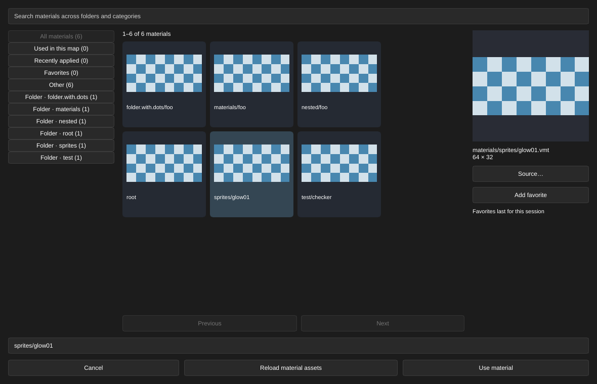

[← Manual](README.md)

# Sprite resource guides

Show a static image for a sprite entity at its authored scale. The image helps
you place the resource; the entity's ordinary box remains its selection and
framing target.

1. Click **Entity…**, choose `env_sprite`, then **Place entity**. Compatible
   custom classes need one `sprite()` helper and a `model(sprite)` field.
2. Select the entity. Beside **Sprite Name**, click **Browse…** and choose a
   supported Sprite material. **Use material** writes its full virtual VMT filename;
   **Cancel** leaves the original reference untouched.
3. Under **Advanced properties**, enter a positive **Scale**, such as `0.25`.
   Width and height are the texture dimensions multiplied by Scale. A blank
   Scale shows an unavailable-sizing message until you enter a value.
4. Inspect the helper status for the resolved material, texture source
   and dimensions. Missing or unsupported resources show an explanation and
   retain the editable box.
5. Use **Viewport → Entity images** to show or hide these guides and literal
   entity icons. Change the view to see the image face the current camera.

## Preview authored Additive mode

1. Select the Sprite entity and set **Render Mode** to **Additive**. This must
   be an explicit authored choice.
2. Keep **FX Color (R G B)** white, **FX Amount (0 - 255)** at 255 and
   **Render FX → Normal**. Unsupported appearance settings show a reason beside
   the ordinary raw image.
3. Enable **Viewport → Entity images**, then **Additive Sprite guides**.
4. Inspect the helper status to confirm **authored Additive LDR** is applied.
   Disable **Additive Sprite guides** to return to the raw RGBA image.

Limits:

- The default is an unlit RGBA editor image with no fog. Opt-in Additive guides
  evaluate only explicitly authored mode 5 under the white/255/FX0 constraints.
  Unsupported, missing, duplicated or malformed appearance values keep the raw
  image with a diagnostic. Color/amount modulation, HDRColorScale, animation,
  glow visibility, enable state and I/O remain unevaluated.
- Additive RGB uses source-alpha-plus-destination blending, depth testing and
  no depth writes. Destination alpha is preserved as an editor output policy.
  Mixed raw/additive guides retain camera-depth order. The editor's color space
  and guide ordering do not establish native Sprite pixel parity.
- Supported resources use a direct centered `Sprite` material with
  `$spriteorientation vp_parallel` and one static LDR texture. Oriented sprites,
  nonzero angles, parents, brush entities and specialized light/rope/model
  helpers are outside this guide.
- Browse authors `materials/<catalog-name>.vmt`, preserving nested directories.
  Existing references remain unchanged until an explicit edit. The bounded
  legacy form `sprites/<basename>.spr` resolves to its Sprite material;
  extensionless values, other legacy directories and dotted filename stems
  are unavailable. Bare `foo.vmt` names `sprites/foo`, while
  `materials/foo.vmt` names the root material.
- Scale must remain positive and finite at native precision. Textures are
  limited to 512 pixels per axis, VMTs to 64 KiB and VTFs to 4 MiB. Icons and
  Sprite guides share 64 cached success/failure entries, 32 MiB of encoded
  assets and 256 visible images. Reload material assets after repairing files.
- Images do not become surface-picking or snap targets and do not change
  bounds, placement or working-region membership. Native reflection capture
  retains its separate unsupported-external-model checks.
