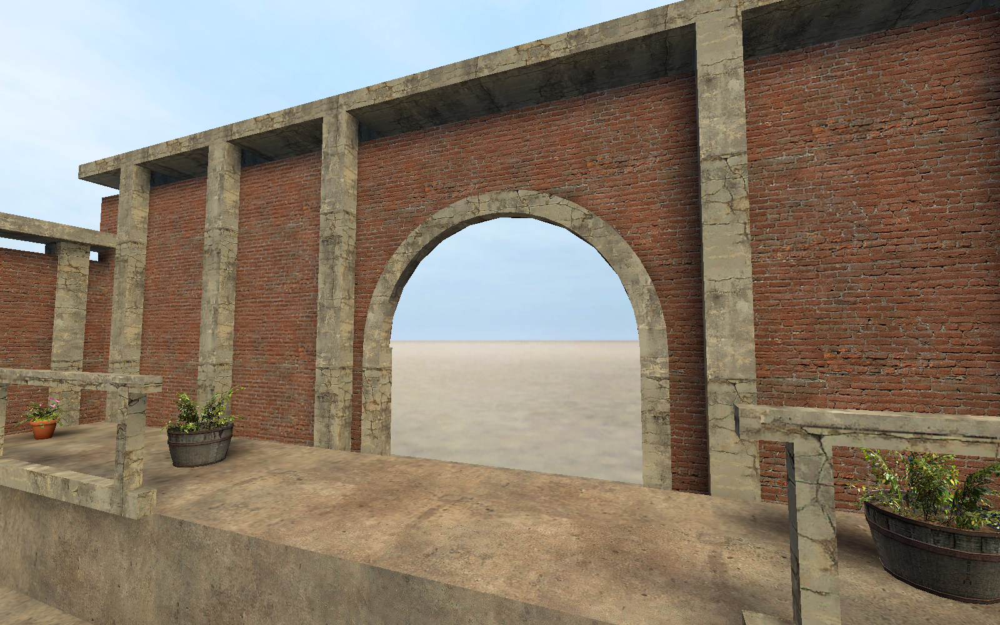

[← Manual](README.md)

# Static props

Compile static scenery models with visibility, collision options and lighting.

## Place and build

1. Use **Entity…** to place `prop_static`.
2. Click **Browse…** beside **World Model**.
3. Choose a compatible static model, then click **Use model**.
4. Set **Position**, **Rotation** and **Skin**.
5. Compile and inspect **Static props**, **Model assets**, **Leaf references** and **Diagnostics**.

Use **Not Solid**, **Use Bounding Box** or **Use VPhysics** under **Collisions**, as supported.
VPhysics needs compatible model collision data from a matching `.phy` file.
The **Physics bodies** setting controls compiled brush and terrain bodies separately.

## Pack static prop assets

1. Enable **Pack static prop assets** in **Build settings…**.
2. Compile.
3. Check **Static-prop assets** and diagnostics in **Build details…**.

Packing includes the checked model companions and supported material dependencies.
Unsupported materials or missing required assets stop publication.
Supported `Patch` materials can inherit through up to eight include edges,
with at most one `$basetexture` `insert` or `replace` block per Patch. Packing retains
every original material and declared texture, including overridden textures.
Deeper edits win within the same edit type; replacements apply after all inserts.

## Bake vertex lighting

1. Choose **Direct LDR** or **Direct LDR + HDR**.
2. Enable **Bake static-prop vertex lighting**.
3. Choose direct lighting or one to four diffuse bounces.
4. Compile, then inspect **Static-prop vertex lighting** and **Prop vertex lighting bytes**.

Vertex lighting requires a stricter model/material subset than ordinary prop placement.
Unsupported model or material effects stop the build.
Default-alpha-test receivers accept the supported nested basetexture Patch edits.
Every hardware vertex keeps its lighting colors; receiver textures are read only
when shadow casting or packing needs them.
Use [baked prop inspection](baked-prop-vertices.md) to read the emitted samples.

## Visibility and lighting options

Set fade distances, fade scale and DX-level range in **Advanced properties**.
Use **Disable Shadows**, **Disable Vertex lighting** and supported self-shadow or normal controls as required.
Keep defaults unless the intended game behavior needs a change.

## Native lighting origin

Set **Lighting Origin** to a named eligible point entity for supported native lighting-origin control.
Referenced assemblies apply their name-fixup rules before resolving that target.
Missing or ambiguous required targets fail explicitly.

## Ignore receiver normals

Use **Ignore surface normal for computing vertex lighting** only for the supported vertex-lighting path.
This changes receiver weighting, not shadow geometry or source normals.

## Props in referenced assemblies

Supported child static props compile with transformed positions, angles, skins and checked names.
Inspect **Instance contents…** before building. Child source files must remain available.

## Limits

- Models must be built as static props, with supported companion files and body 0.
- Static props retain unit scale, white tint and normal render-mode restrictions.
- Leaf membership uses conservative rotated header bounds, not exact model hulls.
- Packing does not change vertex lighting or shadow settings.
- Packed chains must end at `VertexLitGeneric` with one canonical `$basetexture`. Optional `$alphatest 1` uses the default cutoff.
- Other terminal parameters, authored alpha references and proxies remain unsupported.
- Cutout vertex-lighting receivers require one canonical basetexture and literal `$alphatest 1` at the default cutoff, with the same bounded Patch grammar as packing.
- Cutout vertex lighting is experimental.
- Missing or unsupported required data fails rather than substituting another asset.
- Sampled textures must meet the [native texture limits](textures.md#native-texture-files).
