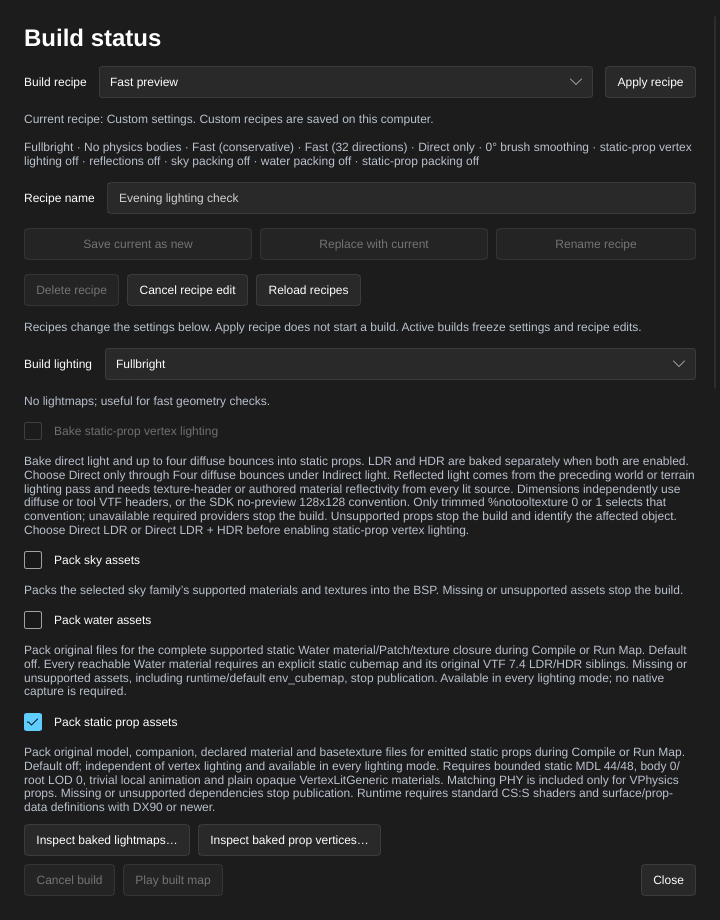

[← Manual](README.md)

# Static props

Place static scenery with model assets, native collision choices and visibility membership based on the model's bounds.

1. Click **Entity…**, choose `prop_static`, then **Place entity** inside a sealed map.
2. Click **Browse…** beside **World Model**, choose a model built as a static prop, then **Use model**. Keep scale 1 and body 0. See [Models](models.md) for skin previews and model inspection.
3. Set **Position**, **Rotation** and **Skin** in the inspector. The compiler uses the same saved transform. Rotated props use a clipped, rotated box containing both the model's render bounds and collision bounds to determine which open world leaves can display them.
4. Click **Compile**. Static props use collision supplied by their model assets; the map's **Physics bodies** setting controls separately generated brush, terrain and fluid bodies.
5. Open **Build details…** and inspect **Static props**, **Model assets**, **Leaf references** and **Diagnostics**. Missing or unsupported requested assets stop publication and preserve the previous output. Fix the asset or properties and compile again.
6. Recompile after replacing a consumed `.mdl` or required `.phy`, changing its winning content mount or reloading content. The completed build becomes stale and **Play built map** becomes unavailable; launching also checks the retained sources before starting the game.

Limits: MDL versions 44/48, scale 1 and body 0. Native static-prop collision choices remain none, bounding box or model VPhysics; VPhysics needs the model's checked `.phy` asset. Leaf clipping uses header boxes rather than the exact mesh or physics hull, so it can retain extra leaves. It preserves the existing 0.01-unit world-axis boundary padding, omits solid leaves and keeps the existing unrotated membership. It does not change collision, shadows, materials or baked lighting.

Ordinary model VPhysics reads are limited to 64 MiB before their payload is allocated, for both directory and VPK sources. Missing, unreadable, oversized or malformed `.phy` files stop publication even with **Fullbright** and **No physics bodies**; non-solid and bounding-box props leave unused `.phy` files unread.

Builds retain the first consumed MDL and required PHY source identities, including consulted VPK files and content lookups. Enable **Pack static prop assets** below to retain supported original dependencies in the BSP; ordinary source checks cover the files consumed by the build. Unused PHY files remain outside that guard. Write outputs in a pre-existing map directory separate from consulted model-lookup directories; creating output entries directly inside an observed lookup directory can invalidate its conservative identity checks.

HammeRR bounds static-prop leaf traversal and clipping to 16 million work units and four million cumulative reserved polygon points per build. A clipped fragment reserves at most 4,096 points and 256 faces. Exceeding these budgets, an invalid asset or a prop with no open leaf fails before publication. Existing native prop/model/leaf-table limits also apply. The source map and Undo history stay unchanged during compilation.

## Pack static prop assets

Include the supported original model and material files for emitted static props
in the BSP, including props expanded from referenced assemblies. Standard CS:S
shaders and surface/prop-data definitions remain installed runtime prerequisites.

1. Open **Build settings…** and enable **Pack static prop assets**. It starts
   disabled and works with **Fullbright**, **Direct LDR** and **Direct LDR + HDR**.
   **Bake static-prop vertex lighting** is a separate choice.
2. Click **Close**, then **Compile** or **Run Map**. Missing or unsupported
   dependencies stop the build and preserve the previous BSP and pointfile.
3. Open **Build details…**. For a current successful published build,
   **Static-prop assets** reports model, file and original-byte counts. With no
   emitted static props, the counts are zero and packing still succeeds.
4. Recompile after changing a consumed source file or its winning content mount.
   Changing this setting makes a previous build stale until its captured settings
   match again. Recipes and compatible recent maps retain the choice.

Limits: unit-scale static MDL 44/48 models with body 0, root LOD 0 and one
bodypart/model. Original MDL, VVD and DX90 VTX files must agree. Every declared
material, including other skins and draw LODs, must resolve to a plain opaque
**VertexLitGeneric** VMT containing only one canonical `$basetexture`, with a
complete supported VTF 7.0–7.4 containing one frame, one face and depth one. VTF 7.5,
animated, cubemap and volume textures are unsupported. The matching original PHY
is included only when an emitted use needs **Collisions → Use VPhysics**;
**Not Solid** and **Use Bounding Box** leave an unused PHY unread.

Included models, external or nontrivial animation, attachments, flexes, eye
forms, LOD material replacements, material proxies/Patch/conditions, additional
texture parameters and unsupported textures reject packing. Metadata must be
empty or exactly the supported `Metal.Medium` prop-data declaration. Standard
installed CS:S shaders and surface/prop-data definitions, plus DX90 or newer,
remain runtime requirements. Authored DX visibility bounds are preserved.

Packing follows the final emitted static-prop dictionary after hidden-content
and compile-region selection. Hidden and region-omitted props do not add packing reads;
dynamic and detail models are excluded. All producers share the final PAK limits:
4,096 entries, 16 MiB per entry, 64 MiB each encoded and decoded, and a 512 MiB
BSP. Conflicting archive paths, exceeded limits and changed original sources
reject publication. Reflection generation and Run staging preserve the packed
original model entries.

Agents use `set_compile_settings {"pack_static_prop_assets":true}`; the CLI flag
is `--pack-static-prop-assets`. Enabling the setting performs no asset reads.

## Props in referenced assemblies

Saved [referenced assemblies](instances.md) can contain the strict unnamed,
unit-scale/body 0, normal-white subset with **Collisions → Not Solid**,
**Use Bounding Box** or **Use VPhysics**. An omitted collision property uses
**Use VPhysics**, which requires the same matching PHY even with **No physics
bodies**. Nested transforms compile
through this same model consumer and retain its original source guards. Child
props have expanded counts in **Build details…** and **Instance contents…**;
their models, bounds, picking and framing are unavailable in the reference layer.
The ordinary root-map prop options described here remain available separately.

1. Open the child VMF and select its `prop_static`.
2. Set **Skin** to a nonnegative family number, starting at 0. A build checks
   that the selected model actually contains that family.
3. In **Advanced properties**, choose **No** or **Yes** for the lighting choices
   below. The [visibility options](#visibility-options) below also work in
   children. Save the child and compile its parent.

| Advanced property | Effect |
| --- | --- |
| **Disable Shadows** | Exclude this prop from compiled prop-mesh shadow rays. |
| **Disable Vertex lighting** | Opt this receiver out of the requested vertex bake. |
| **Disable Self-Shadowing with vertex lighting** | Exclude only this receiver's own mesh from its bake's shadow rays. |
| **Ignore surface normal for computing vertex lighting** | Use the ordinary [ignored-normal reception](#ignore-receiver-normals). |

Limits: these four choices accept only 0/1 and default to **No**. An omitted skin
uses 0. Opting out of vertex lighting does not bypass required model or collision
assets. Reference refresh does not inspect skin families or display child models.
Other non-neutral flags, body selections and scale remain unsupported in
children; see the [complete child limits](instances.md).

Agents use the same `create_entity`, `set_entity_properties`, `compile_map` and `start_compile` operations.

## Visibility options

Set fade intervals and DX level bounds on ordinary or referenced
static props through the same entity properties.

1. Select a `prop_static`; for a referenced prop, open its child VMF first.
2. Open **Advanced properties**. Set **Screen Space Fade** to **No** for distance
   in Source units or **Yes** for the model's on-screen width in pixels.
3. Set **Start Fade Dist/Pixels** and **End Fade Dist/Pixels**. A distance
   interval can use 512 and 1024; a screen-space interval can use 256 and 64.
   An end of 0 disables the authored fade interval. A negative start uses the
   end value. **Fade Scale** defaults to 1; 0 disables the additional forced
   fade described by the game's FGD.
4. Choose **Minimum DX Level** and **Maximum DX Level**. Their default choices
   use 0: **default (lowest)** and **default (highest)** respectively.
5. Save the child, if applicable, and click **Compile** in its parent. These
   properties do not add a live fade/DX preview or child model display.

Limits: start, end and scale must fit finite native floats; end and scale must
be nonnegative. Missing values use start -1, end 0, scale 1 and distance fading.
An end of 0 emits start 0; otherwise any negative start inherits the positive
end. No start/end ordering is imposed: screen-space fading uses decreasing
pixel widths. DX levels must be integers from 0 to 65535; a nonzero maximum
must be at least the minimum. The inspector and typed MCP property edits offer
the FGD's standard DX choices; imported values still receive these native range
checks. **Screen Space Fade** accepts only 0/1.
Reference refresh validates these options without reading model assets; it
does not certify a skin family or native visibility behavior. Invalid options
on a visible child reject refresh and compilation even if that prop would be
outside the compile region. Model-specific checks remain after region selection.
Requested baked vertex receivers still require unrestricted/default DX levels;
nonzero DX bounds do not relax the ordinary vertex-bake limits. Native fade/DX
appearance is not verified by these compiler checks.

## Bake vertex lighting

Bake direct light and up to four diffuse world/terrain bounces into supported
static models instead of relying on the game's ambient samples. The result is
stored in the BSP for every declared draw LOD.

1. Open **Build settings…** and choose **Build lighting → Direct LDR** or
   **Direct LDR + HDR**.
2. Choose **Indirect light → Direct only**, **One diffuse bounce**, **Two diffuse bounces**,
   **Three diffuse bounces** or **Four diffuse bounces**, then
   enable **Bake static-prop vertex lighting**.
3. Click **Close**. Optional: select a prop and enable **Advanced properties**. Enter
   `disableselfshadowing` in **Property key**, enter `1` in **Value**, then
   press Enter. This removes only that prop's own geometry from its lighting
   rays. Use `0` to retain self shadows.
4. Click **Compile**. Unsupported requested props stop the
   build; **Diagnostics** identifies the affected object.
5. Open **Build details…** to inspect **Static-prop vertex lighting** and
   **Prop vertex lighting bytes** for the current published build.

Limits: this is an experimental, default-off vertex bake for simple opaque
models. Prop reception supports zero to four diffuse bounces. Indirect light
needs texture-header or [authored material reflectivity](compile-and-play.md#authored-material-reflectivity)
from every lit world or terrain source. Dimensions independently use the
selected diffuse/tool VTF or the deliberate SDK no-preview convention described
under [Tool preview dimensions](compile-and-play.md#tool-preview-dimensions).
The compiler hashes each complete VTF actually consumed for either metric and
fails on unavailable providers or neutral default reflectivity. Body 0, root LOD 0, unit scale, one bodypart/model and plain selected
**VertexLitGeneric** materials are required. LDR and HDR are evaluated
independently. Self-shadow control applies to point/spot lights, sun and sky
ambient and reflected receiver rays; other props, world brushes and terrain
still block light. It does not
move embedded vertices or admit unsupported support contacts. See [the complete limits](compile-and-play.md#static-prop-vertex-lighting)
before enabling it on a larger map. Per-texel prop lightmaps and reflected sources from props or brush models
remain unavailable. Each nonzero depth receives the preceding world/terrain
lighting pass: one bounce uses direct world lighting, while four use the world
result after three bounces. Direct prop light is added once.

Agents enable the same setting with `set_compile_settings` and
`bake_static_prop_vertices: true`. Use `set_entity_properties` with
`set: {"disableselfshadowing": "1"}` for the same per-prop shadow choice.

## Native lighting origin

Keep a named point for the game's native prop lighting while baking zero to four
bounces at the model's actual vertices.

1. Click **Entity…**, enter `info_lighting` in **Classname (custom classes are supported)**,
   set **Position**, then click **Place entity**.
2. With the helper selected, set **Name** to a unique name.
3. Select the prop and set **Lighting Origin** to that same name.
4. Choose the vertex-bake settings above, then **Compile**. The helper is
   consumed during compilation; the final native prop retains its point.

The name is case-sensitive and must resolve to exactly one visible
`info_lighting` with a finite point within ±16384 units. Missing, hidden-only
or ambiguous helpers reject publication and preserve the previous BSP. The
helper may lie inside a world brush: it is native runtime metadata, not the
baked receiver. Every supported bounce depth still uses each actual vertex
and its PVS location. The helper does not recover embedded vertices or relax
brush, terrain or other-prop contact limits. Finite nonzero model normals remain
required, including when the prop ignores their receiver-facing direction.

Agents create the same helper with `create_entity` and bind it with
`set_entity_properties`, using `set: {"lightingorigin":"helper_name"}`.

In a [referenced assembly](instances.md), create the helper and prop binding
inside the same child file, then save it. Set every enclosing reference's
**Advanced properties → Fix Up Name** explicitly and choose **Entity Name Fix
Up → Prefix**. For example, `assembly` plus local `sample` becomes
`assembly-sample`; nested names join outermost first. Components use ASCII
letters, digits and underscores, with a 127-byte composed-name limit. Child
bindings cannot reach parent or sibling helpers. A root-map prop may explicitly
use the complete prefixed name. Outside-region helpers remain available;
missing or hidden local bindings fail only for props retained by the region.
Reference inspection counts helpers without drawing icons or helper geometry.

## Ignore receiver normals

1. Select the static prop and enable **Advanced properties**.
2. Set **Property key** to `ignorenormals` and **Value** to `1`, then press Enter. Remove the override or set `0` for normal-facing reception.
3. Open **Build settings…**, choose **Indirect light → Direct only** or one to four diffuse bounces and enable
   **Bake static-prop vertex lighting**. Choose **Build lighting → Direct LDR** or **Direct LDR + HDR**.
4. Click **Close**, then **Compile**. Read **Build details… → Diagnostics** if
   the receiver is unsupported.

Point, spot and sun reception uses a constant angular factor of 0.35 while
retaining falloff, spotlight emission cones and actual shadow rays. Sky ambient
uses a full-sphere visibility mean without that factor. At positive depths, reflected light uses full-sphere sampling with SDK angular normalization, receiving the preceding world/terrain pass and adding direct light once. The separate
`disableselfshadowing` choice still controls only the receiver's own shadows.
Agents set the same property with `set_entity_properties` and use shared compile
settings; `get_compile_settings` describes the supported receiver limits.

Limits: zero to four diffuse bounces are supported. The spherical reflected kernel differs from a unit visibility average; this is an angular policy, not full VRAD parity. Finite nonzero
model normals, original-point contact/burial rules, opaque materials, source
guards, native ordinals and hardware-section limits remain the same. This does
not enable VTX morph strip groups or change normal-facing world/terrain lighting.
