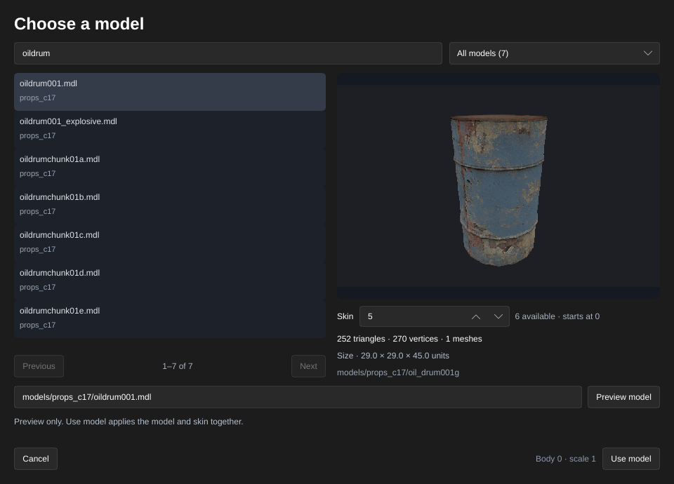

[← Manual](README.md)

# Static props

Place static scenery with model assets, native collision choices and visibility membership based on the model's bounds.

1. Click **Entity…**, choose `prop_static`, then **Place entity** inside a sealed map.
2. Click **Browse…** beside **World Model**, choose a model built as a static prop, then **Use model**. Keep scale 1 and body 0. See [Models](models.md) for skin previews and model inspection.
3. Set **Position**, **Rotation** and **Skin** in the inspector. The compiler uses the same saved transform. Rotated props use a clipped, rotated box containing both the model's render bounds and collision bounds to determine which open world leaves can display them.
4. Click **Compile**. Static props use collision supplied by their model assets; the map's **Physics bodies** setting controls separately generated brush, terrain and fluid bodies.
5. Open **Build details…** and inspect **Static props**, **Model assets**, **Leaf references** and **Diagnostics**. Missing or unsupported requested assets stop publication and preserve the previous output. Fix the asset or properties and compile again.
6. Recompile after replacing a consumed `.mdl` or required `.phy`, changing its winning content mount or reloading content. The completed build becomes stale and **Play built map** becomes unavailable; launching also checks the retained sources before starting the game.

Limits: MDL versions 44/48, scale 1 and body 0. Native static-prop collision choices remain none, bounding box or model VPhysics; VPhysics needs the model's checked `.phy` asset. Leaf clipping uses header boxes rather than the exact mesh or physics hull, so it can retain extra leaves. It preserves the existing 0.01-unit world-axis boundary padding, omits solid leaves and keeps the existing unrotated membership. It does not change collision, shadows, materials or baked lighting.

Selected model VPhysics files are limited to 64 MiB before their payload is allocated, for both directory and VPK sources. Missing, unreadable, oversized or malformed `.phy` files stop publication even with **Fullbright** and **No physics bodies**; non-solid and bounding-box props leave unused `.phy` files unread.

Builds retain the first consumed MDL and required PHY source identities, including consulted VPK files and content lookups. This does not pack model assets or snapshot every file in the installation. Unused PHY files remain outside that guard. Write outputs in a pre-existing map directory separate from consulted model-lookup directories; creating output entries directly inside an observed lookup directory can invalidate its conservative identity checks.

HammeRR bounds static-prop leaf traversal and clipping to 16 million work units and four million cumulative reserved polygon points per build. A clipped fragment reserves at most 4,096 points and 256 faces. Exceeding these budgets, an invalid asset or a prop with no open leaf fails before publication. Existing native prop/model/leaf-table limits also apply. The source map and Undo history stay unchanged during compilation.

Saved [referenced assemblies](instances.md) can contain the strict unnamed,
unit-scale/body 0/skin 0, normal-white subset with **Collisions → Not Solid**,
**Use Bounding Box** or **Use VPhysics**. An omitted collision property uses
**Use VPhysics**, which requires the same matching PHY even with **No physics
bodies**. Nested transforms compile
through this same model consumer and retain its original source guards. Child
props have expanded counts in **Build details…** and **Instance contents…**;
their models, bounds, picking and framing are unavailable in the reference layer.
The ordinary root-map prop options described here remain available separately.

Agents use the same `create_entity`, `set_entity_properties`, `compile_map` and `start_compile` operations.

## Bake vertex lighting

Bake direct light and up to four diffuse world/terrain bounces into supported
static models instead of relying on the game's ambient samples. The result is
stored in the BSP for every declared draw LOD.

1. Open **Build settings…** and choose **Build lighting → Direct LDR** or
   **Direct LDR + HDR**.
2. Choose **Indirect light → Direct only**, **One diffuse bounce**, **Two diffuse bounces**,
   **Three diffuse bounces** or **Four diffuse bounces**, then
   enable **Bake static-prop vertex lighting**.
3. Click **Close**. Optional: select a prop and enable **Advanced properties**. Enter
   `disableselfshadowing` in **Property key**, enter `1` in **Value**, then
   press Enter. This removes only that prop's own geometry from its lighting
   rays. Use `0` to retain self shadows.
4. Click **Compile**. Unsupported requested props stop the
   build; **Diagnostics** identifies the affected object.
5. Open **Build details…** to inspect **Static-prop vertex lighting** and
   **Prop vertex lighting bytes** for the current published build.

Limits: this is an experimental, default-off vertex bake for simple opaque
models. Prop reception supports zero to four diffuse bounces. Indirect light
needs texture-header or [authored material reflectivity](compile-and-play.md#authored-material-reflectivity)
from every lit world or terrain source. Dimensions independently use the
selected diffuse/tool VTF or the deliberate SDK no-preview convention described
under [Tool preview dimensions](compile-and-play.md#tool-preview-dimensions).
The compiler hashes each complete VTF actually consumed for either metric and
fails on unavailable providers or neutral default reflectivity. Body 0, root LOD 0, unit scale, one bodypart/model and plain selected
**VertexLitGeneric** materials are required. LDR and HDR are evaluated
independently. Self-shadow control applies to point/spot lights, sun and sky
ambient and reflected receiver rays; other props, world brushes and terrain
still block light. It does not
move embedded vertices or admit unsupported support contacts. See [the complete limits](compile-and-play.md#static-prop-vertex-lighting)
before enabling it on a larger map. Per-texel prop lightmaps and reflected sources from props or brush models
remain unavailable. Each nonzero depth receives the preceding world/terrain
lighting pass: one bounce uses direct world lighting, while four use the world
result after three bounces. Direct prop light is added once.

Agents enable the same setting with `set_compile_settings` and
`bake_static_prop_vertices: true`. Use `set_entity_properties` with
`set: {"disableselfshadowing": "1"}` for the same per-prop shadow choice.

## Native lighting origin

Keep a named point for the game's native prop lighting while baking zero to four
bounces at the model's actual vertices.

1. Click **Entity…**, enter `info_lighting` in **Classname (custom classes are supported)**,
   set **Position**, then click **Place entity**.
2. With the helper selected, enable **Advanced properties**. Enter `targetname`
   in **Property key**, enter a unique name in **Value**, then press Enter.
3. Select the prop. In **Advanced properties**, enter `lightingorigin` in
   **Property key**, enter the same name in **Value**, then press Enter.
4. Choose the vertex-bake settings above, then **Compile**. The helper is
   consumed during compilation; the final native prop retains its point.

The name is case-sensitive and must resolve to exactly one visible
`info_lighting` with a finite point within ±16384 units. Missing, hidden-only
or ambiguous helpers reject publication and preserve the previous BSP. The
helper may lie inside a world brush: it is native runtime metadata, not the
baked receiver. Every supported bounce depth still uses each actual vertex
and its PVS location. The helper does not recover embedded vertices or relax
brush, terrain or other-prop contact limits. Finite nonzero model normals remain
required, including when the prop ignores their receiver-facing direction.

Agents create the same helper with `create_entity` and bind it with
`set_entity_properties`, using `set: {"lightingorigin":"helper_name"}`.

## Ignore receiver normals

1. Select the static prop and enable **Advanced properties**.
2. Set **Property key** to `ignorenormals` and **Value** to `1`, then press Enter. Remove the override or set `0` for normal-facing reception.
3. Open **Build settings…**, choose **Indirect light → Direct only** or one to four diffuse bounces and enable
   **Bake static-prop vertex lighting**. Choose **Build lighting → Direct LDR** or **Direct LDR + HDR**.
4. Click **Close**, then **Compile**. Read **Build details… → Diagnostics** if
   the receiver is unsupported.

Point, spot and sun reception uses a constant angular factor of 0.35 while
retaining falloff, spotlight emission cones and actual shadow rays. Sky ambient
uses a full-sphere visibility mean without that factor. At positive depths, reflected light uses full-sphere sampling with SDK angular normalization, receiving the preceding world/terrain pass and adding direct light once. The separate
`disableselfshadowing` choice still controls only the receiver's own shadows.
Agents set the same property with `set_entity_properties` and use shared compile
settings; `get_compile_settings` describes the supported receiver limits.

Limits: zero to four diffuse bounces are supported. The spherical reflected kernel differs from a unit visibility average; this is an angular policy, not full VRAD parity. Finite nonzero
model normals, original-point contact/burial rules, opaque materials, source
guards, native ordinals and hardware-section limits remain the same. This does
not enable VTX morph strip groups or change normal-facing world/terrain lighting.
