[← Manual](README.md)

# Terrain

Turn world quad faces into flat terrain surfaces at three grid resolutions. Sculpt heights and paint two-material blends through shared previews. Imported terrain also displays and compiles, including saved grids marked as already subdivided.

## Create a terrain surface

1. Create or select an ordinary world brush with **Add brush** or **Draw brush**. Keep solid world brushes around your room to seal the map.
2. Set **Selection → Faces · materials & textures** and select one quad face on the brush.
3. In the face inspector, choose **Terrain grid**: **5 × 5 · power 2**, **9 × 9 · power 3** or **17 × 17 · power 4**.
4. Choose **Start corner**. **Corner 1** is the default; the four choices show world coordinates for a single selected face. The grid rows follow the next corner and columns follow the previous one. For multiple faces, the same corner index applies to each face.
5. Click **Create terrain**. The selected face becomes a flat terrain surface; its IDs, material, texture mapping and lighting settings stay fixed. **Undo** restores the ordinary brush.
6. To change its material, click **Browse materials…**, choose **Use material**, then **Apply**. **Cancel** leaves the material unchanged.
7. Open **Build settings…** and choose **Direct LDR** for baked light and **CS:S engine physics** for contact with the terrain, then **Close** and **Compile** or **Run Map**.

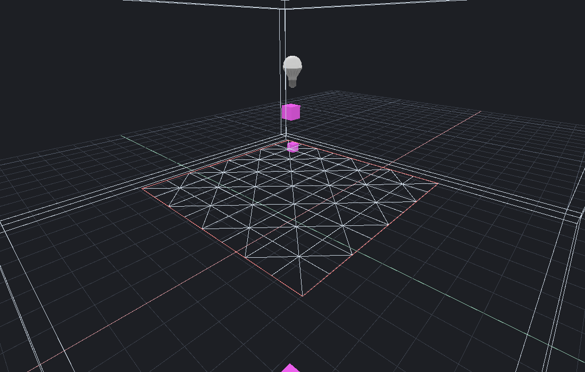

Limits: 1–16 world quad faces per action, one per parent brush. Nonquad faces, brush entities and parents with existing terrain are rejected together; no partial conversion occurs. Terrain is a surface: its parent brush does not seal the map or become a solid collision box. Creation adds one undo step and retains face selection. Holes remain planned. Use a visible ordinary solid material for native compilation.

## Change grid resolution

1. Select existing terrain faces and click **Edit terrain…**, then choose **Operation → Grid resolution**.
2. Choose **Grid resolution**: **5 × 5 · power 2**, **9 × 9 · power 3** or **17 × 17 · power 4**. The dialog shows the current grid size, or **mixed grid sizes** for a batch.
3. Click **Preview** and inspect the grid in the viewport. Finer grids keep existing height and blend samples; coarser grids can lose detail. The map and Undo history stay unchanged during preview.
4. Click **Apply** to keep the preview in one undo step, or **Cancel** to discard it. Changing the grid choice discards this dialog's previous preview. Reopen the dialog if the map or face selection changes.

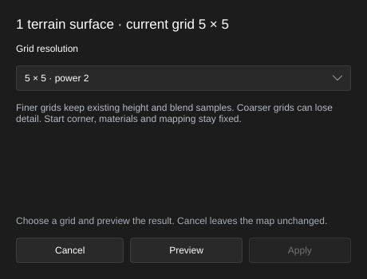

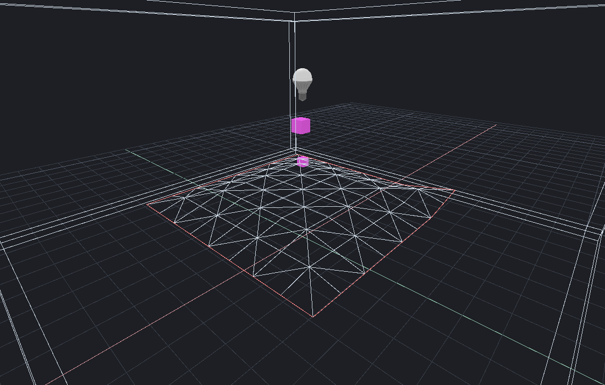

Limits: 1–16 terrain faces per action. Start corners, material, mapping, lighting and IDs stay fixed. Uniform triangle tags, unrestricted vertex masks and zero offset-normal rows are resized or retained. Mixed triangle tags, restricted masks, nonzero offset normals, opaque grid blocks and malformed/nonfinite rows reject together; these need topology remapping. Coarsening samples the old grid rather than preserving every old detail. A stale dialog cannot apply or cancel another actor's preview.

## Subdivide connected terrain

Round connected base quad faces into a smooth terrain surface.

1. Create terrain on the base faces that form the shape. Include every face you want rounded; each surface may use its own grid resolution and start corner.
2. Select those faces and open **Edit terrain…**. Choose **Operation → Subdivide base cage**.
3. Click **Preview**. This replaces existing sculpted positions. Blend values, materials, mapping, flags, triangle tags, powers and start corners stay fixed. Matching full edges and exact whole-to-half junctions share samples; the outer base edges stay fixed.
4. Inspect the shape, then click **Apply** for one Undo step or **Cancel** to discard it. Repeating the same subdivision is a no-op. Generated grids can still be sculpted, moved, painted, sewn or resized.

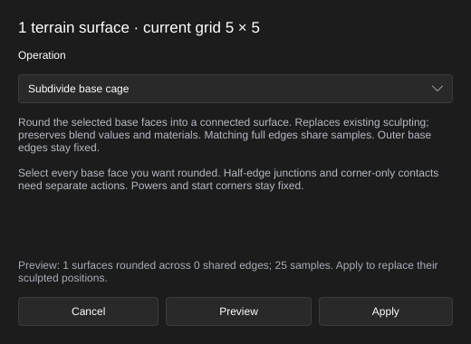

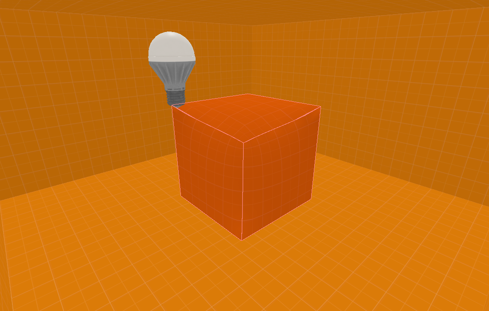

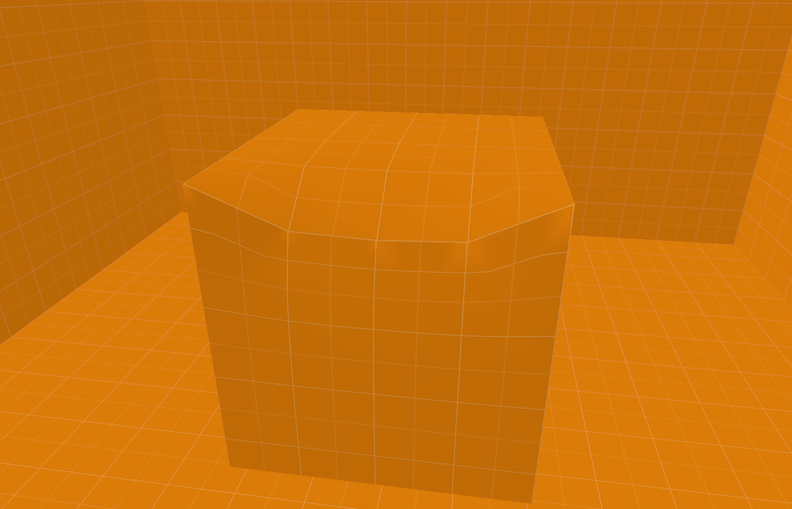

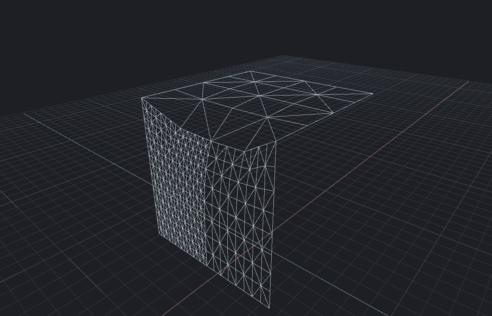

Limits: 1–16 quad cages, four Catmull–Clark refinement rounds, sampled at each surface's existing power. Exact whole-to-half junctions use a shared quad cage with two grid densities; one large edge may meet one or two smaller edges. Nested chains requiring a third density, inconsistent density cycles, other fractional contacts, corner-only contacts, ambiguous overlaps, non-manifold or inconsistently oriented cages, opaque data and nonzero offset-normal caches reject together. It generates geometry from the base faces, replacing prior sculpting on interiors and boundaries. Unmatched outer base edges stay pinned. Compilation and the displayed surface share mixed-resolution LOD snapping; picking, framing and guides follow that surface. Raw grid inspection and editing retain authored samples, including vertices inactive at a native seam. Border-normal rules remain separate. The saved `subdiv` marker alone does not block supported editing operations. Crease controls remain planned.

## Sculpt heights

1. Select terrain faces and click **Edit terrain…**.
2. Choose **Operation**: **Raise / lower**, **Flatten**, **Smooth** or **Noise**.
3. Set **Brush center · world coordinates**, or click **Pick center in viewport…** and choose a point on the selected terrain. The dialog returns with that point filled in. **Escape** or **Cancel picking** restores the dialog without changing its fields. Terrain selection and **Frame · F** follow the displaced surface, including previews. Choose **Brush direction**: **Up / down · world Z** or **Along the face normal**. Set **Radius · world units** with the slider or exact numeric input.
4. For **Raise / lower**, set **Height change · negative lowers**. For **Flatten** or **Smooth**, set **Strength** from 0 to 1. Flatten moves toward the plane through the brush center; with world-Z direction, **Z** sets its target height. Smooth uses the original neighboring samples. For **Noise**, set **Noise amount · world units** and **Noise seed**.
5. Click **Preview** and inspect the shape. Each brush fades smoothly toward its edge. Click **Apply** to keep it, or **Cancel** to discard it. **Undo** restores the complete source grid.

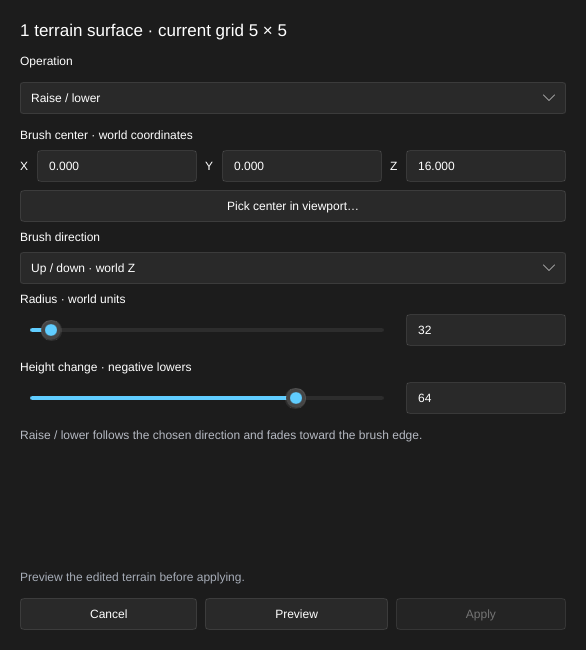

Limits: 1–16 terrain faces. Radius is 1–8192 world units; height/noise change is within ±4096. Positions must remain within ±65536. The same source and noise seed repeat exactly. Opaque terrain blocks, malformed rows and nonzero offset-normal caches reject together. Start corner, material, texture mapping, IDs, alpha and authored flags/tags remain. Fixed previews use the entered world-space center; use **Draw stroke in viewport…** for a path. **Sew borders & corners** joins matching full/half borders across grid sizes; sewing is not automatic.

## Draw a brush stroke

Sculpt or paint a blend along a visible terrain path, then review it before keeping the edit.

1. Select terrain faces and open **Edit terrain…**. Choose **Raise / lower**, **Flatten**, **Smooth**, **Noise** or **Paint blend** under **Operation**.
2. Set **Radius · world units**, direction and the operation's amount, strength or blend value. For **Flatten**, the entered **Brush center · world coordinates** sets the target plane for the whole stroke. Enable **Affect only selected terrain vertices** to use a retained triangle or vertex mask.
3. Click **Draw stroke in viewport…**. Drag with the left mouse button on visible selected terrain. A white circle shows the current brush radius. Moving off a visible terrain surface breaks the path; the next hit starts another segment.
4. Release to return to the dialog and inspect the draft. Click **Apply** to keep one Undo step, or **Cancel** to discard it. During drawing, **Escape** or **Cancel stroke** discards the owned draft and returns to the dialog. Losing viewport focus while dragging discards that stroke.
5. Use **Undo** to restore every original grid. An applied masked stroke keeps its matching selection available for the next brush action.

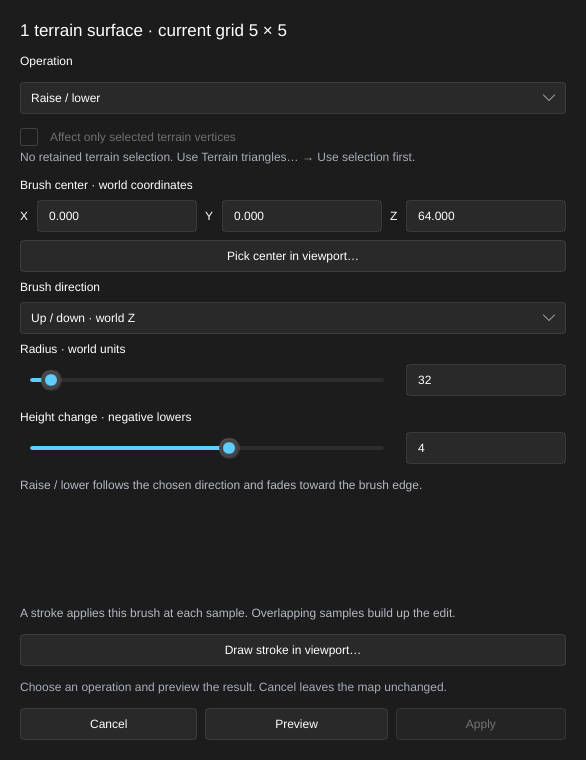

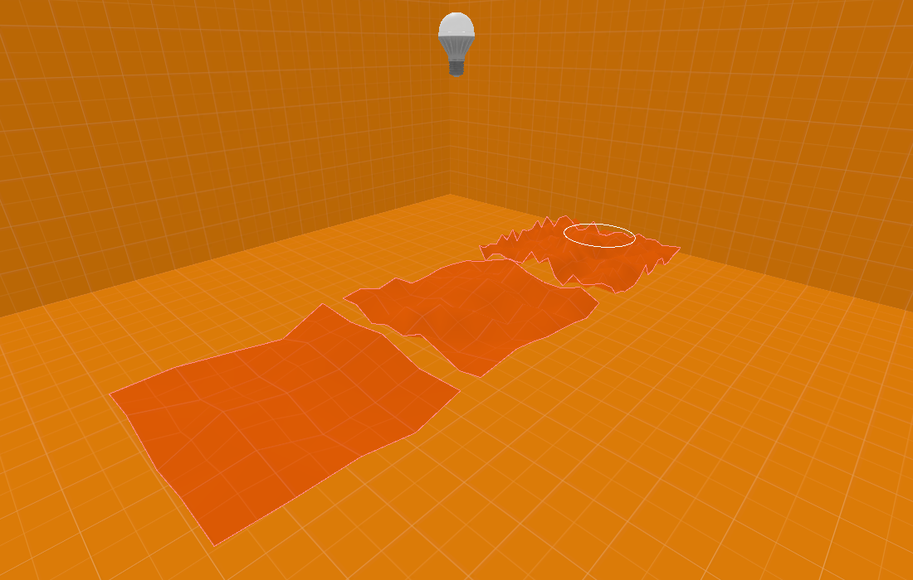

Limits: samples are spaced at one quarter of the radius, clamped to 1–64 units, measured in the brush plane. Face-normal mode uses the first selected base face for path spacing and the circle; each surface keeps its own brush direction. Overlapping samples accumulate the selected operation; stationary pointer positions add no samples. Flatten keeps its original target plane. Smoothing reads original neighbors within each sample. Each stroke supports at most 512 samples, 4096 input points and two million vertex/sample evaluations. Invalid updates retain the last good draft. Source, history and unselected samples stay fixed until **Apply**; other actors' replacement previews or masks reject further stroke updates. Fill, invert, sewing, collision and resolution edits use their existing complete-action controls.

## Select triangles in a box

1. Select 1–16 terrain faces, then open **Select a volume…**. Set **Minimum** and **Maximum** coordinates, then choose **Intersects the box** or **Fully inside the box**.
2. Click **Preview matches** and leave the box preview active. Terrain matches its actual displaced sheet; ordinary parent faces and the old parent volume are excluded. **Fully inside the box** checks every surface vertex, including interior peaks.
3. Open **Terrain triangles…** and click **Select in volume**. The triangle checks and yellow outlines are replaced with the matches inside the current box. Face selection and map history stay fixed.
4. Preview classifications, or click **Use selection** to keep the resulting vertex mask for sculpting and blending. **Cancel** clears this dialog's own triangle draft and outlines.

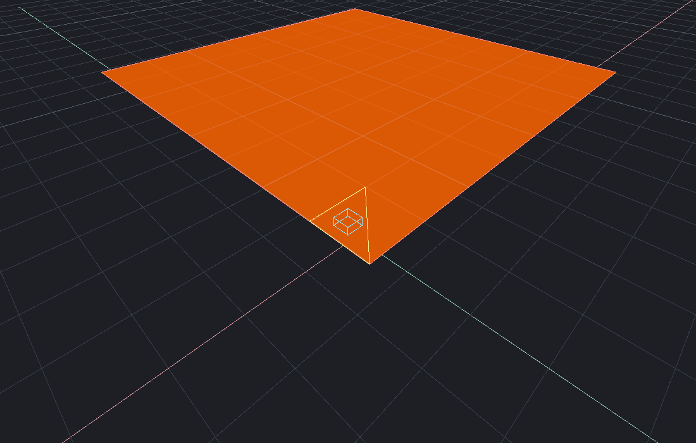

Limits: the current box token, source map and rule must still match. A replaced/canceled box or changed map rejects the query. Hidden owners and tool-material filtering apply. Crossing accepts clipped triangle overlap, including contact at the boundary; fully contained requires all three triangle vertices inside. Selections use authored terrain rather than compiled LOD geometry. Regular volume and marquee selection also use the displaced surface rather than its parent box.

## Limit brushes to selected vertices

1. Open **Terrain triangles…**, select a subset across surfaces, then click **Use selection**. The dialog closes and keeps its yellow outlines without changing the map.
2. Select the terrain faces to edit and open **Edit terrain…**. Choose **Raise / lower**, **Flatten**, **Smooth**, **Noise**, **Paint blend**, **Fill blend** or **Invert blend**.
3. Enable **Affect only selected terrain vertices**. **Selection mask** reports the affected vertex and surface counts. Faces outside the retained selection stay fixed.
4. Set the brush controls, then click **Preview**. Radius and falloff still apply. Smooth reads the original neighbors, but writes only to selected vertices. Fill and invert use the same selection mask.
5. Click **Apply** or **Cancel**. An applied masked edit keeps its selection available for the next brush action; **Undo** restores the original source.

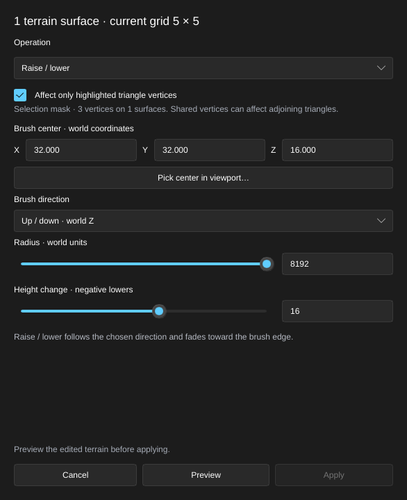

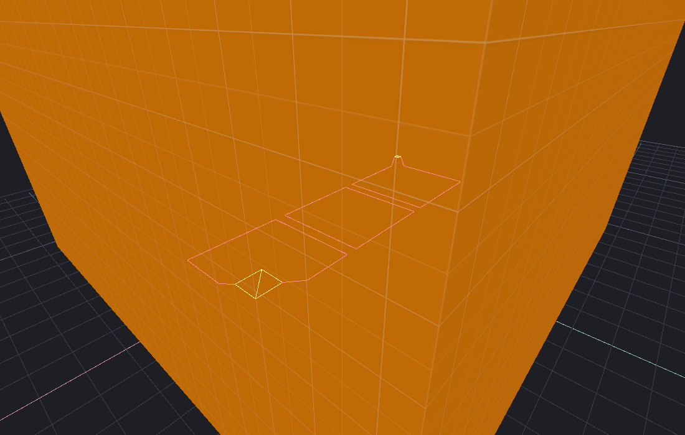

Limits: a triangle selection masks the union of its three vertices; an explicit vertex selection masks only its checked IDs. Shared vertices can reshape adjoining triangles or spread a blend across them. Geometry and alpha outside the mask stay fixed; other source flags, tags and metadata remain. Grid resolution, sewing, border shading and collision controls use their complete-surface scopes. Replaced mask tokens, topology previews and external source changes reject the masked brush; retain a fresh selection and reopen **Edit terrain…**. Saving/reopening clears the mask's validity; it is not stored in the VMF.

## Select exact vertices

Choose individual terrain samples for a precise height or blend edit.

1. Select terrain faces and open **Terrain triangles…**. Under **Selection type**, choose **Vertices · exact brush masks**.
2. Choose **Surface**, then tick vertices by ID, row and column. Each row shows its world coordinates and blend value. Switching **Surface** retains its checks. **Select surface** checks every vertex on that surface; **Clear selection** clears the batch.
3. To choose from the map, click **Pick vertex in viewport…**. Click visible selected terrain; the nearest corner of the hit triangle is checked. **Escape** or **Cancel picking** keeps the prior selection. Cyan markers show checked vertices. **Frame selected** frames visible checked samples.
4. For a box selection, open **Select a volume…**, set its coordinates and click **Preview matches**. Return to the vertex dialog and click **Select in volume**. Both box rules select point samples inside the box.
5. Click **Use selection**, then open **Edit terrain…**. Choose a sculpting or blend operation and enable **Affect only selected terrain vertices**. Set the brush controls, then **Preview → Apply / Cancel**. Only checked samples are written; radius and falloff still apply. **Undo** restores the source.

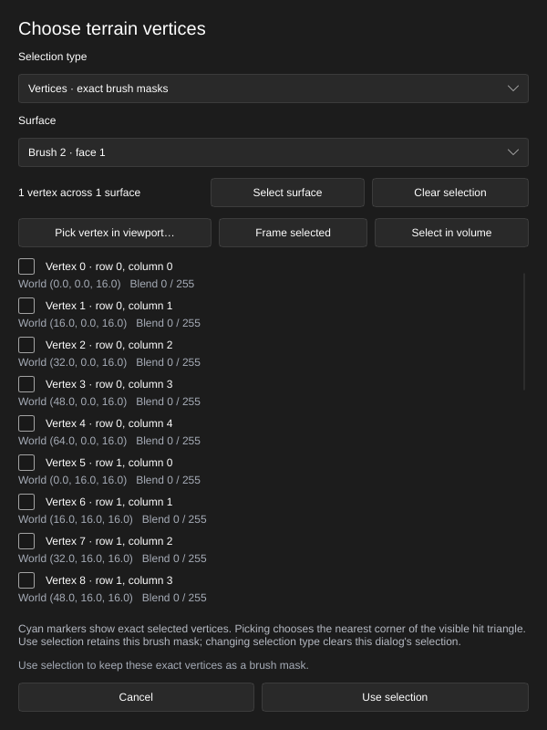

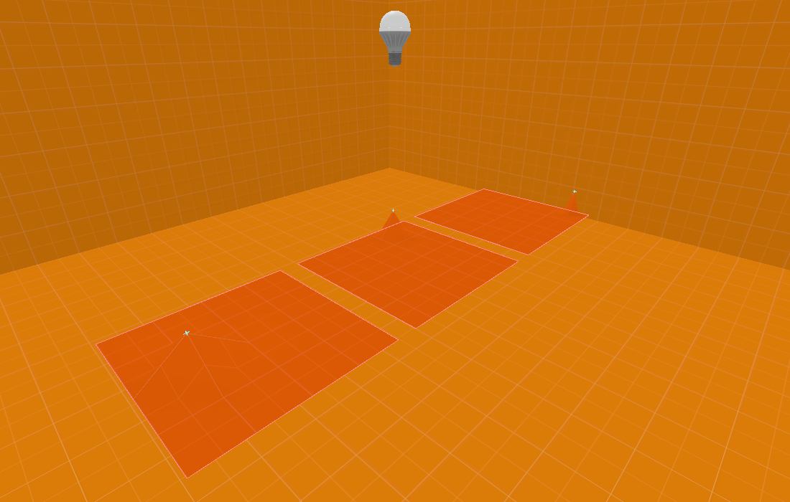

Limits: 1–16 surfaces at powers 2–4, with row-major IDs from 0–24, 0–80 or 0–288. Start-corner rotation determines their world placement. Changing **Selection type** clears this dialog's selection. Triangle and vertex selections share one retained mask; a new selection replaces the old one. Compatible geometry previews move the markers; changed topology, external edits, Undo/Redo or reopening stale them. Hidden owners and tool-material visibility apply to picking, guides, framing and box queries. Moving one sample reshapes adjoining triangles. Direct vertex drag handles remain planned.

## Move selected vertices

Move retained terrain samples by exact world coordinates, including sideways edits.

1. In **Terrain triangles…**, choose a triangle union or **Vertices · exact brush masks**, then click **Use selection**.
2. Select the terrain surfaces to edit and open **Edit terrain…**. Choose **Operation → Move selected vertices**. **Selection mask** reports the affected samples and surfaces.
3. Enter **World offset · units** under **X**, **Y** and **Z**. X/Y move sideways; positive Z raises. These are total offsets from the current source, rather than accumulated preview changes.
4. Click **Preview** and inspect the shape. Click **Apply** to keep one Undo step or **Cancel** to restore the source. An applied move retains its matching selection for another edit.

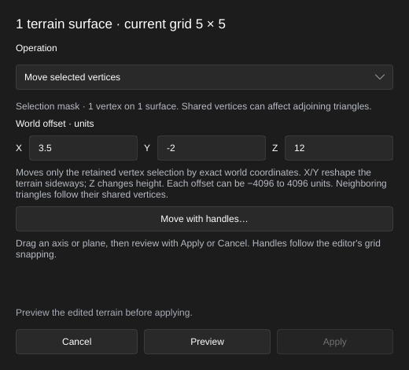

Limits: offsets must be finite and between −4096 and 4096 per axis, with final positions within ±65536. Only selected offset rows change; other samples, normals/distances, alpha, tags, flags, base/start corners, materials and mapping remain fixed. Zero is an exact no-op. Shared vertices reshape adjoining triangles. Stale/replaced masks or unsupported imported geometry/cache data reject without replacing a valid draft.

## Move vertices with handles

Drag a retained terrain selection along a world axis, world plane or the screen plane.

1. Retain vertices with **Terrain triangles… → Use selection**, then open **Edit terrain… → Operation → Move selected vertices**.
2. Click **Move with handles…**. Colored arrows move along X/Y/Z; squares move in XY/XZ/YZ. The center handle moves along the screen plane. Handles use the editor's current grid snapping.
3. Drag a visible handle with the left mouse button. Release to review the total **World offset · units** in the dialog. Click **Apply** for one Undo step, or **Cancel** to discard the draft.
4. During the gesture, **Escape** or **Cancel terrain move** discards the owned draft. Losing viewport focus during a drag cancels it silently.

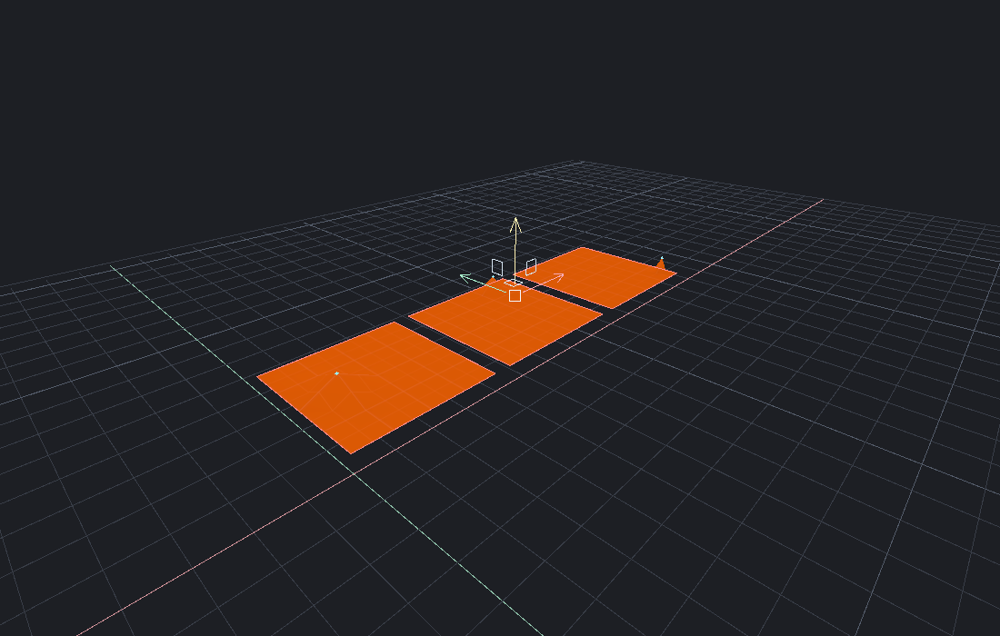

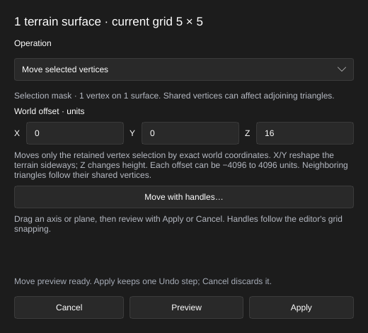

Limits: the same movement bounds and mask rules apply as numeric offsets. Handles use world axes; the screen plane captures the starting camera. Changing the map, mask, camera, visibility or grid invalidates an active gesture. Invalid updates preserve the last good draft and block finishing; correct the move while holding the mouse button, or cancel and retry. Cancellation preserves another actor's replacement preview. Edge-on axes and planes cannot be dragged in that view.

## Paint a material blend

Paint the transition between two textures and their declared terrain contact properties.

1. Select terrain faces under **Selection → Faces · materials & textures**. Assign a two-texture material through **Browse materials…**, **Use material**, then **Apply**. For two physical surfaces, choose a material declaring `$surfaceprop` and `$surfaceprop2`. A single-texture material cannot show the alpha blend.
2. Click **Edit terrain…**, then choose **Paint blend**, **Fill blend** or **Invert blend** under **Operation**.
3. For **Paint blend**, set **Brush center · world coordinates**, **Brush direction**, **Radius · world units** and **Strength · 0 leaves terrain unchanged, 1 applies fully**. Choose **Blend value · 0 first texture, 255 second texture** with the slider or numeric input. Painting moves toward that value and fades toward the brush edge.
4. **Fill blend** applies the chosen value to every vertex in the selected grids. **Invert blend** swaps weights across the complete grids.
5. Click **Preview**, then **Apply** or **Cancel**. Geometry, material, mapping and lighting settings stay fixed; **Undo** restores the original blend values.
6. For physical contact, open **Build settings…**, choose **Physics bodies → CS:S engine physics**, then **Close** and **Compile**.

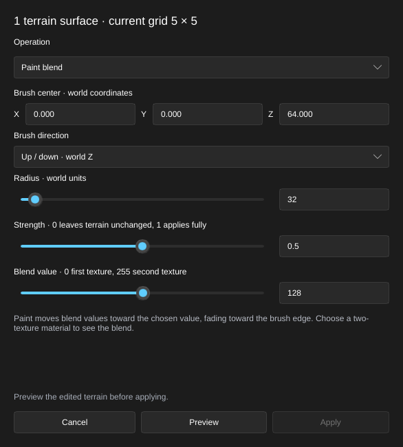

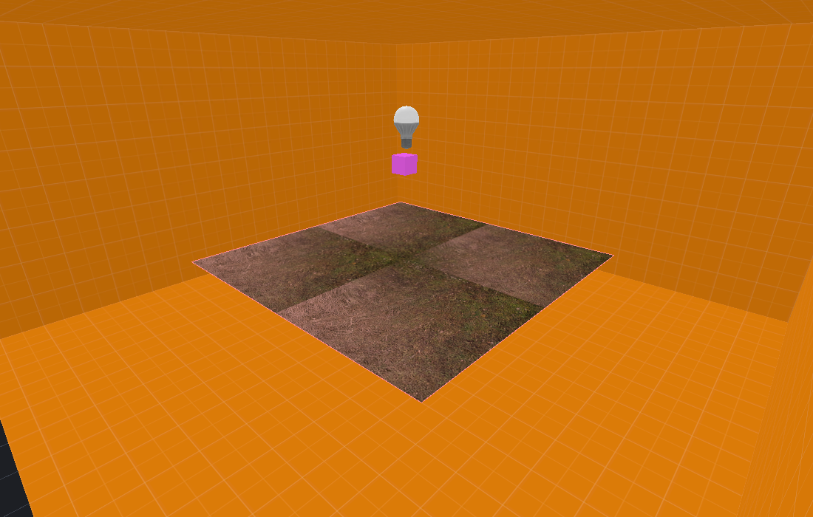

Limits: 1–16 terrain faces, alpha 0–255 and strength 0–1. A material can remap how the alpha affects its textures. Use **Pick center in viewport…** or exact coordinates for a fixed brush, or **Draw stroke in viewport…** for blend paint. **Sew borders & corners** can also average shared alpha.

Engine physics selects one property per emitted collision triangle: `$surfaceprop2` only when its three stored 32-bit (`f32`) alpha values, added in triangle order, sum to more than 382.5. Equality uses `$surfaceprop`; a missing `$surfaceprop2` always retains the primary. Physical properties do not blend continuously. Mixed-resolution borders use compiled LOD triangles. See [Terrain contact surfaces](physics.md#terrain-contact-surfaces) for surface-definition requirements.

## Sew neighboring terrain

1. Select 2–16 terrain faces with matching full base edges, exact whole-to-half borders or matching base corners. Grid resolutions may differ.
2. Click **Edit terrain…**, then choose **Operation → Sew borders & corners**.
3. Enable **Also sew blend values** to join alpha at those shared borders and corners as well as positions.
4. Click **Preview**. Common border and corner groups average their original positions once, including junctions. Finer border points follow the sewn coarse edge; the preview reports their count. Interior vertices stay fixed.
5. Click **Apply** or **Cancel**. **Undo** restores all original grids.

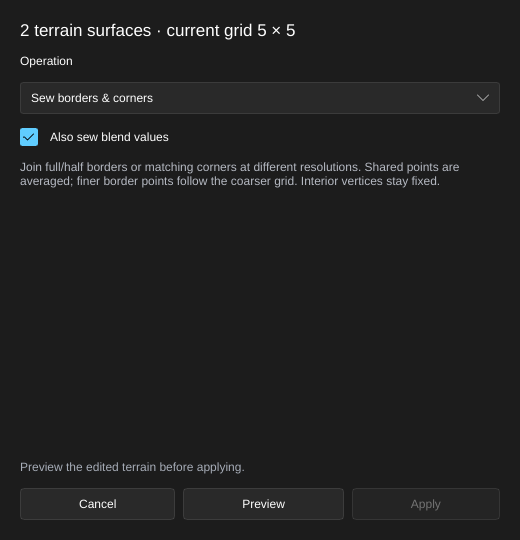

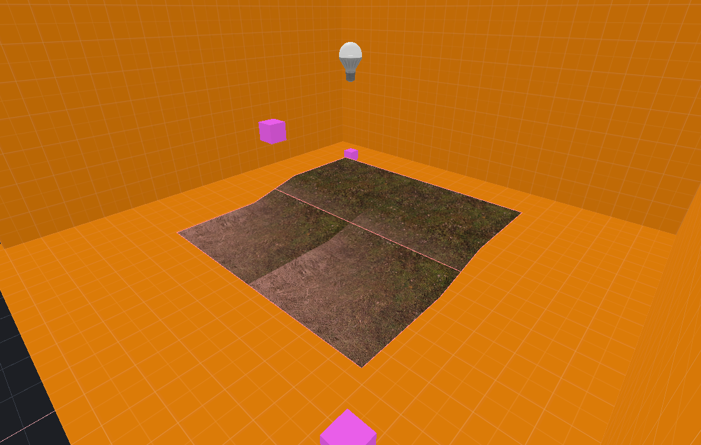

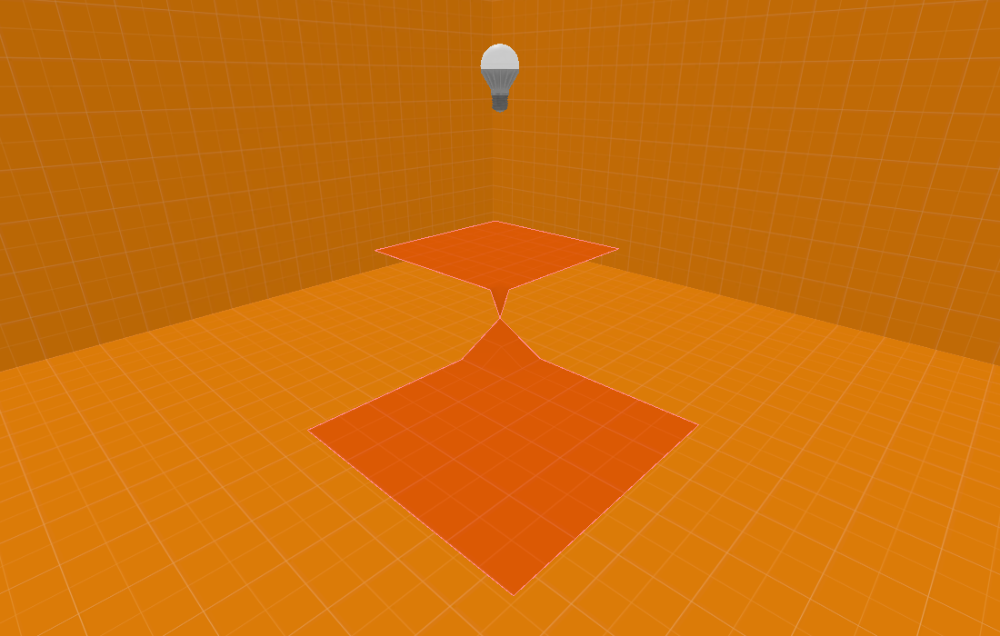

For corner-only contacts, **Preview** reports **corner joins** separately from joined borders. Only those shared corner vertices move; optional alpha averages once across the same group. Unrelated borders and interiors stay fixed.

Limits: full or exact whole-to-half base edges and matching base corners at powers 2–4. Missing matches, ambiguous overlaps, Source-float-collapsed corners and unsupported cache data reject atomically. Unmatched borders stay fixed. Sewing can remove fine detail along a border to make it match the coarser grid. Other fractional spans remain planned. Start corners, materials, mapping, IDs, triangle tags and collision settings remain fixed.

## Set collision behavior

1. Select terrain faces and click **Edit terrain… → Operation → Collision**.
2. Set **Physics collision** for crates and other dynamic objects, **Player collision** for player hulls, and **Ray collision** for traces and shots. Each label shows the committed state, including **mixed** for a batch.
3. Choose **Keep current**, **Enabled** or **Disabled** for each setting. **Keep current** preserves every face's own value.
4. Click **Preview**, then **Apply** or **Cancel**. The visible terrain geometry remains; only the chosen collision behavior changes. Use **CS:S engine physics** when compiling physical contact.

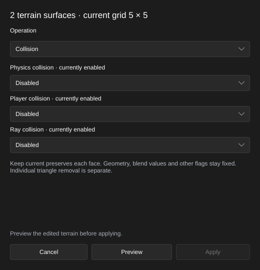

Limits: 1–16 faces; other flags, geometry, alpha and tags stay fixed. Unsupported imported flags still need compiler support. These controls affect complete surfaces; use **Terrain triangles…** for per-triangle classifications. Triangle removal remains planned. Editor picking continues to use visible geometry, even when game collision is disabled.

## Inspect and classify triangles

1. Select terrain faces under **Selection → Faces · materials & textures**, then click **Terrain triangles…**.
2. Choose **Surface**. Each row shows a native triangle ID, its center in world coordinates, and its current **Walkable** and **Buildable** classifications, marked **automatic** or **forced**.
3. Tick any triangle subset. Changing **Surface** retains its checks, so one edit can span several surfaces. **Select surface** selects every triangle on the displayed surface; **Clear selection** clears the complete batch. IDs run from 0–31 at power 2, 0–127 at power 3, and 0–511 at power 4.
4. Click **Pick triangle in viewport…**, then click visible terrain in the selected face scope. The dialog returns with that native triangle checked. **Escape** or **Cancel picking** restores the dialog without changing its fields or checks.
5. Selected triangles have yellow outlines in the viewport. Click **Frame selected** to frame all visible checked triangles. Hidden owners and tool-material filtering apply to both picking and guides.
6. Under **Walkability** and **Buildability**, choose **Keep current**, **Automatic · from slope**, **Enabled** or **Disabled**. Automatic clears that override and recomputes the selected triangles from their source slope. Keep current retains each triangle's value.
7. Click **Preview** to inspect the proposed classifications, then **Apply** to keep one undo step or **Cancel** to discard them. **Undo** restores the original tag rows, including their absence.

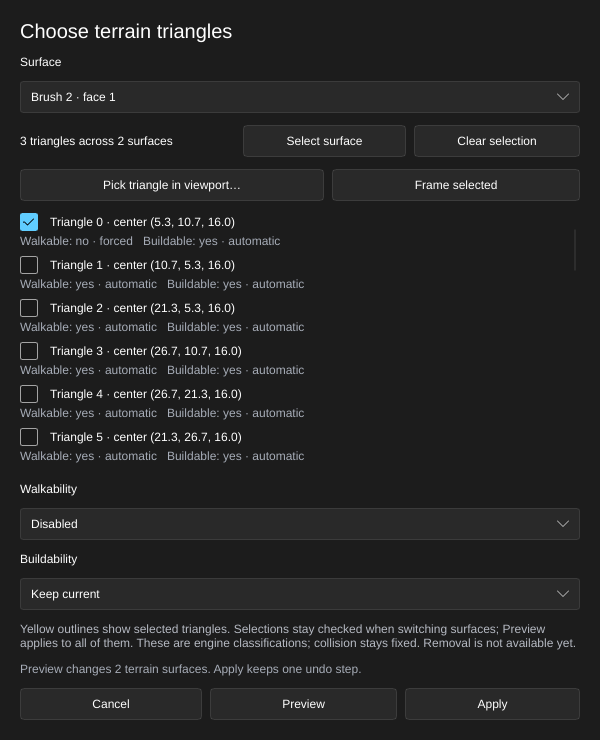

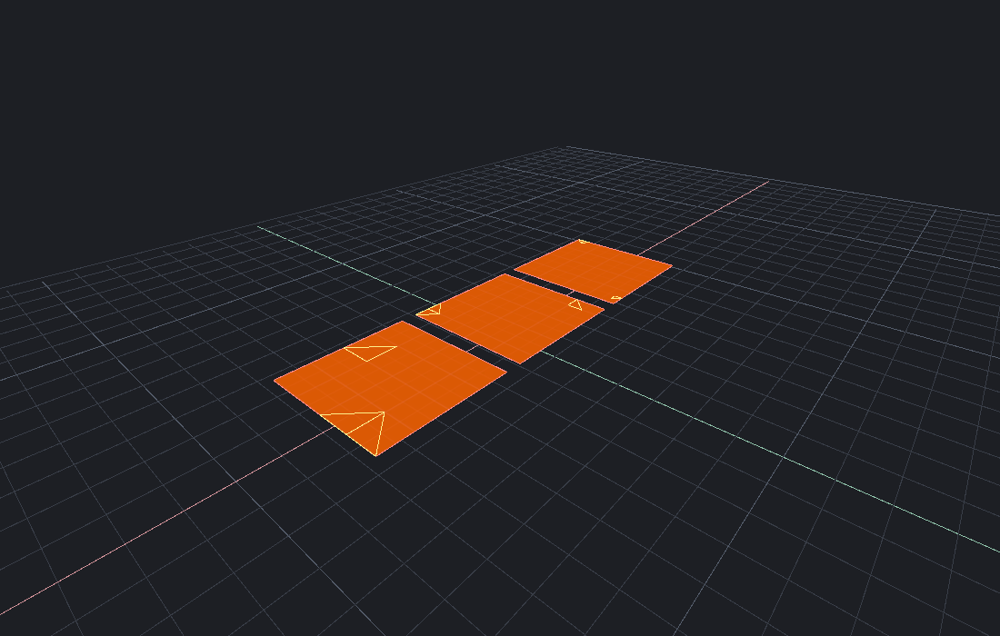

Limits: 1–16 selected terrain faces; subsets across surfaces apply in one undo step. These are engine classifications, not collision switches: disabling Walkability does not make a player fall through terrain. Buildability applies to games that consume that legacy classification. Geometry, blend values, mapping, IDs, collision settings and unselected tags stay fixed. Malformed rows and invalid triangle IDs reject atomically. Imported removal and unknown tags remain inspectable but cannot compile; hole authoring remains planned. IDs belong to a face's current power and start corner; query again after changing its topology. The outlines follow compatible source previews. A different-power preview hides them; finish it before framing or selecting draft IDs. Map/source changes make highlights stale. Cancel clears this dialog's own preview and outlines while retaining another actor's replacements.

## Remove terrain

1. Select the terrain faces under **Selection → Faces · materials & textures**.
2. Click **Remove terrain**. Removing the last terrain face restores the parent's solid brush volume; another terrain face on that parent keeps it as terrain.
3. Use **Undo** to restore the complete grid, including imported heights, alpha, tags and extra data.

Limits: every target must contain terrain, with 1–16 faces per action. Invalid or mixed ordinary/terrain targets reject together. IDs, brush planes, material, mapping and lighting remain. Imported brush-entity terrain can be removed to repair it, while native runtime brush-model terrain remains unsupported; static `func_detail` helpers compile as world terrain.

## Compile different grid resolutions together

1. Create adjacent terrain faces whose complete base edges match. Set their powers independently with **Terrain grid** during creation or **Edit terrain… → Operation → Grid resolution** afterward.
2. Keep the heights at shared coarse vertices aligned. Refining an existing grid preserves those samples; independently sculpted borders may need repair.
3. Open **Build settings…**, choose **Direct LDR** and **CS:S engine physics**, then **Close** and **Compile**.
4. Open **Build details…** and inspect **Mixed-power pairs**, **LOD disabled vertices** and **Snapped vertices**. Read **Diagnostics** for unmatched edges or reduced fine detail.

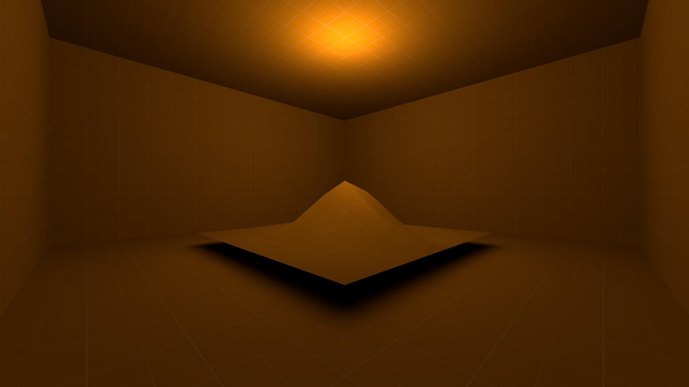

Limits: powers 2–4, complete base edges with matching common heights, and bounded topology work. Compilation removes unsupported fine vertices and snaps their geometry onto the compatible surface. The editable grid remains unchanged, so the compiled surface can be less detailed near a coarse neighbor. Lighting and physics use the compiled geometry. Exact whole-to-half connections also compile; other partial spans and holes remain planned. **Sew borders & corners** repairs these source borders through a preview.

## Compile split borders

1. In **Top**, use **Draw brush** with one **Start** and **Depth** to create a larger parent beside two smaller parents. Each smaller border must cover exactly half of the larger border.
2. Select the top faces under **Selection → Faces · materials & textures** and use **Create terrain**. Choose each **Terrain grid** independently; their powers may differ.
3. Keep shared coarse heights aligned, then **Compile** with the lighting and physics settings above.
4. Open **Build details…** and check **Half-edge pairs**. A large border can link both smaller neighbors, or either half by itself. Overlapping candidates stay unlinked and appear in **Diagnostics**.

Limits: exact full-to-half base edges with matching common samples. Masks and geometry snapping follow sample spacing within each covered interval. Shared junction samples stay aligned; other fractional spans and holes remain planned. Imported subdivided grids compile their saved rows; source editing rejects actual unsupported caches. Source grids stay unchanged.

## Compile terrain as detail

1. Create terrain on world parents using **Create terrain**.
2. Select the terrain parents, click **Tie to entity…** and choose **func_detail**.
3. Open **Build settings…**, choose **Direct LDR** and **CS:S engine physics**, then **Close** and **Compile**.
4. Open **Build details…** and inspect **Terrain surfaces**, **Neighbor pairs** and **Half-edge pairs**. Detail helpers contribute world terrain with their saved heights, blends, border shading and collision choices.

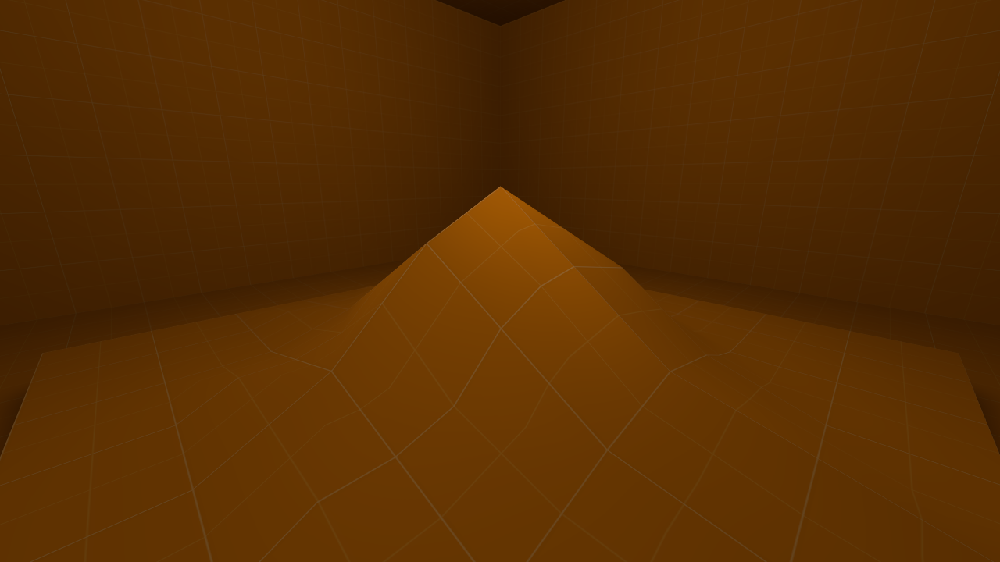

Limits: world and consumed `func_detail` terrain only. Helpers keep sheet behavior; parent volumes do not seal or become solid boxes. Hidden helpers are omitted. Runtime brush-model terrain remains unsupported. Creation still starts on world parents; **Move to world** returns a helper to world brushes. Compatible world/detail borders share the same preview, lighting and native neighbor rules.

## Control border shading

1. Select terrain faces and click **Edit terrain… → Operation → Border smoothing**.
2. Read the current setting, including **mixed** for a batch. Choose **Automatic** to blend compatible borders, **Hard borders** to keep neighboring patch normals separate, or **Angle limit** to restrict blending.
3. For **Angle limit**, set **Maximum angle · degrees** with the slider or exact numeric input. Both neighboring surfaces must allow the blend; 0 keeps borders hard and the maximum is 180.
4. Click **Preview**, then **Apply** or **Cancel**. Use **Undo** to restore the previous settings.
5. Compile with **Direct LDR** for baked shading. **Build details…** reports **Border smoothing** as the number of authored surfaces.

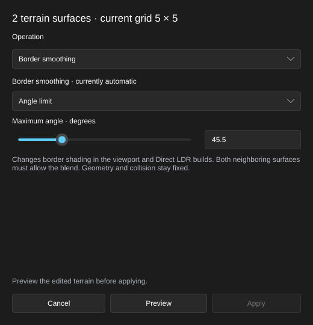

| Automatic borders | Hard borders |
| --- | --- |
|  | 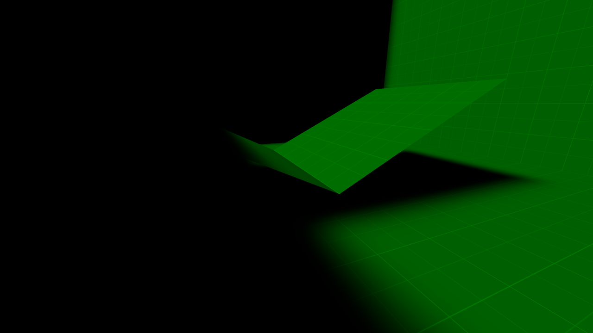 |

Limits: 1–16 faces, angles 0–180 degrees, world/func_detail terrain with shared full/half borders and pairwise local-normal thresholds. Connected corners share the accepted group normal. Interior shading remains smooth; heights, alpha, flags, topology and collision stay fixed. The viewport uses its prepared sewn LOD mesh; changing fine border positions can also change local shading angles. Invalid/duplicate imported `smooth` fields block compilation until repaired; **Automatic** removes the override. This setting is separate from the compiler's brush smoothing angle and the **Smooth** height brush.

## Preview authored lighting

Inspect point and spot lighting on terrain before a bake.

1. Under **VIEWPORT**, choose **Textured**, then enable **Unshadowed authored lighting**.
2. Choose **Fast · vertex lighting** for interpolated vertex contributions or
   **Detail · per-fragment lighting** for each displayed surface point. Fast can
   miss small pools between terrain vertices.
3. Set **Lighting exposure (EV)** from −8 to 8. The status reports admitted and
   excluded terrain surfaces and drawn triangles separately from flat polygons.
   Read the reason when a sheet keeps its ordinary display.
4. Use **Edit terrain… → Preview** to review terrain under the same lights.
   **Apply** or **Cancel** controls the terrain edit; lighting settings preserve the
   review, committed map and undo history.

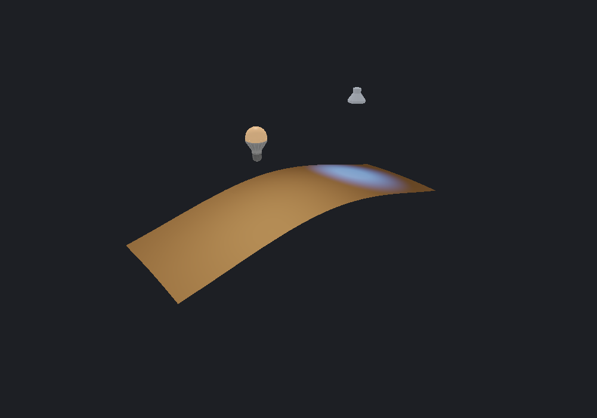

Limits: visible world and `func_detail` terrain at power 2, 3 or 4, with an
available opaque single-base `LightmappedGeneric` image. Prepared sewn LOD
positions and normals must pass finite Source-coordinate, nondegenerate-triangle
and safe-normal checks. Bump/normal, second/base blend, detail, reflection/specular
and light-warp declarations are excluded, along with tool/sky, alpha-tested,
translucent, self-illuminated, additive and proxy/fallback materials. Declared
unsupported keys are excluded even when zero. **Reload material assets**
refreshes cached base pixels and receiver policy together.

The preview has no shadows, sun, ambient, bounce or native brightness claim.
Rejected terrain keeps its ordinary geometry and contributes excluded counts.
A preparation failure retains its outline and counts one excluded surface with
zero drawn triangles. Suppressed tool/sky terrain also counts zero drawn
triangles. Exceeding the light budget disables the whole preview. Off, Flat,
Wireframe and diagnostic views retain their rendering behavior. No terrain
normal texture or new lighting atlas is created.

## Connected lighting

Compatible full/half edges share lighting normals according to the selected border rules in the viewport and compiled map. See [Compile and play](compile-and-play.md#terrain-displacements) for the settings and limits.

If terrain preparation fails, the viewport shows its error above the map and
marks checked terrain geometry with a red wireframe, or its base face with an
outline when the grid itself is invalid. The patch is omitted from shaded
geometry. Open **Check map… → Run checks**, then **Select issue**
or **Focus issue** to inspect it. Invalid imported border angles can be repaired
with **Edit terrain… → Border smoothing → Automatic**.

Terrain normals and distances must be supplied together. Nonfinite values,
positions or blend weights that exceed native floating-point range, invalid
smoothing fields and exceeded shared-normal limits are reported. They are not
replaced with automatic, local or zero normals. Invalid patches are excluded
before normal assembly for the remaining valid patches. Hiding an invalid patch
removes its viewport warning. More than 2,048 visible world/detail patches
exceeds the native shared-normal limit and leaves those patches unshaded.
