[← Manual](README.md)

# Terrain

Create, sculpt and paint displacement surfaces. Compile them with lighting and collision.

## Create terrain

1. Click **Faces** in the toolbar and select world quad faces.
2. Choose **Terrain grid**: 5 × 5, 9 × 9 or 17 × 17.
3. Choose **Start corner** to set grid orientation.
4. Click **Create terrain**.
5. Use **Browse materials…** to change the surface material.

Terrain is a sheet. Its parent volume does not seal the map or become a solid collision box.

To make an opening, [remove selected triangles](#remove-selected-triangles)
or use [Carve terrain](brush-tools.md#carve-terrain).
Both create native patches around the opening. Add separate brush walls
if the opening needs thickness.
For cutout or partial-transparency terrain, enable [Brush texture shadows](brush-texture-shadows.md)
in a lit build. Texture opacity does not remove collision triangles.
Use ordinary world brushes to seal playable areas.

## Sculpt heights

1. Select terrain faces and click **Edit terrain…**.
2. Choose **Raise / lower**, **Flatten**, **Smooth** or **Noise** under **Operation**.
3. Set **Brush center · world coordinates**, or use **Pick center in viewport…**.
4. Set **Brush direction**, **Radius · world units** and the operation's amount or strength.
5. Click **Preview**.
6. Inspect the shape, then click **Apply** or **Cancel**.

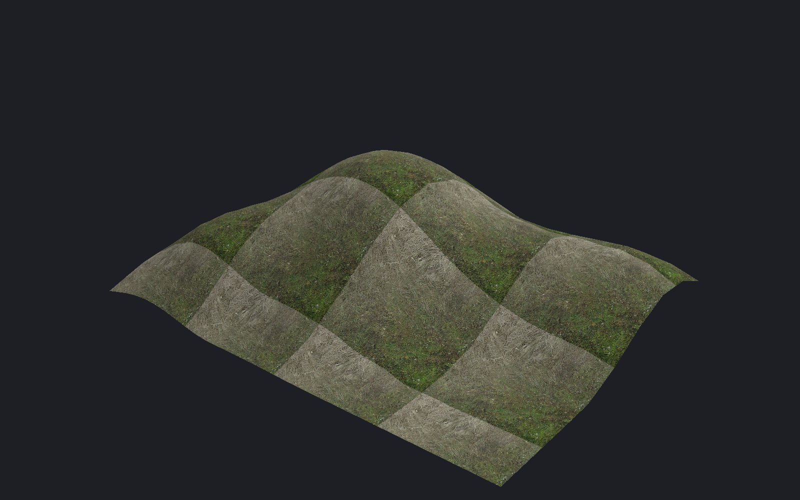

Flatten targets the plane through the brush center. Smooth uses neighboring samples.
Noise repeats with the same source and seed.

Textures follow the flat base grid. Sculpting and XYZ vertex movement retain
each sample's grid UVs; changing resolution retains the same continuous grid
mapping. Nonlinear world projection onto sculpted positions is not represented
by Source's terrain format.

## Paint blends

1. Apply a supported two-base blend material.
2. Open **Edit terrain…** and choose **Paint blend**.
3. Set the brush center, radius, strength and blend value.
4. Click **Preview**, then **Apply**.

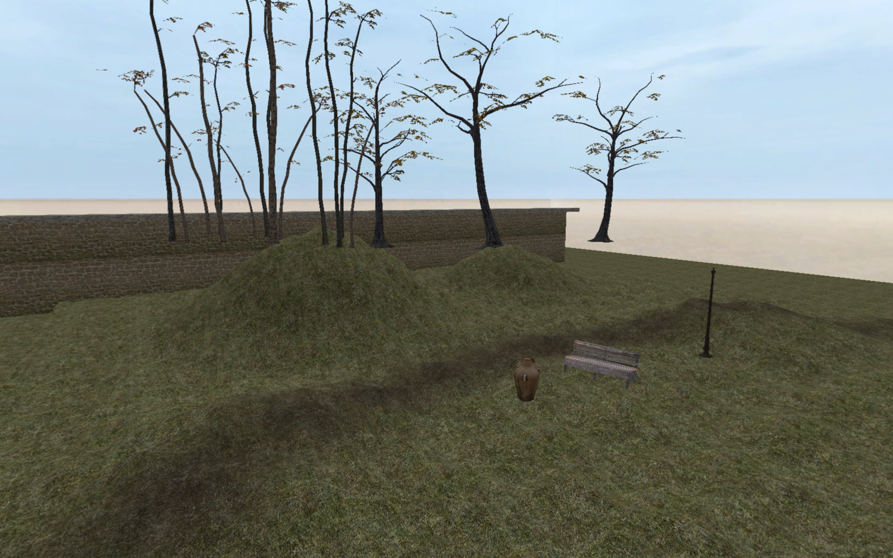

Blend values run from 0 to 255. **Fill blend** changes the complete selected scope.
**Invert blend** reverses its values.

## Draw a stroke

1. Choose a sculpting or blend operation in **Edit terrain…**.
2. Set the brush controls.
3. Click **Draw stroke in viewport…**.
4. Drag over visible selected terrain.
5. Release, inspect the draft, then click **Apply** or **Cancel**.

The white circle shows the radius. Leaving the surface breaks the path.
Escape or **Cancel stroke** discards the owned stroke.

## Select vertices and triangles

1. Open **Terrain triangles…** for selected terrain faces.
2. Choose **Selection type** and **Surface**.
3. Check IDs, or use **Pick vertex in viewport…** or **Pick triangle in viewport…**.
4. Use **Frame selected** to inspect the selection.
5. Click **Use selection** to retain a vertex mask.
6. Enable **Affect only selected terrain vertices** in **Edit terrain…**.

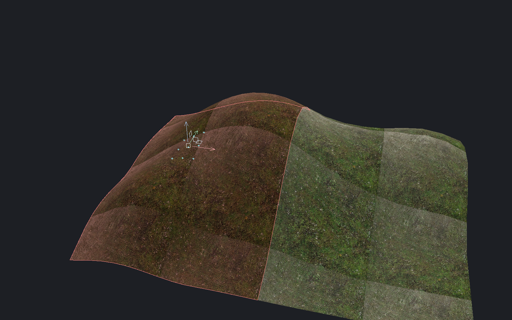

Triangle masks include all three vertices. Explicit vertex masks include only checked samples.
Use **Select a volume… → Preview matches**, then **Select in volume**, for a box selection.

For exact movement:

1. Retain a mask with **Use selection**.
2. Open **Edit terrain… → Operation → Move selected vertices**.
3. Enter **World offset · units**, then click **Preview** and **Apply**.

For dragging, click **Move with handles…** in the same operation.
Review the displacement before applying. **Undo** restores the previous grid.
Accepted **New** or **Open…** discards the old move handles. Retained inspection
masks can remain stale; make a new selection before editing another map.

## Set exact vertex heights

1. Open **Terrain triangles…** for the selected terrain faces.
2. Choose **Vertices · exact positions & brush masks** under **Selection type**.
3. Check the vertices to change.
4. Enter **Set checked vertices to world Z · units** and click **Preview height**.
5. Inspect the terrain and **World** coordinates, then click **Apply** or **Cancel**.

X and Y stay fixed. To supply different heights, enter **Height CSV file path**
and click **Preview CSV**. Use the exact header and native vertex IDs:

```csv
solid,side,vertex,z
12,72,0,-12.5
12,72,7,8191.25
```

CSV rows choose vertices within the dialog's captured faces; checkboxes do not
limit them. Edits preserve the viewport highlight. Failed input preserves the
last valid preview. Supply matching border heights to keep a seam joined.
Limits: 16 faces, 289 vertices per face, 512 KiB per CSV file, coordinates within
±65536 units. No interpolation or automatic sewing occurs.

## Change grid resolution

1. Open **Edit terrain…** and choose **Grid resolution**.
2. Choose 5 × 5, 9 × 9 or 17 × 17.
3. Click **Preview**, then **Apply** or **Cancel**.

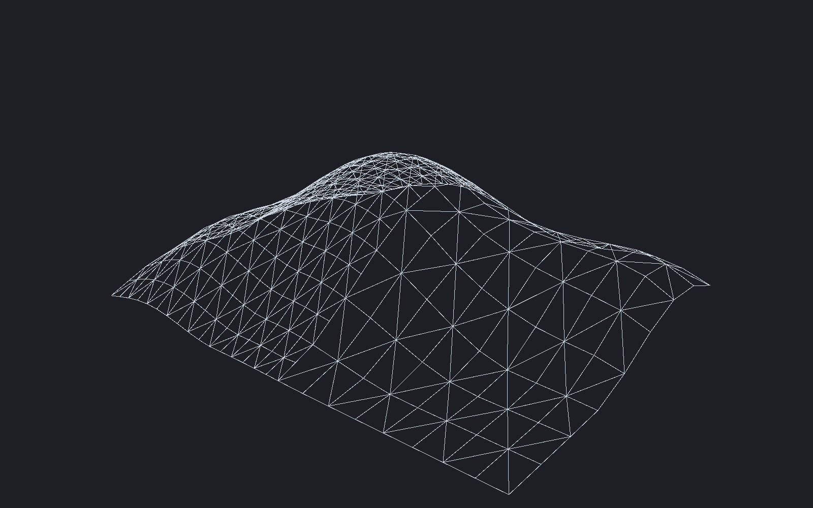

Finer grids retain existing samples. Coarser grids can lose detail.
Mixed triangle tags, restricted masks and unsupported caches can prevent resizing.

## Subdivide connected terrain

1. Select terrain on the base faces to round.
2. Choose **Edit terrain… → Operation → Subdivide base cage**.
3. Click **Preview** and review the shape and work summary.
4. Click **Apply** or **Cancel**.

Subdivision replaces sculpted positions with a rounded base-cage surface.
Coherent full/full and whole/half chains can join across several cage densities.
Unmatched outer edges stay fixed. Powers, start corners, blend values, triangle
tags, materials and mapping stay fixed. Preview checks aggregate work before
generation; rejected requests preserve the previous preview.

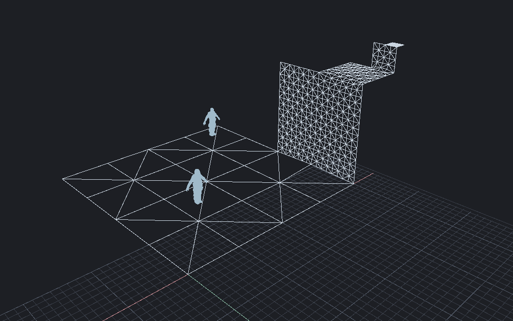

Four base cages rounded in one operation. Each terrain grid keeps its resolution.

Work is limited to 65,536 refined quads and 73,744 intermediate sample slots.
Ambiguous, non-manifold and corner-only cage networks reject.

Save the parent map before subdividing in a map with visible instances. The preview
captures child sources. Changed references make the draft unavailable; preview
again or **Cancel**. Child maps remain unchanged.

## Sew borders and corners

1. Select adjacent terrain faces.
2. Choose **Edit terrain… → Operation → Sew borders & corners**.
3. Enable **Also sew blend values** if required.
4. Click **Preview**, then **Apply** or **Cancel**.

Shared borders and corners average their original positions. Fine border points follow the coarse edge.
Interior samples stay fixed. Sewing can remove fine border detail.

## Collision and triangle classes

1. Choose **Edit terrain… → Operation → Collision**.
2. Set **Physics collision**, **Player collision** and **Ray collision**.
3. Click **Preview**, then **Apply** or **Cancel**.

For triangle classes, open **Terrain triangles…**, choose **Operation → Classifications**,
select IDs, and set **Walkability** and **Buildability**.
These classes do not disable collision or create holes.

## Remove selected triangles

1. Select terrain faces and open **Terrain triangles…**.
2. Under **Selection type**, choose **Triangles · classifications & brush masks**.
3. Choose **Operation → Remove selected triangles**.
4. Select triangles in the list or use **Pick triangle in viewport…**. Selections remain when changing **Surface**.
5. Choose **Blend samples**. **Exact fields** is the default; **Native float** and **Nearest byte** allow the reported paint-sampling error.
6. Enable **Partition selected neighbors** only to authorize required neighbors among the captured surfaces, including surfaces with no checked triangles.
7. Click **Preview removal** and inspect the retained patches and counts.
8. Click **Apply**, **Discard preview** or **Cancel**. Apply records one **Undo** step.

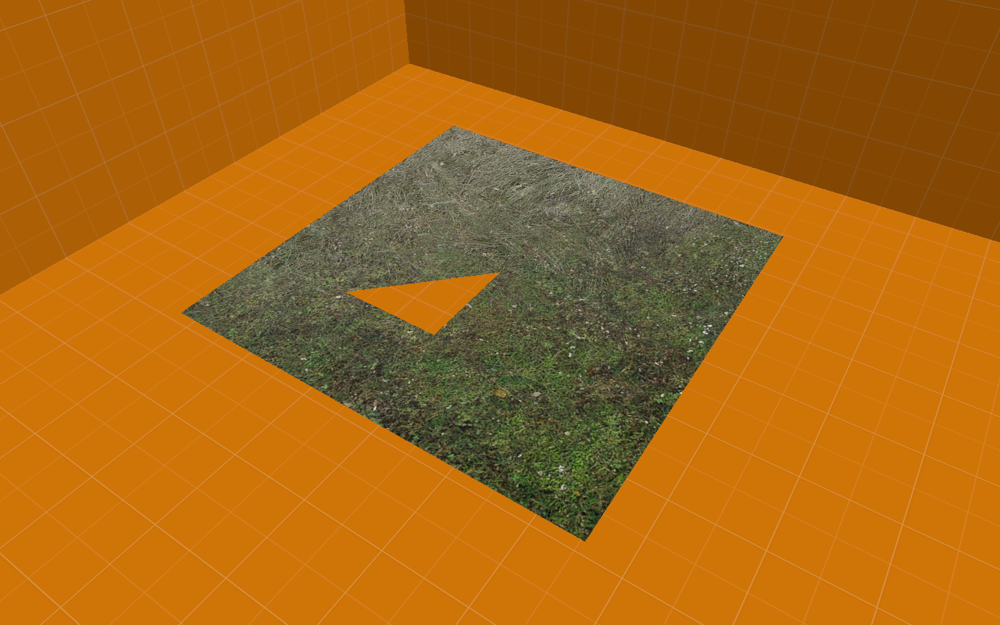

Removal creates native terrain patches around the selected triangles. Retained
surface positions, materials, UVs and triangle classes stay fixed; borders remain
open. Selecting every triangle deletes its parent brush. Removing the final brush
of a brush entity is refused. **Remove terrain** instead restores the parent's
solid volume.

The list keeps original source IDs while the viewport shows the retained patches.
Source outlines are hidden during removal preview. **Pick triangle in viewport…**,
**Frame selected** and **Select in volume** discard this dialog's removal draft
before using source geometry. Failed requests preserve the last valid draft.
A stale draft cannot be applied; **Discard preview** and **Cancel** remain available.

Removal accepts 1–16 world or `func_detail` faces at powers 2–4, with one terrain
face per parent brush. It retiles each complete retained cell into four power-2
patches and a cell with one retained triangle into three. The shared operation
limit is 128 patches, 5,184 vertices and 8,192 triangles, including required neighbor
partitions. Removing one triangle from a power-2 source creates 63 patches; the
same small hole in power 3 would need 255 and exceeds the current limit.
Native geometry, materials, LOD, contacts and metadata must pass the shared checks.

## Control border shading

1. Choose **Edit terrain… → Operation → Border smoothing**.
2. Select **Automatic**, **Hard borders** or **Angle limit**.
3. For Angle limit, set **Maximum angle · degrees** from 0 to 180.
4. Click **Preview**, then **Apply** or **Cancel**.

Full edges, half edges and corner-only joins use the same area-weighted shading
in the viewport and with **Terrain lighting normals → Authored smoothing** in
the compiler. Both surfaces must permit smoothing; the smaller
angle limit applies. Mixed grids also check samples between common border
vertices. Their shared field continues across coarse and fine triangles.
**Detail · per-fragment** lighting uses that field. **Fast · vertex** lighting
remains an approximation. Heights and collision geometry stay fixed.

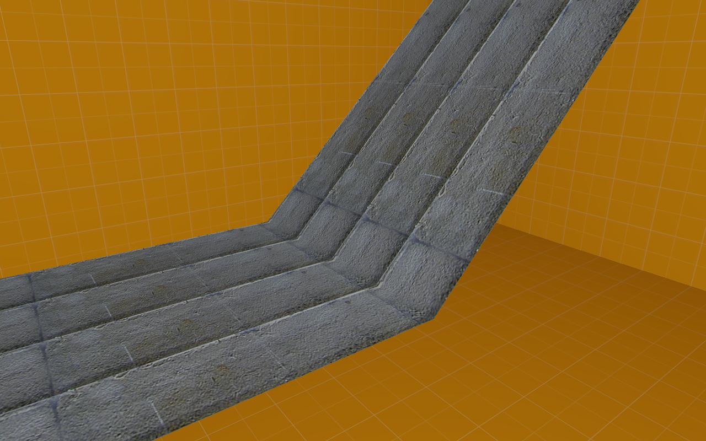

Automatic:

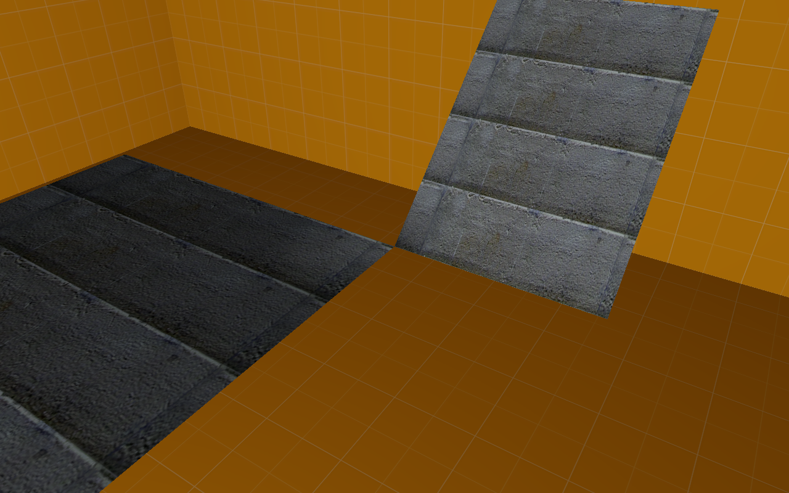

Hard borders:

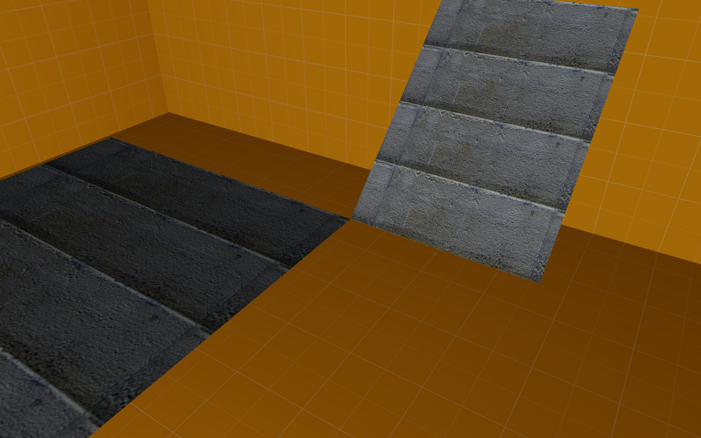

Border shading is separate from height smoothing and brush smoothing.
Conflicting or cancelling border support stops preparation.

> [!NOTE]
> These controls affect HammeRR previews and baked lighting with **Authored smoothing**.
> **Native client normals** uses fixed native load normal inputs for unbumped
> baked terrain and ignores these authored border choices. The checked CS:S
> Linux client uses fixed runtime normal and tangent smoothing; the BSP angle
> field does not control that process. See [Terrain lighting normals](compile-and-play.md#terrain-lighting-normals).

## Compile split borders

Use matching full edges or exact whole-to-half borders. Keep common coarse heights aligned.
Choose **Direct LDR** and **CS:S engine physics** in **Build settings…**, then compile.
Inspect **Half-edge pairs**, **Mixed-power pairs** and diagnostics in **Build details…**.

Compiled LOD snapping can reduce detail near coarse neighbors. Source grids remain unchanged.
Saved explicit grids can compile through supported multilevel full/half chains without running base-cage subdivision.

### Native neighbor matching

Compilation and the viewport compare stored base-edge coordinates per axis,
within 0.01 units. Half-edge matches must agree from both surfaces. Ambiguous
or order-dependent matches stop preparation. Corner-only links compare actual
displaced corners within 0.001 units. Shared samples must also pass the surface
checks. These rules do not move authored samples or base cages.

Clipping, carving, triangle removal and subdivision need matching exact and
native topology in the affected context. Align the parent base corners before
these edits. **Sew borders & corners** repairs displaced borders, not base gaps.
The checked context can include up to 128 neighboring faces.

## Compile terrain as detail

Create terrain on world parents first. Select the parents, then use **Tie to entity… → func_detail**.
Consumed detail helpers contribute world terrain. Runtime brush-model terrain remains unsupported.

## Preview authored lighting

1. Choose **Textured** in the viewport header.
2. Open **Overlays** and enable **Unshadowed authored lighting**.
3. Set **Quality** to **Detail · per-fragment** for local light pools.

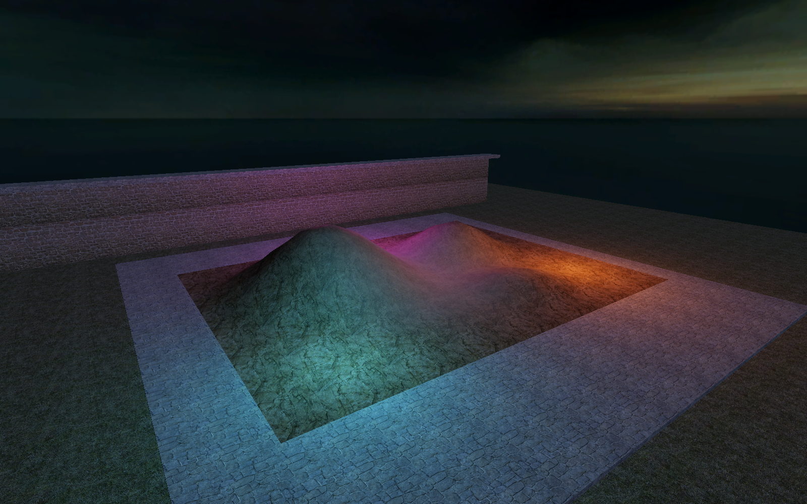
Supported opaque single-base terrain and plain unbumped two-base
`WorldVertexTransition` terrain receive this preview. Both declared static 2D
color textures must be available. Vertex paint blends the bases before the same
shared lighting calculation. Base display overrides, material texture transforms, bump maps,
detail layers, blend modulation, proxies and translucent effects remain excluded.
See [lighting preview](lighting-preview.md).

## Mirror or shear terrain

1. Select the terrain's parent brush, or its child brush inside a detail entity.
2. Expand **Transform**. Choose **Mirror** or **Shear**.
3. Set the axes, pivot and texture option. For shear, set **Factor**.
4. Click **Mirror selection** or **Shear selection**.

Grid samples, blend weights and triangle classifications follow the geometry.
Odd mirrors transpose the grid while keeping the transformed start corner.
Requery vertex and triangle IDs after the edit. **Undo** restores the original.
Rebind terrain attachments if the changed grid order makes them unavailable.
Unknown displacement payloads stop odd mirrors when their indices cannot be remapped.

## Split on the existing grid

Use [plane clipping](brush-tools.md#cut-terrain-on-its-existing-grid) to split a
power-3/4 world or `func_detail` patch at a complete middle grid line without resampling.
Power 4 also permits quarter-grid lines, with mixed power-2/3 output patches.
Matching neighbor borders are checked, including supported visible map instances.
Their child files remain unchanged. Unselected coarsened neighbors need identical
native LOD state. Selected and output coarsening must preserve mapped masks, fine
collision and maximal render geometry. Save a new parent before cutting.
For `func_detail`, select individual children in **Solids** mode or their whole
entity. The cut retains the owner and unselected siblings.

For quarter-grid joins, select the required noncrossing power-3/4 neighbors and
enable **Partition selected neighbors** under **Existing grid**. The default-off
option refines only required regions down to native power 2 within the shared
limits: one level for power 3 and up to two for power 4. The preview counts cut
brushes and partitioned neighbors separately. Unselected and unrelated terrain
stay unchanged; missing selection or insufficient native power rejects the
complete request.
All terrain cut modes accept valid ten-word VMF vertex caches and reset present
caches only on new patches. Native LOD masks remain guarded.

Choose [**Retile grid cells**](brush-tools.md#retile-grid-cells) to cut curved
terrain at any complete original row or column, including power 2. It refines
whole cells and supports curved height and non-affine interior tangential warps
on exact planar bases, including qualified tilted bases. The base cage must be
rectangular in its exact base-plane coordinate chart.
Original projected borders may form simple convex or concave polygons.
Connected originals need the same exact base chart and orientation. Complete footprint
checks must preserve the native contacts and complete shared seam polylines.
Output patches retain straight, strictly ordered convex quad projections.
Local cell and normal checks can still reject the cut.
Folded projections, self-intersecting borders, overlap, extra unsewn contacts and
unsupported degenerate contacts reject.
Native geometry, piecewise raw/native paint fields and labels must remain exact.
Curved source/output LOD can qualify when changed maximal triangles match every
fine triangle field with positive base-area overlap. Different local maps are
allowed when overlapping fields agree exactly. Other regions may stay curved.
The source and all outputs need constant paint and uniform labels when any uses LOD.
**Both sides** and whole-neighbor partitions require whole equivalence when coarsened.
A one-sided source can also use strictly discarded coarsening.
Unchanged curved neighbors can retain a certified corner, or an old edge contact
can be fully severed. They must share the exact base chart and orientation.
Native contact checks cover complete seam polylines. Normal checks still apply.
Their authored grids
stay unchanged. To retain a full original edge, select the required noncrossing
neighbor and enable **Partition selected neighbors**. This explicitly retiles the
entire neighbor: one power-2 patch per old cell in **Retile grid cells**, four in
**Retile surface triangles**. Partial edges, incompatible density, uncertified LOD
and output limits can still reject; corner-only, severed and unrelated neighbors
stay unchanged. Normals and runtime LOD are regenerated for the new patches.
Coarsened unchanged neighbors need whole geometric equivalence and identical LOD state.
[**Retile flat terrain**](brush-tools.md#retile-flat-terrain) supports non-grid
cuts on eligible planar surfaces, including tilted base cages and affine
tangential offsets. Joined planar patches can have different slopes on a common
planar base, including tilted bases, when they share one exact coordinate
projection with exact native contacts and certified normals.
Flat source or output LOD may qualify with constant paint, uniform labels and exact
LOD checks. The proof covers the source and all its outputs.
Unchanged neighbors keep their full LOD state.
Choose [**Retile surface triangles**](brush-tools.md#cut-through-curved-cells)
to cut through curved cells while preserving their original triangle surfaces.
It accepts convex cages in the exact chart of its planar base, including qualified
tilted bases. Native geometry and normal checks still apply.
Under **Blend samples**, **Exact fields** preserves raw and native packed paint
fields, including representable fractional samples. **Native float** and
**Nearest byte** explicitly permit bounded error in inserted samples. The preview
reports the selected policy, actual per-cut raw/native error bounds and limits.
Geometry, UVs and collision classifications remain exact.

## Inspect native terrain vectors

Read the final terrain positions, normals and tangents from a private CS:S run.
This does not change the map or replace HammeRR lighting.

1. Compile the map.
2. Open **Build → Native terrain…**.
3. Click **Prepare**. Keep Steam open while the capture runs.
4. Select a terrain patch, then a vertex.
5. Click **Frame** to locate it. Click **Show vector guide** to show its normal and tangents.

The inspector retains the exact 32-bit values. Zero and nonfinite vectors have
explicit states and no substitute direction. Guide lengths are for display;
the reported values remain unchanged.


The normal is cyan. Tangent S is red. Tangent T is green.

### Compare an offline basis prediction

Predict positions, normals and tangents from the exact retained BSP, then compare
every sample with the independent observed catalog.

1. Prepare an observation in **Build → Native terrain…**.
2. Open the **Offline comparison** tab.
3. Under **Selected predictive arithmetic**, choose **Position rounding** and
   **Basis rounding**. Set **Flush subnormal results to zero (FTZ)** and
   **Treat subnormal inputs as zero (DAZ)** explicitly.
4. Click **Compare all**. Read the complete-catalog exact and mismatch counts,
   per-field maximum errors and the result's CPU/FP profile.
5. Expand **Displacements** and **Vertices**, then select a patch and vertex.
   Under **Compared values**, choose **Field** to
   inspect **Position**, **Normal**, **Tangent S** or **Tangent T**. Observed and
   predicted values retain separate raw bits, with per-axis equality, absolute
   error and ULP distance.
6. Use **Cancel comparison** to stop computation or **Clear comparison** to
   release the prediction. The observed catalog remains available in **Observation**.

Prediction uses the worker's recorded CPU and RSQRTSS behavior. The selected
arithmetic does not establish the observed game's generation-time FP state.
Mismatches remain diagnostics; the inspector does not substitute predicted
vectors into the observed catalog, HammeRR lighting or the map. **Frame** and
vector guides continue to use observed values.

### Inspect CPU topology

Read the actual native triangle indices and vertex masks from the same observed
snapshot. Compare them with the independently compiled BSP.

1. Prepare an observation in **Build → Native terrain…**.
2. Open the **Topology** tab. Expand **Displacements** and select a patch.
3. Read **CPU topology** for the vertex base, index and triangle counts, active
   grid vertices and explicit compiled comparison results.
4. Expand **Raw vertex masks** to inspect the observed active and allowed words
   beside the compiled allowed words. The counts include all 320 stored bits;
   the active grid-vertex count uses only valid sample slots.
5. Select a row under **Triangles**. Use **Previous triangles** and **Next triangles**
   to page the observed index list. **Selected triangle** shows global and local
   indices, compiled local indices and the observed vertex positions.
6. Click **Frame triangle** to locate it. Click **Show triangle guide** to outline
   the actual triangle. Use **Hide guide** or **Clear guide** to remove the display.

One vector or triangle guide can be displayed at a time. Historical topology
remains readable; triangle framing and guide display require a current snapshot.
Mask differences and ordered triangle mismatches remain visible.

> [!NOTE]
> These values describe observed CPU storage at the capture boundary. They do
> not attest a GPU draw, a completed frame or later runtime LOD changes. A compiled
> source contributor does not identify an authored triangle.

> [!NOTE]
> Native inspection requires the supported Linux64 CS:S build and Steam.
> It reads the complete compiled LDR terrain catalog at load completion. It does
> not measure shader output, later LOD frames or player contact. Editing the map,
> changing a consumed source or starting an edit preview can hide the guide.
> Historical rows remain readable; framing requires a current snapshot.

<a id="observe-passive-player-support"></a>

## Observe player support

Read a fresh player's native movement, actual hull and ground owner. Choose idle,
forward or crouch input. Add a diagnostic hull sweep when needed.

1. Save and compile a map with a spawn for the required team.
2. Open **Build → Player support…**.
3. Expand **Observation settings**. Choose **Team** and **Input**. Set
   **Duration**, **Sample interval** and **Sample limit**.
4. To add sweeps, select **Probe movement hull** and set **Probe distance**
   from 1 to 128 world units. Each probe sweeps downward along world Z from the
   observed origin.
5. Click **Start**. Keep Steam open until the observation finishes. Rows are
   accepted only after the private game acknowledges the selected input.
6. Expand **Samples** and select a row. Use **Previous** and **Next** to change
   the page. Inspect **Movement hull** for actual bounds, **Ducked** state and
   the separate raw duck flag. Expand **Movement** or **Support** for more values.
7. Read **Diagnostic sweep** for its status, fraction and solid flags. Expand
   **Sweep details** for endpoints and any valid plane, surface property or hit owner.
8. Click **Frame sample** to locate the row. Click **Show sample guide** for its
   observed hull, trajectory and optional sweep. Use **Hide guide** or **Clear guide**
   to remove the display.
9. Click **Cancel** to stop an observation or **Clear** to release its rows and
   guide. **Close** keeps the observation and guide.

Duration and sample interval use native simulation time. The engine chooses a
matching team spawn. Each row reports the actual origin and acknowledged input.
Pressed crouch and the completed **Ducked** pose can differ during a transition.
The movement hull comes from the actual native movement getter.

A ground owner and the raw on-ground flag are separate values. Without a ground
owner, surface values are labelled **Cached surface (previous support)**.
**Movement friction** is the player's cached factor, not a raw physics coefficient.
**Sweep details** reports the hit surface's raw **Physics friction coefficient**.

### Inspect linear mover support

Record a supported platform's actual state when it is the player's native ground
owner. The observer finds matching movers automatically; no new setting is needed.

1. Save and compile a map with an unparented `func_movelinear` platform.
2. Run a player-support observation. Select a row and expand **Support**.
3. Check **Ground kind**. For a declared mover, read **Compiled declaration**
   and the **Native model index (independent)**.
4. Expand **Support pose and velocity** for actual local and absolute positions,
   angles and velocities. Expand **Raw support state** for move/solid fields,
   parent handle and runtime OBB. The sample guide shows the player's hull and route.

World rows have no mover pose or velocity fields. Rows without a ground owner
have no current mover telemetry; their surface values remain explicitly cached.
A mover classname does not prove motion. Use the sampled pose and velocity values.

> [!NOTE]
> Requires the supported Linux64 CS:S build and Steam. Input goes to the fresh
> private game. A diagnostic sweep does not prove actual contact or traversal.
> Its endpoint is the hull reference position, not a contact point. Surface names
> identify checked surface properties; collision surface strings remain unavailable.
> Hit owners do not identify authored faces or terrain triangles. Historical rows
> remain readable; framing and guides require a current compiled map.
> Mover support is limited to exact BSP-declared, unparented `func_movelinear`
> entities. The entity/model-name association does not measure a collision-body
> identity or prove continuous carrying, contact geometry or collision fidelity.

## Remove terrain

Select terrain faces, then click **Remove terrain**. Undo restores the complete grid.
Removing the last terrain face restores its parent's solid brush volume.

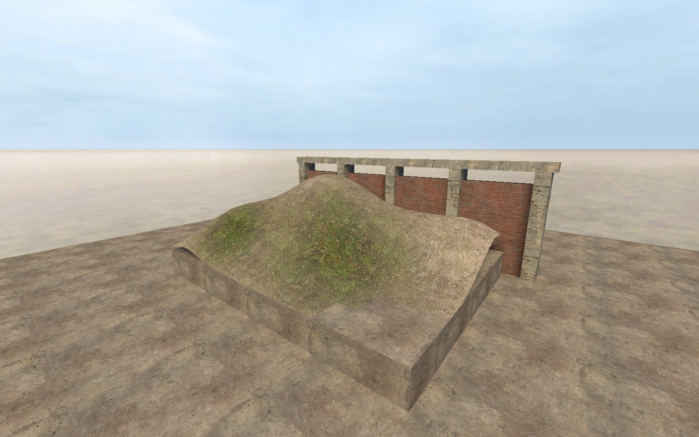

## Limits

- Most edits accept 1–16 faces at powers 2–4. Creation needs one world quad per parent.
- Radius: 1–8192 units. Height/noise change: ±4096. Coordinates: ±65536.
- Strokes accept 512 samples and 4096 input points within a shared work budget.
- Subdivision rejects inconsistent densities, ambiguous contacts, corner-only networks and work beyond its checked budget.
- Unsupported caches, malformed rows and nonfinite data reject before applying changes.
- Masks are session-local and become stale after incompatible topology or source changes.
- Triangle removal retiles whole retained cells within the shared 128-patch limit; small holes in larger grids can exceed it.
- General fractional border joins remain unavailable.
- Displacement grids compile as world terrain. Use ordinary brush or model geometry for moving entities.
- Invalid terrain shows a diagnostic and an outline instead of substituted shaded geometry.

<!-- page-nav -->

---

[← Repeated placement](repeated-placement.md) · [Manual](README.md) · [Merge brushes →](merge.md)
