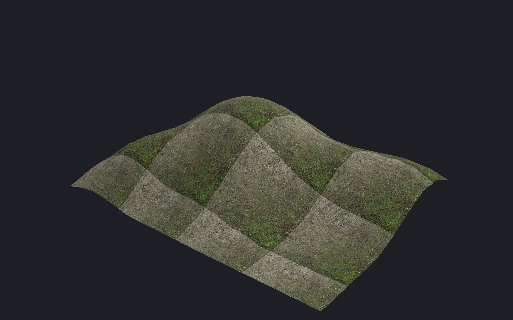
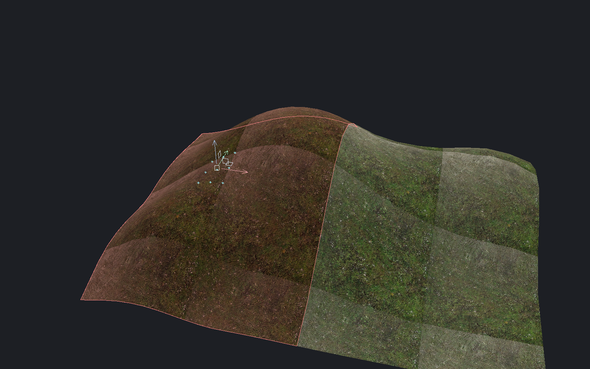
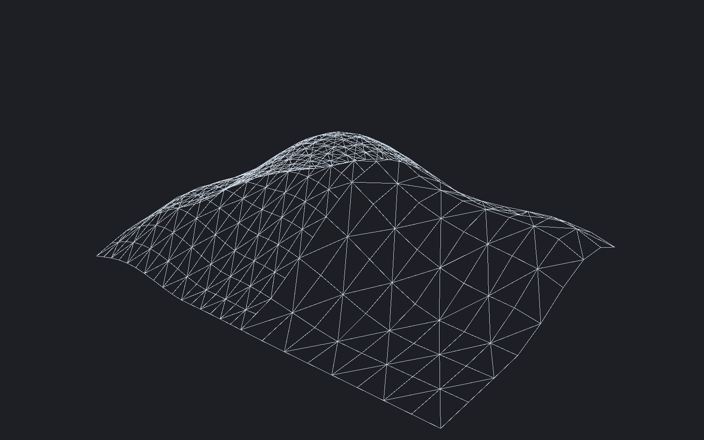

[← Manual](README.md)

# Terrain

Create, sculpt and paint displacement surfaces. Compile them with lighting and collision.

## Create terrain

1. Select world quad faces under **Selection → Faces · materials & textures**.
2. Choose **Terrain grid**: 5 × 5, 9 × 9 or 17 × 17.
3. Choose **Start corner** to set grid orientation.
4. Click **Create terrain**.
5. Use **Browse materials…** to change the surface material.

Terrain is a sheet. Its parent volume does not seal the map or become a solid collision box.
Use ordinary world brushes to seal playable areas.

## Sculpt heights

1. Select terrain faces and click **Edit terrain…**.
2. Choose **Raise / lower**, **Flatten**, **Smooth** or **Noise** under **Operation**.
3. Set **Brush center · world coordinates**, or use **Pick center in viewport…**.
4. Set **Brush direction**, **Radius · world units** and the operation's amount or strength.
5. Click **Preview**.
6. Inspect the shape, then click **Apply** or **Cancel**.



Flatten targets the plane through the brush center. Smooth uses neighboring samples.
Noise repeats with the same source and seed.

## Paint blends

1. Apply a supported two-base blend material.
2. Open **Edit terrain…** and choose **Paint blend**.
3. Set the brush center, radius, strength and blend value.
4. Click **Preview**, then **Apply**.


Blend values run from 0 to 255. **Fill blend** changes the complete selected scope.
**Invert blend** reverses its values.

## Draw a stroke

1. Choose a sculpting or blend operation in **Edit terrain…**.
2. Set the brush controls.
3. Click **Draw stroke in viewport…**.
4. Drag over visible selected terrain.
5. Release, inspect the draft, then click **Apply** or **Cancel**.

The white circle shows the radius. Leaving the surface breaks the path.
Escape or **Cancel stroke** discards the owned stroke.

## Select vertices and triangles

1. Open **Terrain triangles…** for selected terrain faces.
2. Choose **Selection type** and **Surface**.
3. Check IDs, or use **Pick vertex in viewport…** or **Pick triangle in viewport…**.
4. Use **Frame selected** to inspect the selection.
5. Click **Use selection** to retain a vertex mask.
6. Enable **Affect only selected terrain vertices** in **Edit terrain…**.



Triangle masks include all three vertices. Explicit vertex masks include only checked samples.
Use **Select a volume… → Preview matches**, then **Select in volume**, for a box selection.

For exact movement:

1. Retain a mask with **Use selection**.
2. Open **Edit terrain… → Operation → Move selected vertices**.
3. Enter **World offset · units**, then click **Preview** and **Apply**.

For dragging, click **Move with handles…** in the same operation.
Review the displacement before applying. **Undo** restores the previous grid.

## Set exact vertex heights

1. Open **Terrain triangles…** for the selected terrain faces.
2. Choose **Vertices · exact positions & brush masks** under **Selection type**.
3. Check the vertices to change.
4. Enter **Set checked vertices to world Z · units** and click **Preview height**.
5. Inspect the terrain and **World** coordinates, then click **Apply** or **Cancel**.

X and Y stay fixed. To supply different heights, enter **Height CSV file path**
and click **Preview CSV**. Use the exact header and native vertex IDs:

```csv
solid,side,vertex,z
12,72,0,-12.5
12,72,7,8191.25
```

CSV rows choose vertices within the dialog's captured faces; checkboxes do not
limit them. Edits preserve the viewport highlight. Failed input preserves the
last valid preview. Supply matching border heights to keep a seam joined.
Limits: 16 faces, 289 vertices per face, 512 KiB per CSV file, coordinates within
±65536 units. No interpolation or automatic sewing occurs.

## Change grid resolution

1. Open **Edit terrain…** and choose **Grid resolution**.
2. Choose 5 × 5, 9 × 9 or 17 × 17.
3. Click **Preview**, then **Apply** or **Cancel**.



Finer grids retain existing samples. Coarser grids can lose detail.
Mixed triangle tags, restricted masks and unsupported caches can prevent resizing.

## Subdivide connected terrain

1. Select terrain on the base faces to round.
2. Choose **Edit terrain… → Operation → Subdivide base cage**.
3. Click **Preview**, then **Apply** or **Cancel**.

Subdivision replaces sculpted positions with a rounded base-cage surface.
Unmatched outer edges stay fixed. Exact full and whole-to-half edges can join.
The authoring operation supports at most two cage densities per connected component.

## Sew borders and corners

1. Select adjacent terrain faces.
2. Choose **Edit terrain… → Operation → Sew borders & corners**.
3. Enable **Also sew blend values** if required.
4. Click **Preview**, then **Apply** or **Cancel**.

Shared borders and corners average their original positions. Fine border points follow the coarse edge.
Interior samples stay fixed. Sewing can remove fine border detail.

## Collision and triangle classes

1. Choose **Edit terrain… → Operation → Collision**.
2. Set **Physics collision**, **Player collision** and **Ray collision**.
3. Click **Preview**, then **Apply** or **Cancel**.

For triangle classes, open **Terrain triangles…**, select IDs, and set **Walkability** and **Buildability**.
These classes do not disable collision or create holes.

## Control border shading

1. Choose **Edit terrain… → Operation → Border smoothing**.
2. Select **Automatic**, **Hard borders** or **Angle limit**.
3. For Angle limit, set **Maximum angle · degrees** from 0 to 180.
4. Click **Preview**, then **Apply** or **Cancel**.

This changes border normals, not heights. It is separate from height smoothing and brush smoothing.

## Compile split borders

Use matching full edges or exact whole-to-half borders. Keep common coarse heights aligned.
Choose **Direct LDR** and **CS:S engine physics** in **Build settings…**, then compile.
Inspect **Half-edge pairs**, **Mixed-power pairs** and diagnostics in **Build details…**.

Compiled LOD snapping can reduce detail near coarse neighbors. Source grids remain unchanged.
Saved explicit grids can compile through supported multilevel full/half chains without running base-cage subdivision.

## Compile terrain as detail

Create terrain on world parents first. Select the parents, then use **Tie to entity… → func_detail**.
Consumed detail helpers contribute world terrain. Runtime brush-model terrain remains unsupported.

## Preview authored lighting

Choose **Textured** and enable **Unshadowed authored lighting**.
**Detail · per-fragment lighting** shows local pools more accurately than Fast vertex lighting.
Only supported opaque, single-base terrain receives this preview; blends and bump/detail materials are excluded.
See [lighting preview](lighting-preview.md).

## Remove terrain

Select terrain faces, then click **Remove terrain**. Undo restores the complete grid.
Removing the last terrain face restores its parent's solid brush volume.


## Limits

- Most edits accept 1–16 faces at powers 2–4. Creation needs one world quad per parent.
- Radius: 1–8192 units. Height/noise change: ±4096. Coordinates: ±65536.
- Strokes accept 512 samples and 4096 input points within a shared work budget.
- Unsupported caches, malformed rows and nonfinite data reject before applying changes.
- Masks are session-local and become stale after incompatible topology or source changes.
- Holes, triangle removal and general fractional border joins remain unavailable.
- Invalid terrain shows a diagnostic and an outline instead of substituted shaded geometry.
