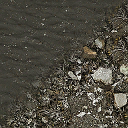
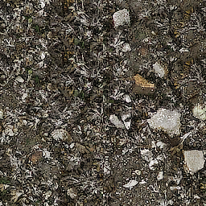

[← Manual](README.md)

# Materials and textures

Apply materials and control their placement on brush faces.

## Apply a material

1. Choose **Selection → Faces · materials & textures**.
2. Select faces. Use Ctrl+click to toggle a face.
3. Click **Browse materials…**.
4. Search, or choose a folder or category.
5. Select a thumbnail, then click **Use material**.
6. Click **Apply** in the inspector.

**Cancel** preserves the previous choice. Object mode applies the material to complete brushes.
The browser includes **Used in this map**, **Recently applied** and **Favorites**.

Use **Winning VMT source** to filter by the directory or VPK that supplies each
material. **Exclude maps/ materials** hides all `maps/` paths, including authored
ones. A lower-priority source does not reveal a shadowed copy.
Source labels describe the current VMT lookup. Cached preview pixels do not
carry physical-source provenance; use **Reload material assets** after changes.

## Explore material names and shaders

1. Open **Browse materials…** and enter the material-name query.
2. Choose **Name match → Substring**, **Prefix** or **Regex**. Prefix starts at the beginning of the material path. Regex supports expressions such as `^nature/blend.*(grass|dirt)`.
3. Optionally enter an exact **Shader**, such as `WorldVertexTransition` or `Water`. Leave it blank for all shaders.
4. Combine these choices with **Winning VMT source**, **Exclude maps/ materials**, folders, categories, used materials or favorites.
5. Read **Shader scan** while the browser classifies declarations in bounded batches. The scan continues while the browser is visible; counts and pages show confirmed matches so far.
6. Check unavailable-material errors before relying on the complete results. Repair sources and choose **Reload material assets** to retry them.

Name matching is case-insensitive by default. Regex uses the Rust regex syntax, including anchors, character classes and alternation; backreferences and look-around are unsupported. Invalid or over-budget patterns show an error. Queries are limited to 256 bytes, regex nesting to 32, and compiled-expression/DFA memory to 1 MiB each.

Shader matching resolves Patch includes through the same material loader as the editor. Each scan step attempts at most 128 materials and reads at most 16 MiB, with existing per-file and include limits. A completed scan can still report unavailable declarations; these are not assumed to match. Shader declarations and their original VMT identities stay cached until **Reload material assets**. The current source labels remain separate from that cached declaration and the preview pixels.

The scan reports the first 16 failures and the full failure count. Narrow the name or source filter to inspect further failures. The shader cache holds at most 250,000 entries and 64 MiB of text; an exceeded budget reports an error. Narrow the query and reload before retrying.

See [material source](material-source.md#inspect-image-layers-and-alpha) to inspect either blend image and its alpha channel before applying a material.

| Default display image | Actual second blend image |
| --- | --- |
|  |  |

## Edit face textures

1. Select faces and open **Edit face textures…**.
2. Set offsets, scale, rotation, fit, justification or alignment.
3. Click **Preview textures**.
4. Inspect the result, then click **Apply textures**.

Blank mixed fields preserve each face's value. Fit uses the material's actual image size.
For direct projection control, enable **Advanced U/V world vectors** under **Edit texture settings**.
See [atlas-region texturing](atlas-texturing.md) for padded pixel rectangles fitted independently or continuously across coplanar faces.

## Sample and wrap

1. Select one face and click **Sample face texture**.
2. Select target faces and open **Edit face textures…**.
3. Choose **Paint sampled material**, **Copy sampled projection**, **Wrap across a shared edge** or **Wrap connected faces**.
4. Preview, then apply.

Connected wrapping accepts up to 256 target faces. Disconnected or inconsistent closed chains reject.
Terrain is excluded from wrapping.

## Paint a stroke

1. Sample a face, then choose **Paint texture** in the tool rail.
2. Choose **Material only** or **Copy projection**.
3. Set **Radius** and drag over visible faces.
4. Release to apply the stroke.

Escape or **Cancel** discards the stroke. Each face is painted once per stroke.
Sampling another face cancels an open stroke.

## Vary texture offsets

1. Open **Edit face textures… → Vary texture offsets**.
2. Enter **Seed** and **Maximum shift · texels** for U and V.
3. Click **Preview variation**, then **Apply textures**.

The same seed and source reproduce the same offsets. Applying again adds another shift.

## Map faces together

1. Open **Map textures together…** for the selected faces.
2. Choose **Fit faces together** or **Project along current view**.
3. Choose a material and tile counts.
4. Click **Preview mapping**, then **Apply mapping**.

Grouped fitting requires coplanar faces. View projection rejects edge-on faces.

## Replace a material

1. Open **Replace materials…**.
2. Choose the source material and search scope.
3. Click **Find faces**.
4. Optionally enable **Include hidden faces**.
5. Choose the replacement.
6. Click **Preview replacement**, then **Replace faces**.

Texture placement and face lighting remain unchanged. Source changes require another search.

## Face lighting

1. Select faces and open **Face lighting…**.
2. Set lightmap scale and smoothing groups.
3. Click **Preview settings**, then **Apply settings**.

Smaller lightmap scale adds samples and increases build work.
Faces that share a smoothing group can blend corner normals.
For unassigned faces, set **Brush smoothing angle** in **Build settings…**; 0° keeps them flat.

## Reload changed materials

1. Save changed files inside mounted content.
2. Open **Browse materials…**.
3. Click **Reload material assets**.
4. Check unavailable-preview details.
5. Repair reported assets, then reload again.

Reload refreshes thumbnails, viewport textures, model materials and sky faces.
It does not reload model geometry, remount content or refresh a running game.

## Favorites

Use **Add favorite** and **Remove favorite** to save choices.
Use **Reload favorites** after another editor changes the saved list.
A stale or unreadable favorites file rejects writes until it is reloaded or repaired.

## Native texture files

A sampled VTF needs a complete mip chain or the `NOMIP` flag for native compilation and packing.
Errors name the material or texture. Correct the source VTF, then compile again.
Editor-only `%tooltexture` images can use only their stored levels.

## Limits

- A missing or broken chosen texture shows an explicit error and missing-texture display.
- Tool and untextured materials can be valid without a display image.
- Materials can use an intentional editor image that differs from the native shader.
- The viewport does not simulate every shader effect. See [normal maps](normal-maps.md) and [material source](material-source.md).
- Reload ends affected paint, area and volume selection gestures. Start a new gesture afterward.
- Favorites are limited to 512 entries. Recent materials last for the current session.
