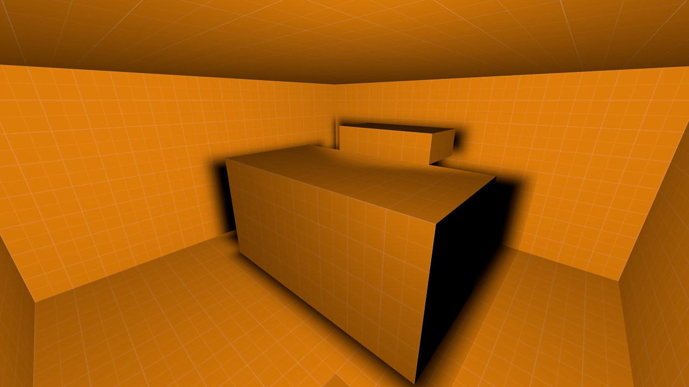

[← Manual](README.md)

# Materials and textures

Most texture tools work on faces. Set **Selection** to **Faces · materials & textures**, then click faces (Ctrl+click toggles). In **Objects** mode, the material controls apply to whole brushes.

## Apply a material

Type a material name in the inspector or click **Browse materials…**, then click **Apply**.

### Material browser

The browser shows thumbnails in pages with a larger preview, search, and groups by folder and category (inferred from the material's path). It also lists the materials **Used in this map**, **Recently applied** and **Favorites**.

Click a thumbnail to preview it, then **Use material**. **Cancel** keeps the previous choice.

The selected preview reports material syntax, patch-include and texture-read
errors. A broken preferred editor texture is reported rather than replaced with
another image. **Check map… → Run checks** identifies affected faces. Repair
the asset, use **Reload material assets**, then rerun checks.

A content-directory read failure shows **Material catalog unavailable** and
clears the old choices. Repair the directory or link, then edit the search field
to retry. A failed scan is not saved as an empty catalog.

- Favorites are saved across sessions and shared with agents, up to 512.
- Recently applied materials last for the current session.

### Keep favorites in sync

1. Select a material and click **Add favorite** or **Remove favorite**.
2. If another editor changed the saved favorites, click **Reload favorites**. Review the updated **Favorites** group, then repeat the intended change.
3. If storage is unreadable or malformed, repair it and click **Reload favorites** again. The previous local favorites stay available until a valid list loads.

Favorites reload independently of **Reload material assets**. Reload refreshes
badges and counts in shared material browsers without changing the selected
material, map, camera, Undo history or active draft. Files are read only on
startup or explicit Reload; other editors' changes are never merged silently.
Persistent writes refuse a stale saved file and use a nonblocking Linux lock.
A busy lock can be retried after the other writer finishes. Without configured
storage, favorites remain session-only and **Reload favorites** is unavailable.

## Reload changed materials

Refresh edited VMT/VTF files without reopening the map.

1. Save the changed material or texture files in content already mounted by the editor.
2. Click **Browse materials…** to open the material picker, then **Reload material assets**.
3. Review the reload summary and any unavailable-preview details. Thumbnails, viewport textures, model textures and cached sky faces refresh, and the catalog includes added or removed material names. Cached models repeat their material search, so newly added preferred VMTs, missing-material repairs and deleted paths update in the viewport and isolated model browser too.
4. Repair any reported asset files and click **Reload material assets** again. Use **Check map… → Run checks** or **Compile** to check their effect on the map.

The report retains the first 100 unavailable-preview details and the full count.
An unavailable preview does not by itself mean a material is invalid for
compilation: valid tool or untextured materials can have no display texture.
Unreadable display assets replace stale images with the missing-texture fallback.

Reload leaves map data, selection, camera, Undo history and draft geometry
unchanged. View-dependent review guards can require another review before Apply.
It refreshes cached materials and the catalog through existing mounts; it does
not watch files, remount content or archives, reload model geometry or particles,
or refresh a running game's asset cache. Model material lookup uses the cached
MDL texture names and directory order, then its existing bare-name candidate.
Changed MDL names or directories still require **Reload models**. Geometry,
bounds, picking and attachment data stay decoded and shared during material
reload. A material-search read or work-limit failure exposes the model path and
error, replaces its old bindings with missing textures, and preserves the mesh.
The report includes refreshed and changed model-material set counts. Cached
material IDs remain stable, so unavailable historical paths can remain listed
even after a model switches to a different existing candidate.

## Edit face textures

**Edit face textures…** controls offsets, scale and rotation, fitting one tile to the face, justification (left/center/right, top/center/bottom), and alignment (**Keep current axes**, **Align to world**, **Align to face**). Click **Preview textures**, then **Apply textures**.

- When the selected faces have different values, blank fields leave each face's value alone.
- Fitting uses the material's real size.

Use **Fit atlas region…** in the same window to fit faces into a pixel rectangle
of the material image. See [Atlas-region texturing](atlas-texturing.md).

For surface detail under editor shading, see [Normal-map preview](normal-maps.md).

## Set U/V vectors and skew

Set the texture projection directly without changing the face geometry.

1. Select the faces and open **Edit face textures…**.
2. Choose **Edit texture settings** and enable **Advanced U/V world vectors**.
3. Enter the world X, Y and Z components in the **U** and **V** rows. Common values are shown; mixed components are blank. Leave a component blank to keep each face's current value. For example, on a horizontal face, **U** = `1, 0.5, 0` and **V** = `0, -1, 0` adds skew.
4. Keep or edit **Offset · texture pixels** and **Scale · world units per texture pixel**. Each texture coordinate is `dot(world position, vector) / scale + offset`; vector magnitudes are kept, so a longer vector increases repetition at the same scale.
5. Click **Preview textures** and review the viewport. Click **Apply textures** to keep exactly that preview in one Undo step. Editing a field requires another preview. **Cancel**, Escape or closing the window discards the draft.

Limits: both vectors must be finite and produce a nonzero, nonsingular projection on every selected face. Zero vectors, nearly parallel projections, edge-on mappings and non-finite texel coordinates are rejected for the whole selection. World and brush-entity faces can share an edit. Vectors are never normalized or replaced with another projection. Direct mode keeps the stored rotation value; **Projection** alignment and **Rotation · degrees** are available when the advanced mode is off. Fitting and placement can still change scale and offsets when explicitly chosen. Terrain keeps its sculpt, blend and other metadata; this edits the base projection. Repeatable random UV variation remains separate.

## Sample and reuse a texture

1. Select one face and click **Sample face texture**.
2. Select the target faces and open **Edit face textures…**.
3. Choose what to do with the sample:
   - **Paint sampled material**: apply only the material.
   - **Copy sampled projection**: apply the material with its texture axes, offsets, scale and rotation.
   - **Wrap across a shared edge**: continue the texture seamlessly onto faces that touch the source.
   - **Wrap connected faces**: carry the texture through a chain of selected faces, folding it at every shared edge, for example around a column.
4. Preview, then Apply.

The sample stays available until you sample again or open another map.

**Wrap connected faces** handles up to 256 target faces and leaves the source face unchanged. If targets are disconnected, or a closed loop can't wrap consistently, it explains why. Terrain is excluded.

| Wrapping controls | Texture continued around a faceted column |
| --- | --- |
|  |  |

## Paint textures

Brush a sampled texture across faces.

1. Sample a face, then choose **Paint texture** in the viewport toolbar.
2. Choose **Material only** to keep each face's texture placement, or **Copy projection** to copy the sample's placement too.
3. Set the **Radius** and drag across visible faces. The toolbar shows how many faces will change.
4. Release, or click **Apply textures**, to apply. Escape or **Cancel** discards the stroke.

- The selection doesn't change.
- Each face is painted once per stroke. Hidden faces and point helpers are skipped.
- A projection that would collapse on a target face is rejected.
- Sampling a new face cancels an open stroke.

## Map one texture across several faces

**Map textures together…** treats a group of faces as one surface:

- **Fit faces together** uses one face's texture direction and fits the texture across the combined area of coplanar faces.
- **Project along current view** projects the texture straight from the camera, with no perspective distortion. Faces seen edge-on are rejected.

Choose a material and the tile counts: **1 × 1** fits one tile across the whole group, **2 × 1** repeats it twice horizontally, and fractions enlarge it. Click **Preview mapping**, then **Apply mapping**. Geometry and lighting settings don't change.

| Grouped mapping controls | One texture fitted across adjoining faces |
| --- | --- |
|  |  |

## Replace a material

1. Open **Replace materials…** and choose the material to find.
2. Search the **Whole map**, **Selected objects** or **Selected faces**.
3. **Find faces** reports the matches and how many hidden faces were skipped. Check **Include hidden faces** to include them. Matching uses the exact material path and ignores case.
4. Optionally click **Select matches**.
5. Choose the replacement, click **Preview replacement**, then **Replace faces**.

Texture placement, lighting settings and hidden flags are preserved. If the map or selection changes, search again before replacing.

## Face lighting

Each face carries two lighting settings that the compiler uses.

Select faces and open **Face lighting…**:

- **Lightmap scale**: world units per lighting pixel. Presets are 8, 16, 32 and 64. Smaller values give sharper lighting and larger lightmaps. A blank field keeps each face's value.
- **Smoothing groups**: toggle groups one at a time, so other memberships stay intact across a mixed selection. Shared groups 1–24 allow smoothing; shared groups 25–32 keep an edge hard. A shared hard group takes priority over a shared smoothing group. **Clear all groups** removes every membership; **Reset group changes** restores the current values.

Click **Preview settings**, then **Apply settings**.

To see the settings, use the **Lightmap density** and **Group membership** views (also available as [viewport modes](basics.md#viewport-modes)).

Direct LDR builds use each face's lightmap scale and assigned smoothing groups on world/detail brushes and rendered brush entities. Terrain uses its own sewn grid normals.

### Bake smooth brush lighting

1. Set **Selection → Faces · materials & textures** and select the adjacent faces that should blend. Ctrl+click toggles faces.
2. Open **Face lighting…**. Give those faces a shared group under **Smoothing groups · 1–24**, such as **1**. Leave unrelated surfaces in different groups.
3. For an edge that should stay sharp, give both adjoining faces a shared **Hard-edge groups · 25–32** group.
4. Click **Preview settings**, then **Apply settings**. **Cancel** leaves the map unchanged.
5. Open **Build settings…**, choose **Build lighting → Direct LDR**, then **Close** and **Compile** or **Run Map**. **Build details…** reports **Brush smoothing**, faces and corners.

Limits: explicitly assigned masks on world/detail brushes and rendered brush entities, with adjacency at matching source vertices and corners landing inside eligible neighboring edges. Unassigned faces keep flat normals when **Brush smoothing angle** is zero. Original fan centers stay fixed when junction points are added. Edge matching uses canonical native positions within 0.000001 world units. The smoothing fan is retained across lightmap subdivision; geometry, texture axes and collision stay fixed. Bump-light maps remain unfinished. Degenerate or backward normals fall back to the geometric face normal. Source allocation shares one cap of four million retained points across all world/model sources and added junctions, native normals at 65,536 entries, and work shares the lighting budget. The viewport's **Group membership** mode shows assignment; compiled shading is viewed in game.

### Smooth a brush model

1. Tie the brushes to a rendered entity, such as `func_brush` or `func_rotating`.
2. Select its faces using **Selection → Faces · materials & textures**.
3. Use **Face lighting…** to assign shared smooth groups or hard-edge groups, then **Preview settings** and **Apply settings**. **Cancel** keeps the original values.
4. Alternatively leave the faces unassigned and set **Brush smoothing angle** in **Build settings…**.
5. Compile with **Build lighting → Direct LDR**. The compiled lightmaps and native corner normals stay attached as the model moves.

Limits: adjacency is isolated within each model, including source edge junctions. Identical local coordinates in separate models do not blend. Original source centers/fans survive lightmap subdivision; sample bias uses geometric normals. Terrain, dynamic relighting, independently rotated initial poses and HDR/prop lightmaps remain separate limits. Materials with `$bumpmap` receive directional maps in compiled Direct LDR output; viewport material previews remain diffuse.

### Smooth by angle

1. Leave the faces without smoothing groups, or select them in **Face lighting…** and use **Clear all groups**, then **Preview settings** and **Apply settings**.
2. Open **Build settings…** and choose **Build lighting → Direct LDR**.
3. Set **Brush smoothing angle** with the degree input or slider. **0°** keeps unassigned faces flat; **45°** is a useful starting point for curved brushes. The range is whole degrees from 0 to 90.
4. Click **Close**, then **Compile** or **Run Map**. **Build details…** shows the captured angle and **Brush smoothing** counts.

Limits: automatic blending requires both neighboring faces within the world/detail scope or one brush model to be unassigned. Assigned smooth/hard groups keep their rules. Matching source vertices, interior edge junctions and retained source fans determine adjacency; each model's local coordinates, the world and terrain are separate. This is a session build setting and does not change VMF groups, selection or undo history. **Fullbright** retains the angle and does no smoothing work. The same native/source/work budgets apply.

| Face lighting controls | Lightmap density on brushes with different scales |
| --- | --- |
|  |  |
