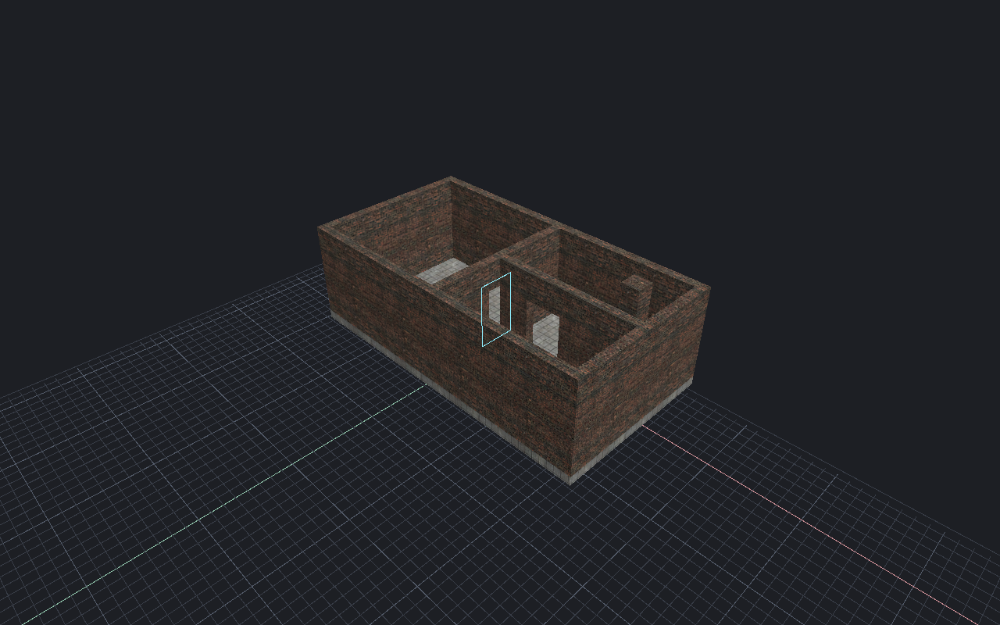
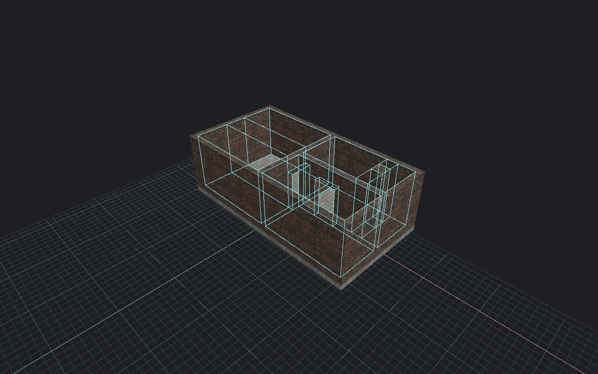

[← Manual](README.md)

# Visibility inspection

Inspect leaves, portals and visibility sets from the last successful build.

1. Open **Build → Build settings…** and choose **Visibility quality → Fast (conservative)**
   or **Detailed (portal clipping)**. Click **Close**, then **Compile**. Open
   **Build details… → Inspect visibility…**.
2. Choose **Target → Summary**. Select a leaf row to inspect its native bounds,
   cluster, visibility area, liquid region and incident portals.
3. Choose **PVS** for potentially visible clusters or **PAS** for potentially audible clusters. Click
   **Inspect target**. Select a destination row to inspect its member leaves.
4. Use **Previous rows**, **Next rows**, **Previous destinations** and
   **Next destinations** to change pages. For a known target, choose **Leaf**,
   **Cluster** or **Portal**, enter its **Ordinal**, then click **Inspect target**.
5. Select a leaf or portal. Click **Frame selection** or **Show selected guide**.
   **Clear guide** removes the cyan bounds box or portal ring.
6. Enter **World position X**, **Y** and **Z**, then click **Inspect position**.
   **Inspect camera position** uses the Perspective camera eye. The result shows
   the native leaf, cluster, visibility area, liquid region, solid/exterior state
   and effective coordinates.
7. With a clustered leaf or cluster selected, click **Show PVS bounds** or
   **Show PAS bounds**. The complete potential destination set appears as native
   world-leaf bounds. The readout gives the source cluster, destination cluster
   count and leaf count. Inspection pages do not limit the guide. To use the
   camera as source, click **Inspect camera position** first.
8. Use **Clear guide** to remove either guide, and **Refresh inspection** after
   another build or source change.

Area and liquid-region IDs belong to the captured build. Liquid region −1 means
no region; 0 is a valid index. Leaves in the same cluster can have different
areas and liquid regions.

**Fast (conservative)** keeps a looser potential visibility set.
**Detailed (portal clipping)** can remove additional destinations by clipping
portal chains. Both include the source cluster. PAS unions the PVS rows of
destinations in the source PVS; it can include destinations outside that PVS.
Game area portals, view frustums and [occluders](occluders.md) apply additional
culling without changing these stored rows.

| PVS destination bounds | PAS destination bounds |
| --- | --- |
|  |  |

## Inspect a light source

1. Open **Build details… → Inspect compiled lights…**. Choose **Channel** and
   select a **point**, **spot** or **surface** row.
2. Click **Inspect source visibility**. The visibility inspector shows the
   selected light, channel and stored source cluster from the same BSP.
3. Choose **PVS** or **PAS**, then click **Inspect target**. Use **Show PVS bounds**
   or **Show PAS bounds** to show the complete destination set.

This uses the stored cluster without a position lookup. A surface centroid can
lie on a boundary where a position lookup selects another cluster. Historical
output remains readable; bounds guides require current output.

## Limits

- Both visibility modes admit at most 32,768 populated clusters and a 16 MiB
  native visibility lump, within the shared 100-million-work-unit solver budget.
  Work limits can refuse smaller maps. A failed build preserves the previous
  published BSP; it does not publish a partial or all-visible substitute.
- [Occluder](occluders.md) boundaries support oblique edge and point contacts,
  shared faces and shallow overlaps when source and stored-coordinate geometry
  can be checked. A gap, contact or generated fragment that cannot retain the
  required boundary through native conversion refuses with source diagnostics.
  Checked arithmetic and shared geometry budgets can also refuse the build.
  A stored gap can be subpixel in the game; native occlusion remains view-dependent.
- Bounds boxes are not exact convex cells. Portal rings retain compiler geometry
  and original slots, including boundaries within a coarsened visibility cluster.
- PVS and PAS are separate native rows. They describe the captured **Fast** or
  **Detailed** build, including Fullbright builds; they do not simulate game
  occlusion or sound mixing. Destination guides use the complete chosen row;
  nonclustered solid/exterior leaves have no destination membership.
- Area and liquid-region readouts describe the captured BSP. They do not report
  live player state or active portal and occluder culling.
- Light-source PVS/PAS does not show native direct-light winners, falloff, ray
  occlusion or exact finite-area visibility. Directional sky, unknown light
  kinds, unbaked channels, invalid ordinals and invalid source clusters reject.
- Complete destination sets above 512 leaves or the 256 KiB bounds/renderer
  allowance refuse with the limit. Sets are never truncated. Ordinary inspection
  stays available, and the previous valid guide remains active.
- Position lookup walks Model 0's planes and nodes. Coordinates narrow to f32;
  negative plane distance selects child 1, zero selects child 0. The response
  gives the full arithmetic policy. Invalid routes, nonfinite values and overflow
  fail. Boundary bit parity with the game is unverified.
- Camera lookup requires **Perspective**. Explicit world positions work in every
  view. Lookup does not move the point or camera. Cluster -1 has no PVS/PAS row;
  reserved leaf 0 reports classification without invented bounds or guides.
- Inspection preserves selection, history and drafts. Framing preserves the
  projection. Finish active viewport gestures or block previews before framing
  or showing a guide. Only one guide configuration is shown.
- Ordinals and slots belong to one build. Intact older output is read-only;
  stale or replaced output cannot frame or display guides. Freshness covers the
  committed map, settings, content epoch and retained source guards, but not
  every world material. Unavailable output clears rows and totals.
- Pages contain at most 64 rows. Retention caps at 64 MiB, 65,536 leaves,
  262,144 portals, 1,048,576 points and 4,096 points per portal. Exceeded metadata
  limits make inspection unavailable; ordinary compilation can still succeed.

<!-- page-nav -->

---

[← Baked prop vertices](baked-prop-vertices.md) · [Manual](README.md) · [Model detail props →](model-detail-props.md)
