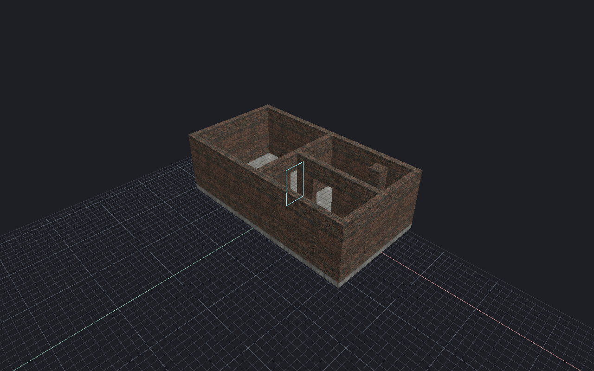
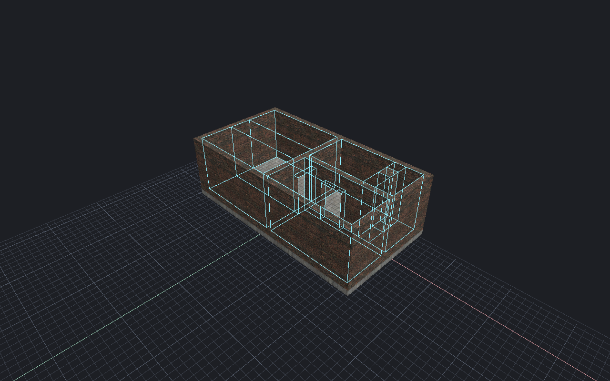

[← Manual](README.md)

# Visibility inspection

Inspect leaves, portals and visibility sets from the last successful build.

1. Compile the map. Open **Build details… → Inspect visibility…**.
2. Choose **Target → Summary**. Select a leaf row to inspect its native bounds,
   cluster and incident portals.
3. Choose **PVS** for potentially visible clusters or **PAS** for potentially audible clusters. Click
   **Inspect target**. Select a destination row to inspect its member leaves.
4. Use **Previous rows**, **Next rows**, **Previous destinations** and
   **Next destinations** to change pages. For a known target, choose **Leaf**,
   **Cluster** or **Portal**, enter its **Ordinal**, then click **Inspect target**.
5. Select a leaf or portal. Click **Frame selection** or **Show selected guide**.
   **Clear guide** removes the cyan bounds box or portal ring.
6. Enter **World position X**, **Y** and **Z**, then click **Inspect position**.
   **Inspect camera position** uses the Perspective camera eye. The result shows
   the native leaf, cluster, solid/exterior state and effective coordinates.
7. With a clustered leaf or cluster selected, click **Show PVS bounds** or
   **Show PAS bounds**. The complete potential destination set appears as native
   world-leaf bounds. The readout gives the source cluster, destination cluster
   count and leaf count. Inspection pages do not limit the guide. To use the
   camera as source, click **Inspect camera position** first.
8. Use **Clear guide** to remove either guide, and **Refresh inspection** after
   another build or source change.

| PVS destination bounds | PAS destination bounds |
| --- | --- |
|  |  |

## Limits

- Bounds boxes are not exact convex cells. Portal rings retain compiler geometry
  and original slots, including boundaries within a coarsened visibility cluster.
- PVS and PAS are separate native rows. They describe the captured **Fast** or
  **Detailed** build, including Fullbright builds; they do not simulate game
  occlusion or sound mixing. Destination guides use the complete chosen row;
  nonclustered solid/exterior leaves have no destination membership.
- Complete destination sets above 512 leaves or the 256 KiB bounds/renderer
  allowance refuse with the limit. Sets are never truncated. Ordinary inspection
  stays available, and the previous valid guide remains active.
- Position lookup walks Model 0's planes and nodes. Coordinates narrow to f32;
  negative plane distance selects child 1, zero selects child 0. The response
  gives the full arithmetic policy. Invalid routes, nonfinite values and overflow
  fail. Boundary bit parity with the game is unverified.
- Camera lookup requires **Perspective**. Explicit world positions work in every
  view. Lookup does not move the point or camera. Cluster -1 has no PVS/PAS row;
  reserved leaf 0 reports classification without invented bounds or guides.
- Inspection preserves selection, history and drafts. Framing preserves the
  projection. Finish active viewport gestures or block previews before framing
  or showing a guide. Only one guide configuration is shown.
- Ordinals and slots belong to one build. Intact older output is read-only;
  stale or replaced output cannot frame or display guides. Freshness covers the
  committed map, settings, content epoch and retained source guards, but not
  every world material. Unavailable output clears rows and totals.
- Pages contain at most 64 rows. Retention caps at 64 MiB, 65,536 leaves,
  262,144 portals, 1,048,576 points and 4,096 points per portal. Exceeded metadata
  limits make inspection unavailable; ordinary compilation can still succeed.
