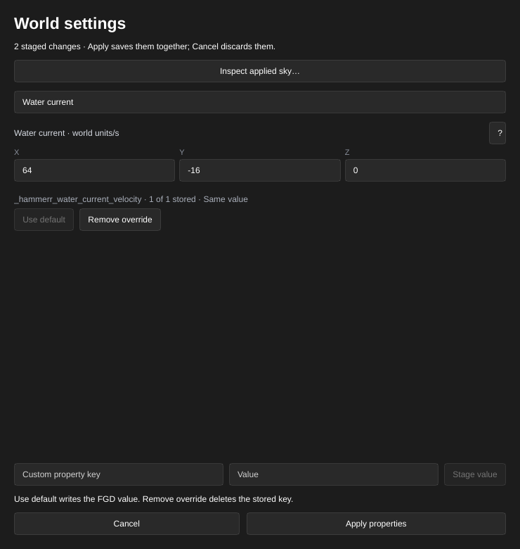
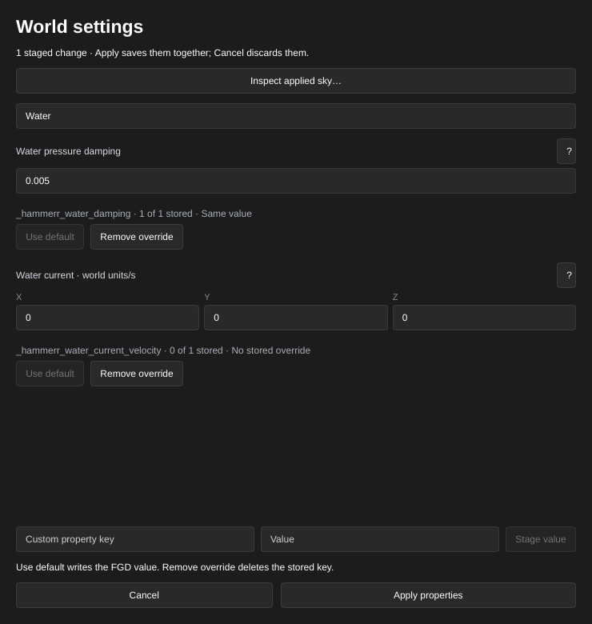

[← Manual](README.md)

# Water

Create a horizontal world-water volume with connected depth metadata, inward-facing top and vertical-side materials, optional fluid physics and a steady map-wide physical current.

1. Use **Draw brush** or **Add brush** to create the water volume inside a sealed room. Keep it as a world brush.
2. Set **Selection → Objects**, enter `tools/toolsnodraw` in the material controls, and click **Apply**.
3. Set **Selection → Faces · materials & textures** and select the flat top face. Click **Browse materials…**, choose a water material, then **Use material** and **Apply**. The material's VMT must declare `$bottommaterial` to provide its below-water surface; this names another material, not a texture for the pool floor.
4. For an exposed vertical water side, select that side and apply a water material in the same way. Its own `$bottommaterial` supplies the inward-facing material. Sides using `tools/toolsnodraw` stay hidden.
5. Open **Build settings…**. For floating physics objects, choose **Physics bodies → CS:S engine physics**. Click **Close**, then **Compile** or **Run Map**.
6. Open **Build details…** and read **Diagnostics**. A missing `$bottommaterial` leaves the face one-sided and reports a warning. A named bottom material that cannot be loaded stops the build and preserves the previous output.

## Steady physical current

1. Open **World settings…**. Enter `Water current` in **Find a property…**.
   **Water current · world units/s** is available before an override exists.
   Its **X**, **Y** and **Z** inputs initially show `0 0 0`; **No stored override**
   means the compiler's intentional zero-current default, without an authored key.
2. Enter the world-axis velocity, for example X `64`, Y `-16`, Z `0`, pressing
   Enter after each edited component. The form stages changes without editing
   the map. Read the staged-change summary, then click **Apply properties**.
   **Cancel** discards the draft. The vector's total length must be at most
   128 world units per second; the components are not normalized or clamped.
3. Open **Build settings…**, choose **Physics bodies → CS:S engine physics**,
   click **Close**, then **Compile**. A stored current requires retained
   structural-world WATER with a visible horizontal top and emitted fluid bodies.
   Read **Build details… → Diagnostics** if the build rejects the request.
4. To restore the intentional default, reopen **World settings…**, find the
   field, click **Remove override**, then **Apply properties**. Explicitly
   storing `0 0 0` keeps a requested current and still requires engine physics
   and eligible water. Undo and Redo restore the same source property.

The current affects VPhysics bodies in all supported world-water volumes; it
does not add player/NPC movement-current contents or change water rendering.
The current is a native fluid-provider velocity, not a promised terminal body
speed or settling time. Water pressure damping is a separate control below.
The compiler consumes the source-only `_hammerr_water_current_velocity` world
property and preserves it in the VMF; it is not a material parameter or runtime
worldspawn key.

## Water pressure damping

Choose one pressure coefficient for every supported world-water volume.

1. Open **World settings…** and enter `Water` in **Find a property…**.
   **Water pressure damping** initially shows `0.01` with **No stored override**.
2. Enter a number from `0` to `0.01`, such as `0.005`, and press Enter.
   This stages a dimensionless coefficient for the native projected-pressure
   term. Zero removes that term; the native fixed pressure term remains.
3. Click **Apply properties**, or **Cancel** to discard the draft.
   Use **Build settings… → Physics bodies → CS:S engine physics**, then compile.
   An explicit coefficient, including zero or `0.01`, requires eligible emitted
   structural-world WATER even when no current is authored.
4. To restore the unchanged native default, click **Remove override**, then
   **Apply properties**. Undo and Redo retain the exact authored value.

The compiler preserves `_hammerr_water_damping` in the VMF and removes it from
runtime worldspawn keys. It sets the native fluid coefficient directly; it is
separate from a physics object's linear/angular damping. The accepted interval
is a product limit, not a universal stability guarantee. It adds no per-pool
control or player/NPC current.

Connected water with the same height, material and contents shares its lowest connected depth. Different heights or top materials keep separate regions. The compiler adds one `water_lod_control` with distances of 1,000 and 2,000 if the map has none; authored controls are preserved. Hidden water is omitted.

Each generated inward face keeps its authored face's texture placement and native surface flags, uses that material's resolved `$bottommaterial`, and belongs to the submerged leaves. Solid covers and internal water-to-water boundaries add no inward faces. Coplanar vertical faces keep separate fog regions when their water heights or top materials differ. Generated faces do not receive overlays attached to authored faces. Material patches are resolved through their includes. `$underwateroverlay` stays a runtime setting of the top material.

VMFs with explicit `info_overlay_transition` projections can use [Build imported water transitions](overlays.md#build-imported-water-transitions). Their authored world, detail and terrain bindings follow compiled surface splits. Keep every target visible; when using a compile region, include every target surface. Transition authoring is not available in **Overlay…**.

Agents use the same material and compile operations: `create_block`, `select_faces`, `edit_faces`, `set_compile_settings`, `compile_map` and `start_compile`. Inspect either water field with `get_property_inspector {"world":true}` and stage it through `begin_property_edit`, `update_property_edit` and `commit_property_edit`; `cancel_property_edit` discards it. See [MCP](mcp.md#steady-physical-water-current).

Limits: structural-world water with a visible horizontal top; inward faces cover the top and exposed vertical sides. HammeRR caps their combined generation at four million work units, 65,536 prospective fragments and one million cumulative winding point allocations. Conservative reservations include clipping and merging; exceeding a budget fails the build and preserves previous output. Current input must contain exactly three ASCII-whitespace-separated finite decimal/scientific components in at most 128 UTF-8 bytes, with finite representable native velocity and vector length at most 128 units/s; invalid values or duplicate keys reject atomically. Damping input is one finite ASCII decimal/scientific coefficient in at most 32 bytes, within 0–0.01 before native conversion; a nonzero value must remain nonzero after conversion. Invalid, duplicate or unsupported controls fail explicitly. Either stored control rejects without engine physics, without emitted eligible water, or when retained slime/detail/model liquids are present. Hidden or region-omitted liquids do not supply eligible bodies. Sloped sides, negative-Z bottom faces, depth-specific material packing, per-pool current/damping, player/NPC currents, sloped or enclosed tops and detail/model liquids remain unfinished. Conflicting overlapping liquids fail with a diagnostic. Editor previews use the material's editor texture; they do not render the game's water reflection, refraction or underwater view. In-game appearance depends on the water materials and renderer settings. Material assets must remain available in the game's mounted content. Compile regions must contain the complete water volume.
