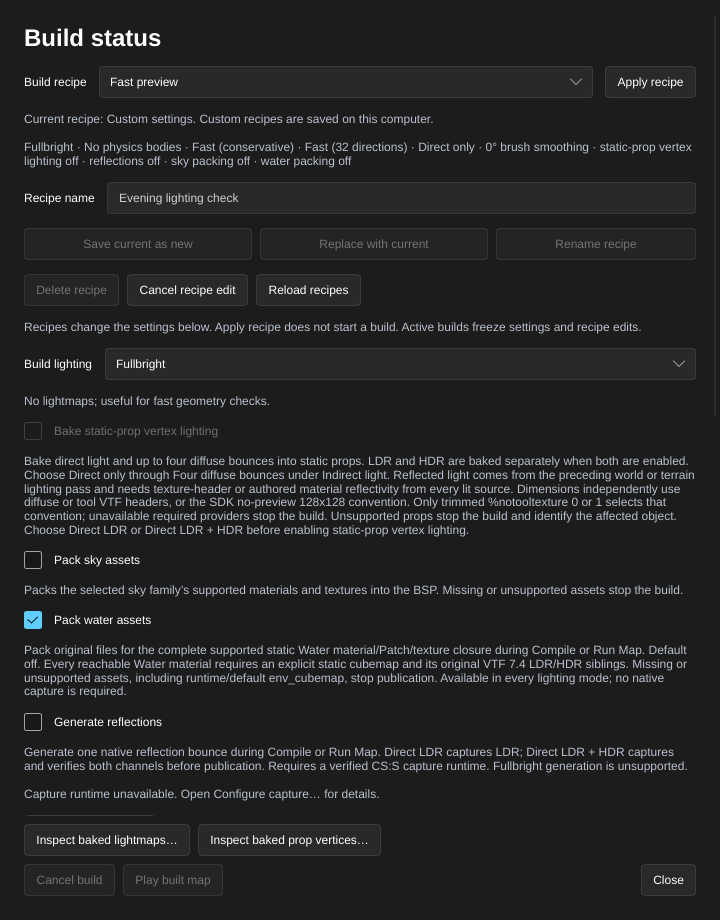

[← Manual](README.md)

# Water

Create a horizontal world-water volume with connected depth metadata, inward-facing top and vertical-side materials, optional fluid physics and a steady map-wide physical current.

1. Use **Draw brush** or **Add brush** to create the water volume inside a sealed room. Keep it as a world brush.
2. Set **Selection → Objects**, enter `tools/toolsnodraw` in the material controls, and click **Apply**.
3. Set **Selection → Faces · materials & textures** and select the flat top face. Click **Browse materials…**, choose a water material, then **Use material** and **Apply**. The material's VMT must declare `$bottommaterial` to provide its below-water surface; this names another material, not a texture for the pool floor.
4. For an exposed vertical water side, select that side and apply a water material in the same way. Its own `$bottommaterial` supplies the inward-facing material. Sides using `tools/toolsnodraw` stay hidden.
5. Open **Build settings…**. For floating physics objects, choose **Physics bodies → CS:S engine physics**. Click **Close**, then **Compile** or **Run Map**.
6. Open **Build details…** and read **Diagnostics**. A missing `$bottommaterial` leaves the face one-sided and reports a warning. A named bottom material that cannot be loaded stops the build and preserves the previous output.

## Inspect water material dependencies

Inspect one mounted material's static declaration graph before resolving missing
content. This does not compile the map or pack its assets.

1. Open **Browse materials…**, select the water material or enter its
   **Material path**, then click **Source…**.
2. Read **Resolved shader declaration**, then scroll to **Water dependencies**.
   Water, Water_DX90 and Water_DX9_HDR use the **CS:S SDK DX90 static Water**
   model. Read the state and issues before treating the inventory as complete.
3. Follow **Compiler material** for `$bottommaterial` and **Runtime material**
   for `$underwateroverlay`; both name VMTs. Normal, color, cubemap and editor
   preview textures have separate roles. **SDK default** and **Runtime resource**
   entries identify inferred defaults and resources with no mounted-file lookup.
4. Read each **File** entry's **Origin**, **SHA256** and **VTF header** where
   available. Use **Refresh source** after repairing external files, then
   **Close**. Inspection preserves the map, selection, history and pending edits.

Limits: a **Supported static inventory** covers only the admitted SDK declaration
model. **Unsupported inventory**, **Source unavailable** and **Inspection limit
reached** retain partial rows and explain why inspection could not finish.
Other child shaders, proxies, conditional forms and unsupported VTF layouts can
prevent completion without changing compilation admission. Header/framing
observations do not establish native water appearance, shader availability or
portability. The call is synchronous, without
interactive cancellation or a latency guarantee; it returns no durable source
token or file watcher. See [Material source](material-source.md#water-dependency-inventory)
for graph, byte and source-tracking limits. MCP `get_material_source` returns
the same inventory without graphics or a game.

## Pack static Water assets

Embed the supported static Water material and texture files in the BSP with
their original names, bytes and mip data. **Pack water assets** is off by default
and works with **Fullbright**, **Direct LDR** and **Direct LDR + HDR** without
native capture. Read-only dependency inspection does not approve a graph for
packing; packing applies the stricter rules below.

1. Prepare the original files in mounted content. Every reachable effective
   Water material must declare a static `$envmap`, for example `custom/water_cube`,
   with both original VTF 7.4 files, `materials/custom/water_cube.vtf` and
   `materials/custom/water_cube.hdr.vtf`. An omitted `$envmap` uses the unsupported
   runtime default `env_cubemap` and stops a requested packing build.
2. Open **Build settings…** and enable **Pack water assets**. Choose any
   **Build lighting** mode. **Generate reflections** and **Physics bodies** are
   separate settings; packing alone needs neither reflection capture nor physics.
3. Click **Close**, then **Compile** or **Run Map**. Keep the original mounted
   files available and unchanged until publication finishes. Missing, malformed,
   unsupported or changed dependencies stop publication and preserve previous
   output.
4. Open **Build details…**. A current, completed, published build reports
   **Water assets** with the root material count, **LDR + HDR**, file count and
   raw asset bytes. File and byte counts exclude the manifest. Zero materials
   means the build found no Water roots. Failed, unpublished or stale jobs do
   not show this summary; read **Diagnostics** for a rejected build.

Only effective `Water`, `Water_DX90` and `Water_DX9_HDR` shaders are admitted
throughout the graph, including `$bottommaterial` and nonzero
`$underwateroverlay` targets. Original Patch/include VMTs and effective normal,
color, cubemap and editor-preview textures are included. Role-specific
`_rt_WaterReflection` and `_rt_WaterRefraction` remain engine resources;
`$underwateroverlay "0"` disables that dependency. Runtime/default `env_cubemap`,
other child shaders, proxies, conditions, cycles, unsupported declarations and
conflicting Patch edits reject. Generated reflections do not make an unsupported
Water graph packable. Liquid surfaces using other shaders, including a generic
material with `%compilewater`, are outside this packing subset.

Dependency references must be canonical lowercase ASCII logical paths with
forward slashes, no `materials/` prefix and no dot in the final path component.
Water surface names also use logical names, with ordinary case-insensitive lookup.
Patch includes instead use full paths such as `materials/custom/water_base.vmt`.
Spaces, control characters, traversal and leading `_` resource names reject;
the full resulting asset path must fit within 259 bytes. References are never
repaired or rewritten.

Textures must have one frame, depth one and at most 4096 pixels per axis.
2D textures support VTF 7.0–7.4. Cubemaps require VTF 7.4, seven stored square
faces and first frame zero: six cube directions plus the legacy sphere-map
image. Six stored faces and VTF 7.5 are unsupported. LDR and RGBA16F HDR siblings
must have matching dimensions and mip counts, even for **Fullbright** or **Direct LDR**. A missing
HDR file cannot use an LDR fallback. These file checks do not establish native
Water appearance or the game's active rendering channel.

Limits: 1024 root materials; each root closure permits 64 assets, 128 dependency
edges, depth eight, nine material reads, 1 MiB per VMT and 4 MiB of VMTs in total.
The combined PAK, including sky assets, generated reflections, prop vertex data
and manifests, allows 4096 entries, 16 MiB per entry and 64 MiB each encoded and
decoded; encoded overhead counts. The BSP is limited to 512 MiB. Matching Water
dependencies can be shared within this producer; a case-insensitive collision
with another packed entry rejects even when its bytes match. This packs only
the admitted Water closure; other map dependencies still need their normal
content. See [MCP](mcp.md#static-water-asset-packing) for exact texture and
manifest limits.

## Steady physical current

1. Open **World settings…**. Enter `Water current` in **Find a property…**.
   **Water current · world units/s** is available before an override exists.
   Its **X**, **Y** and **Z** inputs initially show `0 0 0`; **No stored override**
   means the compiler's intentional zero-current default, without an authored key.
2. Enter the world-axis velocity, for example X `64`, Y `-16`, Z `0`, pressing
   Enter after each edited component. The form stages changes without editing
   the map. Read the staged-change summary, then click **Apply properties**.
   **Cancel** discards the draft. The vector's total length must be at most
   128 world units per second; the components are not normalized or clamped.
3. Open **Build settings…**, choose **Physics bodies → CS:S engine physics**,
   click **Close**, then **Compile**. A stored current requires retained
   structural-world WATER with a visible horizontal top and emitted fluid bodies.
   Read **Build details… → Diagnostics** if the build rejects the request.
4. To restore the intentional default, reopen **World settings…**, find the
   field, click **Remove override**, then **Apply properties**. Explicitly
   storing `0 0 0` keeps a requested current and still requires engine physics
   and eligible water. Undo and Redo restore the same source property.

The current affects VPhysics bodies in all supported world-water volumes; it
does not add player/NPC movement-current contents or change water rendering.
Player/NPC currents remain unavailable. CS:S converts legacy world-current
direction bits into ordinary water before player movement reads them.
The current is a native fluid-provider velocity, not a promised terminal body
speed or settling time. Water pressure damping is a separate control below.
The compiler consumes the source-only `_hammerr_water_current_velocity` world
property and preserves it in the VMF; it is not a material parameter or runtime
worldspawn key.

## Water pressure damping

Choose one pressure coefficient for every supported world-water volume.

1. Open **World settings…** and enter `Water` in **Find a property…**.
   **Water pressure damping** initially shows `0.01` with **No stored override**.
2. Enter a number from `0` to `0.01`, such as `0.005`, and press Enter.
   This stages a dimensionless coefficient for the native projected-pressure
   term. Zero removes that term; the native fixed pressure term remains.
3. Click **Apply properties**, or **Cancel** to discard the draft.
   Use **Build settings… → Physics bodies → CS:S engine physics**, then compile.
   An explicit coefficient, including zero or `0.01`, requires eligible emitted
   structural-world WATER even when no current is authored.
4. To restore the unchanged native default, click **Remove override**, then
   **Apply properties**. Undo and Redo retain the exact authored value.

The compiler preserves `_hammerr_water_damping` in the VMF and removes it from
runtime worldspawn keys. It sets the native fluid coefficient directly; it is
separate from a physics object's linear/angular damping. The accepted interval
is a product limit, not a universal stability guarantee. It adds no per-pool
control or player/NPC current.

Connected water with the same height, material and contents shares its lowest connected depth. Different heights or top materials keep separate regions. The compiler adds one `water_lod_control` with distances of 1,000 and 2,000 if the map has none; authored controls are preserved. Hidden water is omitted.

Each generated inward face keeps its authored face's texture placement and native surface flags, uses that material's resolved `$bottommaterial`, and belongs to the submerged leaves. Solid covers and internal water-to-water boundaries add no inward faces. Coplanar vertical faces keep separate fog regions when their water heights or top materials differ. Generated faces do not receive overlays attached to authored faces. Material patches are resolved through their includes. `$underwateroverlay` stays a runtime setting of the top material.

VMFs with explicit `info_overlay_transition` projections can use [Build imported water transitions](overlays.md#build-imported-water-transitions). Their authored world, detail and terrain bindings follow compiled surface splits. Keep every target visible; when using a compile region, include every target surface. Transition authoring is not available in **Overlay…**.

Agents use the same material and compile operations: `create_block`, `select_faces`, `edit_faces`, `set_compile_settings`, `compile_map` and `start_compile`. Inspect either water field with `get_property_inspector {"world":true}` and stage it through `begin_property_edit`, `update_property_edit` and `commit_property_edit`; `cancel_property_edit` discards it. See [MCP](mcp.md#steady-physical-water-current).

Limits: structural-world water with a visible horizontal top; inward faces cover the top and exposed vertical sides. HammeRR caps their combined generation at four million work units, 65,536 prospective fragments and one million cumulative winding point allocations. Conservative reservations include clipping and merging; exceeding a budget fails the build and preserves previous output. Current input must contain exactly three ASCII-whitespace-separated finite decimal/scientific components in at most 128 UTF-8 bytes, with finite representable native velocity and vector length at most 128 units/s; invalid values or duplicate keys reject atomically. Damping input is one finite ASCII decimal/scientific coefficient in at most 32 bytes, within 0–0.01 before native conversion; a nonzero value must remain nonzero after conversion. Invalid, duplicate or unsupported controls fail explicitly. Either stored control rejects without engine physics, without emitted eligible water, or when retained slime/detail/model liquids are present. Hidden or region-omitted liquids do not supply eligible bodies. Sloped sides, negative-Z bottom faces, per-pool current/damping, player/NPC currents, sloped or enclosed tops and detail/model liquids remain unfinished. Conflicting overlapping liquids fail with a diagnostic. Editor previews use the material's editor texture; they do not render the game's water reflection, refraction or underwater view. In-game appearance depends on the water materials and renderer settings. Assets outside the admitted packed Water closure must remain available in the game's mounted content. Compile regions must contain the complete water volume.

## Stationary invisible water

Create one submerged volume without a rendered water surface.

1. Use **Draw brush** or **Add brush** to make one axis-aligned box in dry,
   open space inside a sealed room. Leave a gap from other brushes and terrain.
2. Set **Selection → Objects**, apply `tools/toolsnodraw` to every face with
   **Apply**, then click **Tie to entity…**.
3. Enter `func_water_analog` in **Classname (custom classes are supported)** and
   click **Tie selected brushes to entity**. Creation sets the origin to the
   selected box's center and initializes zero rotation, start position and flags.
4. Open **Build settings…**, choose **Physics bodies → CS:S engine physics**,
   click **Close**, then **Compile** or **Run Map**. Read entity-owned errors in
   **Build details… → Diagnostics** if the build is refused.

Limits: one retained entity with one closed, six-sided cuboid and one uniform,
mounted ordinary solid nodraw material. Imported entities need an explicit
finite origin. Rotation, start position and flags must be zero; omitted values
use zero. Empty entities, multiple brushes, terrain, origin brushes, hidden
children and outputs are unsupported. Only the class, origin, stationary pose/flags,
`targetname` and `hammerid` fields are accepted. Conservative bounds
must not touch other initial brush or terrain bounds, and the entire volume
must occupy dry open world space. Hidden or region-omitted entities are excluded.

The volume has no rendered surface, fog, reflections, player current or per-pool
pressure/current controls. Keep it stationary and unparented. Runtime movement,
parenting, scripted changes, removal and save/restore are unsupported. This
volume does not satisfy the structural-world-water requirement of the separate
world current and damping settings. Unsupported variants fail compilation and
preserve previous output; importing and editing them remains available.

MCP uses the same `create_block`, `tie_to_entity`, `set_entity_properties`,
`set_compile_settings` and compile operations. See
[MCP](mcp.md#stationary-invisible-water).

Historical map-local `$waterdepth` material aliases are not generated; their
active consumer remains unverified. That is separate from static asset
packing. Existing connected depth and fog metadata remain supported; this does
not establish that the engine lacks depth semantics.
