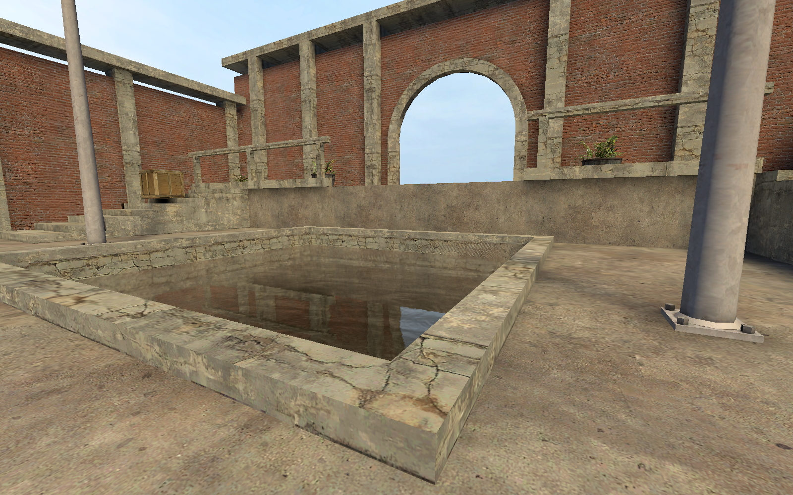
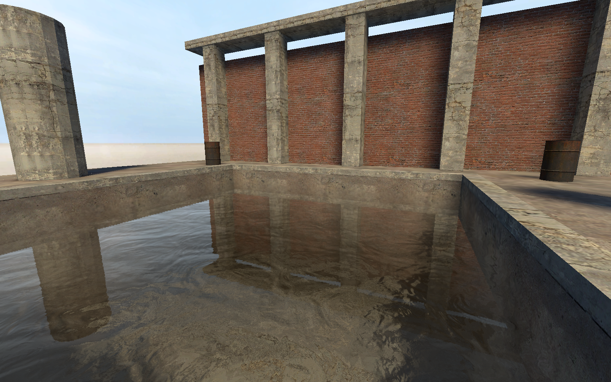
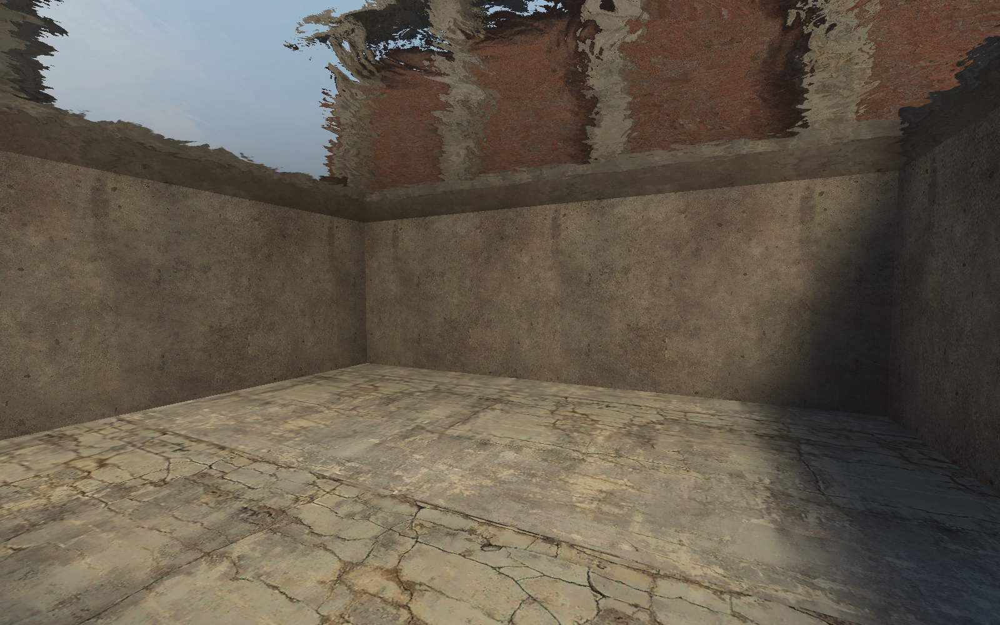

[← Manual](README.md)

# Water

Create a horizontal water volume with native depth, inward surfaces and optional fluid physics.

## Create a pool

1. Draw the water volume inside a sealed room. Keep it as a world brush.
2. In object mode, apply `tools/toolsnodraw` to the brush.
3. Choose **Selection → Faces · materials & textures**.
4. Apply a water material to the horizontal top face.
5. Open **Build settings…**.
6. Choose **Physics bodies → CS:S engine physics** for floating physics objects.
7. Compile, then inspect **Build details… → Diagnostics**.
8. Play the built map to inspect reflection, refraction and the underwater view.

The material's `$bottommaterial` names its below-water surface material, not the solid pool floor.
A missing declaration reports a one-sided surface. An unreadable named material stops the build.

| Above water | Below water |
| --- | --- |
|  |  |

## Inspect water material dependencies

1. Select the material in **Browse materials…**.
2. Click **Source…**.
3. Read **Water dependencies** and its state.
4. Inspect compiler materials, runtime materials, files and unsupported settings.
5. Use **Refresh source** after changes.

**Supported static inventory** describes supported dependencies. Other states explain incomplete or unsupported inventories.
Inspection does not pack assets.

## Pack static Water assets

1. Use a supported static Water declaration and dependencies.
2. Enable **Pack water assets** in **Build settings…**.
3. Compile and inspect **Water assets** in **Build details…**.

Packing supports a checked static subset, not every animated stock Water shader.
Static envmaps require matching supported LDR and HDR cubemap files. Unsupported dependencies fail explicitly.
Assets outside the packed closure must remain mounted in the game.

## Steady physical current

1. Open **World settings…**.
2. Find **Water current · world units/s**.
3. Set **X**, **Y** and **Z**.
4. Click **Apply properties**.
5. Compile with **CS:S engine physics**.

The vector length must not exceed 128 units/s. It applies to eligible physical objects, not player movement.
Use **Remove override** to restore the absent setting.

## Water pressure damping

Set **Water pressure damping** in **World settings…**, then click **Apply properties**.
The coefficient is 0–0.01 and requires eligible water plus engine physics.
Use **Remove override** to restore the absent setting.

## Stationary invisible water

1. Draw an axis-aligned box in dry open space, separated from other geometry.
2. Apply `tools/toolsnodraw` to every face.
3. Use **Tie to entity…** with custom class `func_water_analog`.
4. Click **Tie selected brushes to entity**.
5. Compile with **CS:S engine physics**.

At most two separate root helpers are supported, with one cuboid each.
Keep rotation, start position and flags at zero.
Volumes must not touch each other, other geometry or retained water/slime.
Movement, parenting, rendered surfaces and authored world current/damping are unsupported.

## Limits

- Structural-world water requires a visible horizontal top. Complete volumes must remain inside a compile region.
- Exposed vertical sides and negative-Z bottoms can generate inward surfaces from their own bottom materials.
- Sloped inward surfaces, slime and detail/model liquids remain unsupported.
- Connected compatible water shares depth metadata. Conflicting overlapping liquids fail.
- Current and damping are map-wide; per-pool controls remain unavailable.
- The editor shows the water material's editor image, not native reflection or refraction.
- Invalid controls, missing required assets and exceeded geometry budgets fail without replacing the previous BSP.
