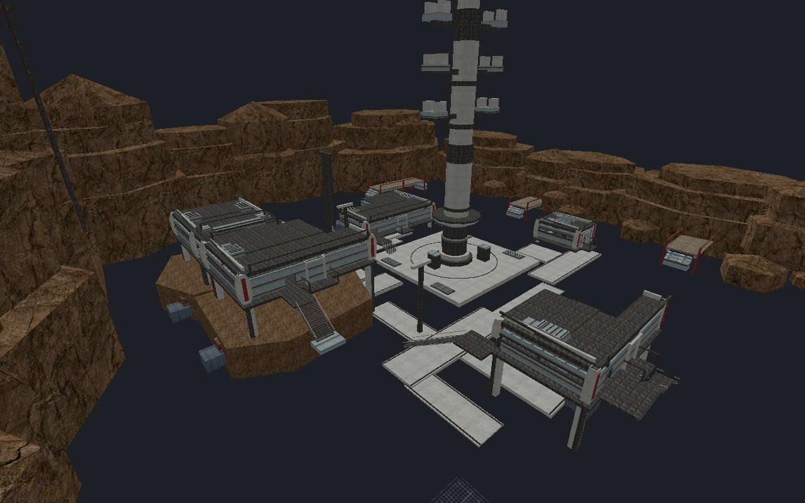

[← Manual](README.md)

# Working region

Limit editor display and picking with a temporary box, camera draw distance,
or object search criteria. Inclusion filters combine with AND. Objects matching
any exclusion stay hidden. Filters keep complete objects.

## Box and inclusion filters

1. Open **View → Working region…**.
2. To use a box, check **Enable box**. Set **Minimum** and **Maximum**, or
   click **Use selection bounds**. Coordinates use world units.
3. To move the box with the camera, check **Center box on camera**. The
   entered corners define its dimensions; its center follows the camera.
4. To limit distance, check **Limit draw distance** and enter **Distance**
   in world units. Distance is measured from the camera to the nearest point
   on each whole object's bounds. Planar views use the view center.
5. To use search criteria, check **Enable object filter**. Set **Search**,
   **Type**, **Class**, **Entity name**, **Material**, or **Visibility**.
   Search, class, name and material match case-insensitive substrings. Check
   **Exact class** to match the complete class name. To add a bounds
   intersection rule, check **Limit object filter to bounds** and set its
   **Minimum** and **Maximum**.
   For a class set, enter one full classname per line in
   **Classes (any exact)**. Any listed complete class name may match, ignoring
   ASCII letter case; **Class** and all other filters must also match.
6. Click **Apply** to update box, distance and inclusion together. Existing
   exclusions stay active. Scroll the panel to reach additional criteria.
   **Cancel** closes it without applying field changes; it does not undo
   actions already taken.
7. Click **Clear working region** in the panel or **View** menu to remove
   all working region filters and restore otherwise-visible objects.

## Categories and exclusions

1. Choose **Categories and exclusions** at the top of **Working region…**.
2. Find a type, entity class or FGD group in
   **Find categories by type, class or FGD group…**.
   Use **Previous** and **Next** to see more categories.
3. Click **Exclude category** to exclude its whole objects immediately.
   Categories update from the map's object types, exact entity classes and
   loaded FGD groups. **FGD · Parent / Name** rows show class counts, matching
   owners and declaration sources. A whole group uses one exclusion.
4. Click **Remove category exclusion** to remove that category's rule.
   Other overlapping rules and hidden state can still exclude its objects.
5. To exclude a custom query, choose **Box and filters**, check
   **Enable object filter**, and enter the criteria. Click
   **Exclude these matches**. This immediately adds an exclusion and clears
   the inclusion filter.
6. Review the readable rules under **Active exclusions**. Click
   **Remove exclusion** to remove one immediately.

Category actions preserve other inclusion and exclusion rules. **Apply** is
not required for category or exclusion buttons. **Clear working region**
removes every active rule, box and distance limit.

FGD groups match literal full classnames; inheritance and wildcard expansion
do not apply. Groups with no matching map objects remain available. Empty or
unavailable declarations show a reason and disable their category button;
**Remove exclusion** still removes an existing rule. Large class sets use a
count summary, including in saved profile details.

## Saved rule profiles

1. Apply the inclusion filter and exclusions you want to save, then choose
   **Saved rule profiles**.
2. Enter **Profile name**, then click **Save applied as profile**. Saving
   captures the applied rules; unapplied field changes are not included.
3. Click a profile's name to inspect its inclusion filter and exclusions.
4. Click **Apply selected profile** to replace the active rules immediately.
   The box, camera-follow setting and draw distance stay unchanged.
5. To overwrite the selected profile with the applied rules, click
   **Replace selected profile**.
6. To rename it, enter the new **Profile name**, then click **Rename profile**.
   **Delete profile** removes the selected saved profile and keeps active rules.
7. Save the map to retain profile edits on disk. Save, replace, rename and
   delete can be undone with **Undo**.

**Clear working region** keeps saved profiles. **Refresh rules** reloads the
category and profile lists and reports any unavailable or invalid data.

A saved class filter removes the surrounding world and prop models.

## Limits

- The box, distance and object filter each work independently. Disable
  **Enable box** to use only distance or search criteria.
- Matching uses whole owners, including every visible child of a brush
  entity. Filters do not cut geometry or remove selected objects.
- Category counts include saved-hidden authored owners. Child brushes and
  expanded instance contents do not form separate category entries.
- Hidden objects remain hidden. **Visibility** matches saved hidden state;
  choosing **Hidden** does not reveal hidden objects. Editor-only hiding
  remains separate; use **View → Show all editor-hidden** to restore it.
- Terrain and loaded models use their displayed geometry or checked bounds.
- Objects with unresolved bounds stay visible to the box and distance filters.
- Applying visibility rules leaves saved visibility, source geometry,
  selection and Undo history unchanged. Saving profiles edits map metadata.
- There can be 32 active exclusions and 64 saved profiles. Profile names
  allow up to 64 characters and 256 UTF-8 bytes; total profile metadata is
  limited to 256 KiB.
- A class set allows up to 256 unique names of 256 UTF-8 bytes each. Empty,
  control-containing or duplicate case-insensitive names reject. Spaces around
  each line are ignored; whitespace-only or newline-only input reports an error.
  Commas and quotes stay part of a name. Names containing `*` or `?` are literal,
  not patterns.
- Applied and saved class sets capture their names. Reloading FGD group
  membership does not rewrite those existing rules; remove an old exclusion
  and exclude the updated category when needed.
- Applied filters are temporary and do not affect compilation. Use
  [Compile region…](compile-regions.md) for builds.
- Each map keeps its own profiles. Instance children do not merge their
  saved profiles into the parent map.
