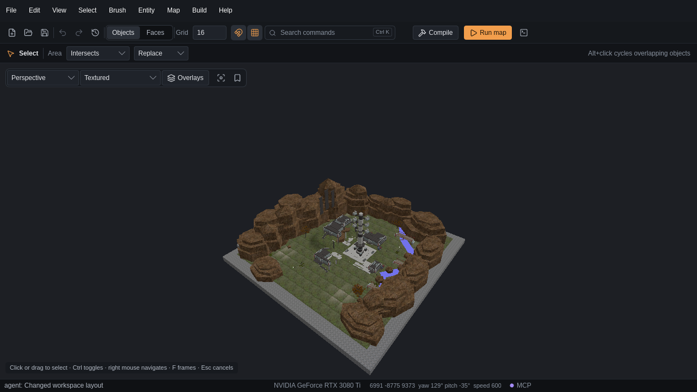

[← Manual](README.md)

# Workspace layout

Choose how much space the dock, Agent feed and tool rail use.

1. Choose **View → Workspace layout…**.
2. Set **Show dock**, **Show Agent feed** and **Show tool rail**.
3. Enter **Preferred dock width** and **Preferred Agent height** in logical pixels.
4. Click **Apply layout**.

The dock contains Inspector, Outliner and the Agent feed. Hiding the dock also
hides the Agent feed. Preferred sizes fit the available window space.
**Cancel** discards unapplied dialog changes.
If another action changes the layout, use **Reload current layout** before editing it again.

## Save the layout

1. Apply the layout you want.
2. Open **View → Workspace layout…**.
3. Click **Save current as defaults**.

New sessions use the saved layout. **Apply saved defaults** restores it in the
current window. **Reload defaults** reads an outside file change without
applying it. **Reset saved defaults** saves factory values; apply them separately.
See [Saved defaults](basics.md#saved-defaults) for storage errors.

## Limits

- Dock width is 240–640 logical pixels; Agent height is 96–480 logical pixels.
- Factory values show all three areas, with dock width 344 and Agent height 250.
- Ordinary layout changes do not save automatically. Saved-default errors do not block **Apply layout**.
- Layout changes preserve the map, selection, Undo history and camera. They cancel captured viewport gestures.
- Window placement, monitor choice and desktop workspaces remain under the operating system's control.

<!-- page-nav -->

---

[← Compare external maps](map-comparison.md) · [Manual](README.md) · [Open documents →](open-documents.md)
